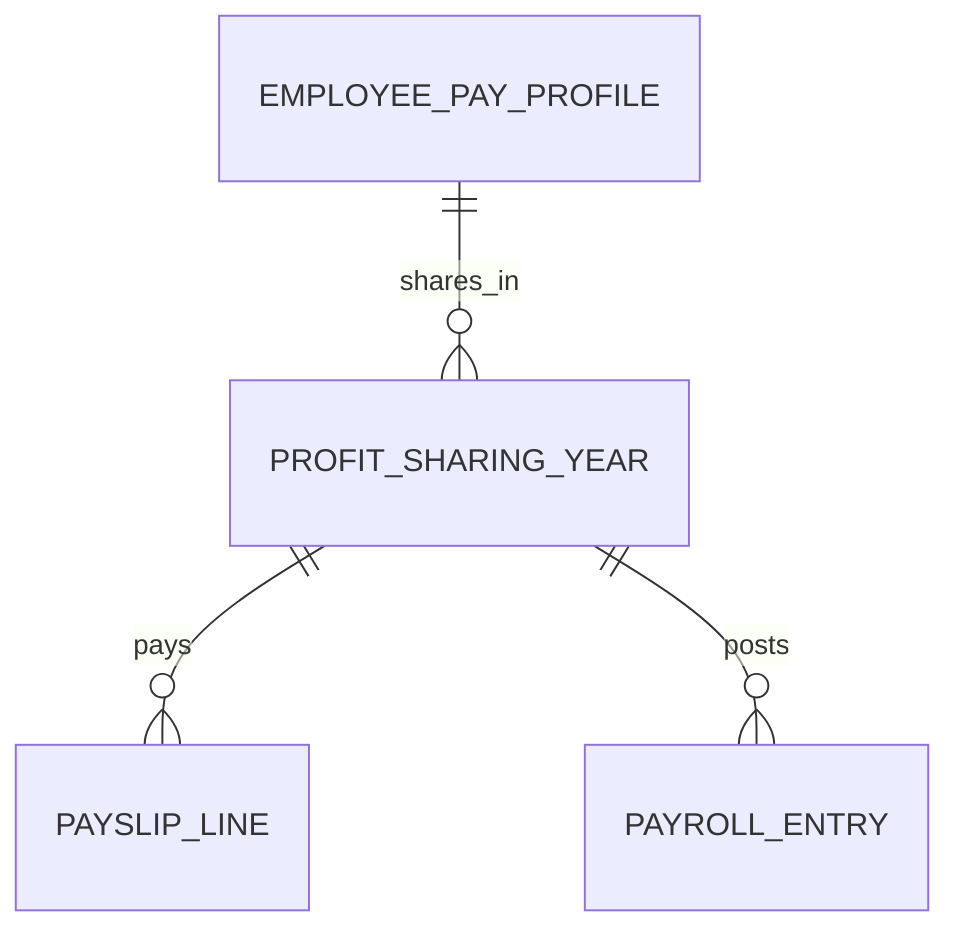
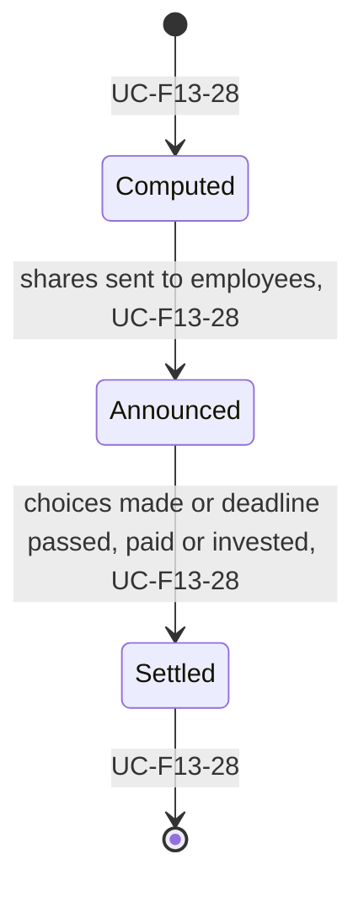

🏠 [Specs](../../../README.md) › 🧩 [Functional capabilities](../../README.md) › 💶 [F13 Payroll (plugin)](../README.md) ›
🗃️ [Data](README.md) › 🗃️ E-F13-21 Profit-sharing year

# 🗃️ E-F13-21 Profit-sharing year

**Status:** 🔄 waiting for the owner

## Purpose

One year of profit-sharing: the reserve computed from the accounts, its split between employees and each employee's
choice to be paid or to invest.

## Fields

| Name | Type | Required | Validation | Default | Example | Personal data | Custom fields |
|---|---|---|---|---|---|---|---|
| year | number | yes | a closed financial year in F8 | - | 2026 | no | no |
| reserve | amount | yes | the legal formula | computed | 40 000.00 EUR | no | no |
| keys | text | yes | salary, time worked, equal share | from the agreement | 50 % salary, 50 % time | no | no |
| employee share | amount per employee | yes | within the individual ceiling | computed | 812.40 EUR | yes | no |
| choice | choice per employee | yes | paid, invested | (Proposed) invested | paid | yes | no |
| choice deadline | date | yes | after the shares are announced | (Proposed) 15 days after | 2027-05-15 | no | no |

## Relations

## Lifecycle

## Indexes and search

By year; each employee sees only their own share (BR-F13-12).

## Retention

As payroll records: CR-FR-047 HR records retention.

## Audit

Every creation and change, with who, when, the old and the new value.

## Import and export

Export of the investments for the savings-plan keeper (CSV).

## Used by

- [UC-F13-28 Compute profit-sharing and employee savings](../use-cases/08-deductions-savings-and-leave-pay/uc-f13-28-compute-profit-sharing-and-employee-savings.md)

## Open questions

None.

---

⬅️ [E-F13-20 Pay advance](e-f13-20-pay-advance.md) · ⬆️ [Up](README.md) ·
➡️ [E-F13-22 Leave pay valuation](e-f13-22-leave-pay-valuation.md)
