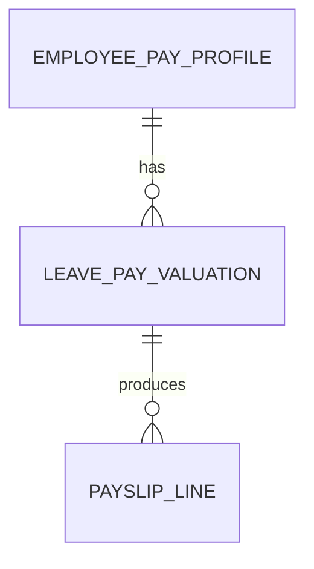
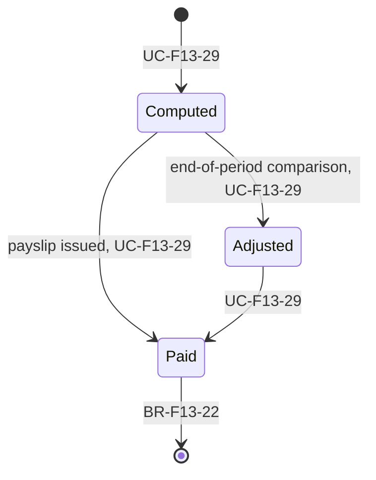

🏠 [Specs](../../../README.md) › 🧩 [Functional capabilities](../../README.md) › 💶 [F13 Payroll (plugin)](../README.md) ›
🗃️ [Data](README.md) › 🗃️ E-F13-22 Leave pay valuation

# 🗃️ E-F13-22 Leave pay valuation

**Status:** ✅ specified

## Purpose

The comparison, for paid leave taken, of maintained pay and one tenth of the reference gross, and the amount kept.

## Fields

| Name | Type | Required | Validation | Default | Example | Personal data | Custom fields |
|---|---|---|---|---|---|---|---|
| employee | link | yes | an employee with a pay profile | - | Marc Petit | yes | no |
| leave taken | link | yes | an approved leave in F9 | - | 5 days, 2026-08-03 to 2026-08-07 | yes | no |
| maintained pay | amount | yes | computed | - | 480.00 EUR | yes | no |
| one tenth | amount | yes | computed on the reference period | - | 512.00 EUR | yes | no |
| kept | amount | yes | the higher of the two (BR-F13-22) | computed | 512.00 EUR | yes | no |
| paid by | choice | yes | company, fund | company | company | no | no |

## Relations

## Lifecycle

## Indexes and search

By employee and reference period.

## Retention

As payroll records: CR-FR-047 HR records retention.

## Audit

Every creation and change, with who, when, the old and the new value.

## Import and export

CSV and JSON export through the API (T5); no bulk import.

## Used by

- [UC-F13-29 Value paid-leave pay](../use-cases/08-deductions-savings-and-leave-pay/uc-f13-29-value-paid-leave-pay.md)

## Open questions

None.

---

⬅️ [E-F13-21 Profit-sharing year](e-f13-21-profit-sharing-year.md) · ⬆️ [Up](README.md) ·
➡️ [E-F13-23 Agreement family](e-f13-23-agreement-family.md)
