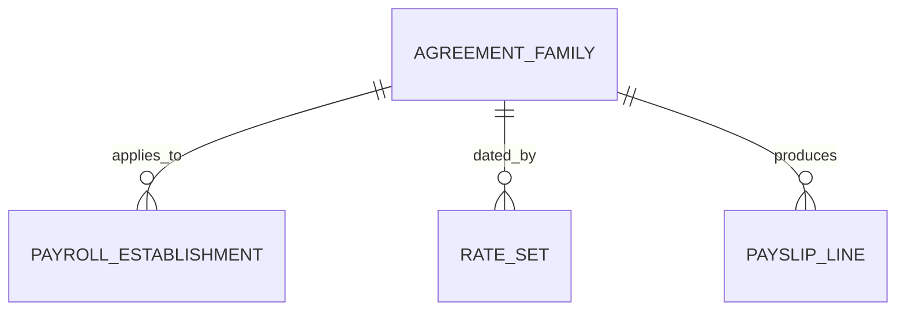
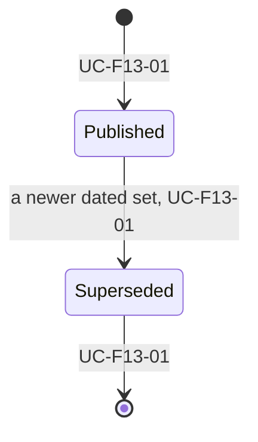

🏠 [Specs](../../../README.md) › 🧩 [Functional capabilities](../../README.md) › 💶 [F13 Payroll (plugin)](../README.md) ›
🗃️ [Data](README.md) › 🗃️ E-F13-23 Agreement family

# 🗃️ E-F13-23 Agreement family

**Status:** ✅ specified, ⚖️ lawyer review before launch (D574)

## Purpose

A family of collective agreements with its dated rule sets: classification grid, minimums, bonuses, working-time limits
and funds, read from the country pack.

## Fields

| Name | Type | Required | Validation | Default | Example | Personal data | Custom fields |
|---|---|---|---|---|---|---|---|
| name | text | yes | unique | - | Hotels, cafés and restaurants | no | no |
| code | text | yes | the agreement's official number | - | IDCC 1979 | no | no |
| grid | table | yes | one row per classification | from the pack | level II echelon 1: 1 890.00 EUR | no | no |
| rules | list | yes | dated | from the pack | meals (CR-FR-114), tips paid in full (CR-FR-113), overtime from 39 h (⚖️ lawyer review before launch, D574: IDCC 1979) | no | no |
| funds | list | no | - | - | BTP paid-leave fund | no | no |
| valid from | date | yes | one set per period | - | 2026-02-01 | no | no |

## Relations

## Lifecycle

## Indexes and search

By name and code; the set in force for a date.

## Retention

Every dated set is kept for corrections of past months (BR-F13-02).

## Audit

Every creation and change, with who, when, the old and the new value.

## Import and export

Delivered by the country pack (T11); no manual import.

## Used by

- [UC-F13-30 Apply the hotels-and-restaurants agreement](../use-cases/09-collective-agreements-by-family/uc-f13-30-apply-the-hotels-and-restaurants-agreement.md)
- [UC-F13-31 Apply the home-help agreement](../use-cases/09-collective-agreements-by-family/uc-f13-31-apply-the-home-help-agreement.md)
- [UC-F13-32 Apply the Syntec agreement](../use-cases/09-collective-agreements-by-family/uc-f13-32-apply-the-syntec-agreement.md)
- [UC-F13-33 Apply the construction agreements](../use-cases/09-collective-agreements-by-family/uc-f13-33-apply-the-construction-agreements.md)
- [UC-F13-01 Set up the company's payroll](../use-cases/01-set-up/uc-f13-01-set-up-the-company-s-payroll.md)
- [UC-F13-05 Apply collective-agreement rules](../use-cases/02-monthly-pay-run/uc-f13-05-apply-collective-agreement-rules.md)
- [UC-F13-19 Update rates and rules from the country pack](../use-cases/05-reports-and-rules/uc-f13-19-update-rates-and-rules-from-the-country-pack.md)

## Open questions

None.

---

⬅️ [E-F13-22 Leave pay valuation](e-f13-22-leave-pay-valuation.md) · ⬆️ [Up](README.md) ·
➡️ [E-F13-24 Payroll cost allocation](e-f13-24-payroll-cost-allocation.md)
