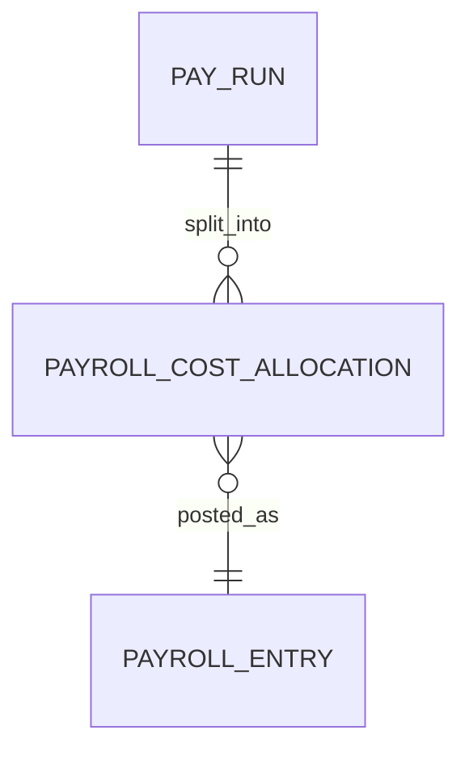
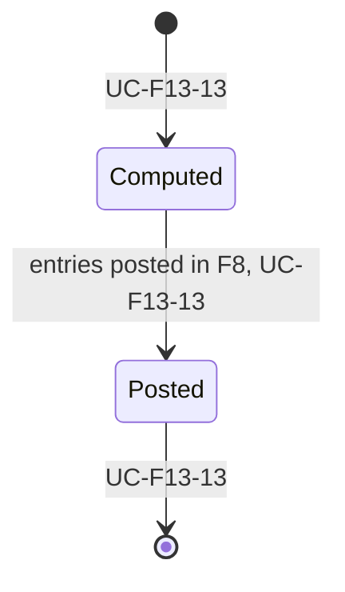

🏠 [Specs](../../../README.md) › 🧩 [Functional capabilities](../../README.md) › 💶 [F13 Payroll (plugin)](../README.md) ›
🗃️ [Data](README.md) › 🗃️ E-F13-24 Payroll cost allocation

# 🗃️ E-F13-24 Payroll cost allocation

**Status:** ✅ specified

## Purpose

The split of a pay run's cost by site, project and analytic axis, for analysis and for the F8 entries.

## Fields

| Name | Type | Required | Validation | Default | Example | Personal data | Custom fields |
|---|---|---|---|---|---|---|---|
| pay run | link | yes | a pay run | - | March 2026 | no | no |
| employee | link | yes | an employee in the run | - | Marc Petit | yes | no |
| axis, value | text | yes | an analytic axis of F8 | - | site, Agency Nord | no | no |
| share | percent | yes | sums to 100 % per employee | from F9 time | 79.5 % | no | no |
| cost | amount | yes | gross plus employer contributions times share | computed | 2 412.80 EUR | yes | no |

## Relations

## Lifecycle

## Indexes and search

By run, site, project and axis; totals per month and year.

## Retention

As the accounting entries: CR-FR-002 Accounting records kept ten years.

## Audit

Every creation and change, with who, when, the old and the new value.

## Import and export

Excel and CSV export of the analysis (amounts only for the roles allowed).

## Used by

- [UC-F13-34 Analyse payroll cost by site, project and analytic axis](../use-cases/05-reports-and-rules/uc-f13-34-analyse-payroll-cost-by-site-project-and-analytic-axis.md)
- [UC-F13-13 Post payroll entries to accounting](../use-cases/03-declarations-and-payments/uc-f13-13-post-payroll-entries-to-accounting.md)

## Open questions

None.

---

⬅️ [E-F13-23 Agreement family](e-f13-23-agreement-family.md) · ⬆️ [Up](README.md) ·
➡️ [E-F13-25 Analytic axis](e-f13-25-analytic-axis.md)
