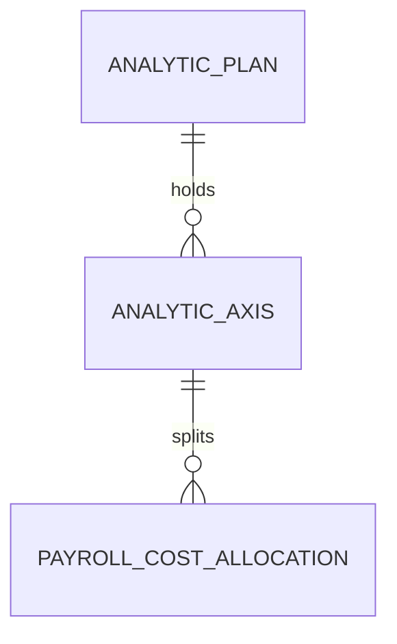
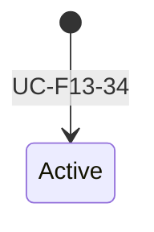

🏠 [Specs](../../../README.md) › 🧩 [Functional capabilities](../../README.md) › 💶 [F13 Payroll (plugin)](../README.md) ›
🗃️ [Data](README.md) › 🗃️ E-F13-25 Analytic axis

# 🗃️ E-F13-25 Analytic axis

**Status:** ✅ specified

## Purpose

The analytic axis the flow charts name with the words "analytic axis"
([FL-F13-05](../flows/fl-f13-05-reports-and-rules.md)). The owner decided to create it
([D516](../../../06-decisions/foundations/d516-naming-rules-and-the-seven-classes-of-names.md)); its fields are derived
from the specifications and confirmed by the owner (D572).

## Fields

| Name | Type | Required | Validation | Default | Example | Personal data | Custom fields |
|---|---|---|---|---|---|---|---|
| name | text | yes | - | - | Site | no | no |
| analytic plan | link | yes | an analytic plan of F8 | - | Payroll plan | no | no |
| values | list of text | no | - | - | Agency Nord, Agency Sud | no | no |
| state | choice | yes | active | active | active | no | no |

An axis of F8 along which each payroll cost is split, in the proportions of the time recorded in F9
([UC-F13-34](../use-cases/05-reports-and-rules/uc-f13-34-analyse-payroll-cost-by-site-project-and-analytic-axis.md),
[BR-F13-23](../business-rules/br-f13-23-payroll-cost-split-by-the-analytic-axes.md)); the site and the project are
axes too. The name and the state are the columns of
[S-F13-L25 Analytic axis](../screens/00-lists/s-f13-l25-analytic-axis.md); the axis and its values are what
[S-F13-27 Payroll analytics](../screens/05-reports-and-rules/s-f13-27-payroll-analytics.md) lets the user choose and
shows, one row per value, from [E-F13-24 Payroll cost allocation](e-f13-24-payroll-cost-allocation.md).

## Relations

- [E-F8-30 Analytic plan](../../f08-accounting/data/e-f08-30-analytic-plan.md)
- [E-F13-24 Payroll cost allocation](e-f13-24-payroll-cost-allocation.md)

## Lifecycle

## Indexes and search

By name, analytic plan and state.

## Retention

As the other records of its capability.

## Audit

Every change, as the other records of its capability.

## Import and export

Excel and CSV export of the axes and their values; no bulk import.

## Used by

- [UC-F13-34 Analyse payroll cost by site, project and analytic axis](../use-cases/05-reports-and-rules/uc-f13-34-analyse-payroll-cost-by-site-project-and-analytic-axis.md)

## Open questions

None.

---

⬅️ [E-F13-24 Payroll cost allocation](e-f13-24-payroll-cost-allocation.md) · ⬆️ [Up](README.md) ·
➡️ [E-F13-26 Employee benefit](e-f13-26-employee-benefit.md)
