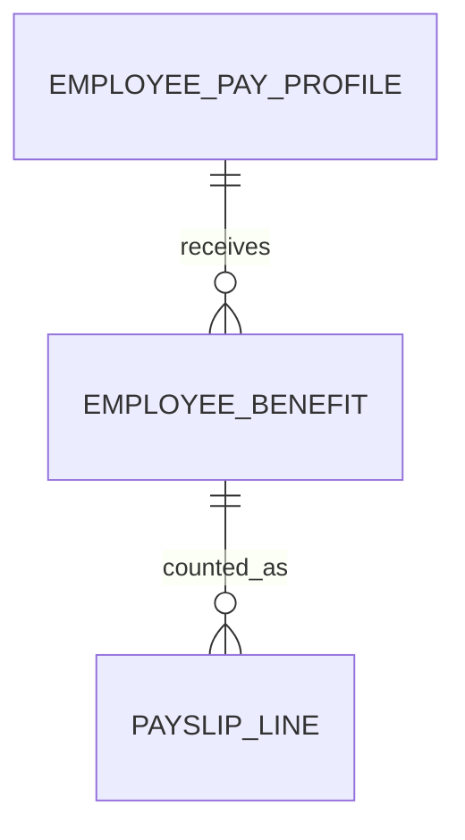
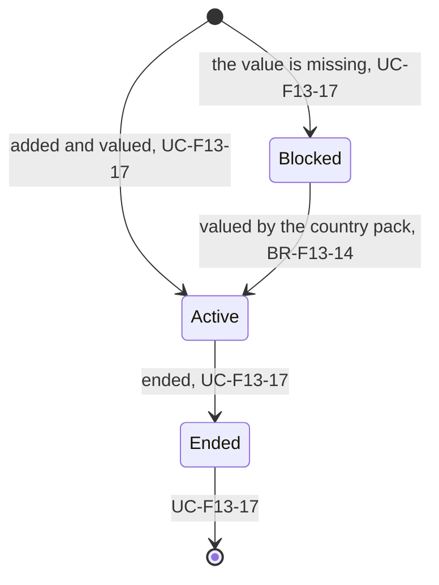

🏠 [Specs](../../../README.md) › 🧩 [Functional capabilities](../../README.md) › 💶 [F13 Payroll (plugin)](../README.md) ›
🗃️ [Data](README.md) › 🗃️ E-F13-26 Employee benefit

# 🗃️ E-F13-26 Employee benefit

**Status:** ✅ specified

## Purpose

The employee benefit the flow charts name with the words "Benefits"
([FL-F13-04](../flows/fl-f13-04-events.md)). The owner decided to create it
([D516](../../../06-decisions/foundations/d516-naming-rules-and-the-seven-classes-of-names.md)); its fields are derived
from the specifications and confirmed by the owner (D572).

## Fields

| Name | Type | Required | Validation | Default | Example | Personal data | Custom fields |
|---|---|---|---|---|---|---|---|
| employee | link | yes | an employee with a pay profile | - | Sophie Bernard | yes | no |
| benefit | choice | yes | a benefit the country pack values (BR-F13-14) | - | meal vouchers | no | no |
| start, end | dates | start yes | end after start | - | 2026-03-01 | no | no |
| quantity | number | yes | above 0 | - | 20 a month | no | no |
| value | amount | yes | from the country pack (BR-F13-14); blocked when missing | computed | - | yes | no |
| employer share, employee share | amounts | yes | sum to the value | computed | - | yes | no |
| taxable amount | amount | for a benefit in kind | added to the taxable gross | computed | - | yes | no |
| state | choice | yes | active, blocked, ended | active | active | no | no |

A benefit an employee receives (meal vouchers, transport pass, company car, mobility allowance), valued by the country
pack and counted in the pay ([UC-F13-17](../use-cases/04-events/uc-f13-17-handle-benefits.md),
[BR-F13-14](../business-rules/br-f13-14-benefits-valued.md)): the payroll officer adds it with its start date and
quantity, SimpleERP shows the employer and employee shares, and the next payslip carries the value, the employee share
and, for a benefit in kind, the taxable amount. The benefit and the state are the columns of
[S-F13-L26 Employee benefits](../screens/00-lists/s-f13-l26-employee-benefits.md); the benefits with their employees
and monthly value are what [S-F13-17 Benefits](../screens/04-events/s-f13-17-benefits.md) shows.

## Relations

- [E-F13-02 Employee pay profile](e-f13-02-employee-pay-profile.md)
- [E-F13-04 Payslip line](e-f13-04-payslip-line.md)

## Lifecycle

## Indexes and search

By employee, benefit and state; the blocked benefits.

## Retention

As the other records of its capability.

## Audit

Every change, as the other records of its capability.

## Import and export

CSV and JSON export through the API (T5), amounts only for the roles allowed (BR-F13-12); no bulk import.

## Used by

- [UC-F13-17 Handle benefits](../use-cases/04-events/uc-f13-17-handle-benefits.md)

## Open questions

None.

---

⬅️ [E-F13-25 Analytic axis](e-f13-25-analytic-axis.md) · ⬆️ [Up](README.md) ·
➡️ [E-F13-27 Pay simulation](e-f13-27-pay-simulation.md)
