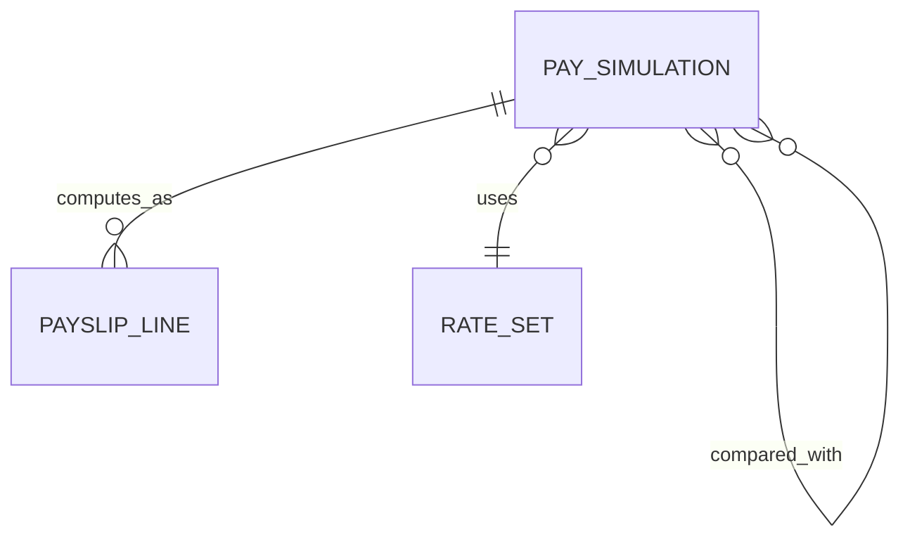
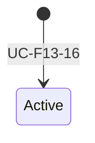

🏠 [Specs](../../../README.md) › 🧩 [Functional capabilities](../../README.md) › 💶 [F13 Payroll (plugin)](../README.md) ›
🗃️ [Data](README.md) › 🗃️ E-F13-27 Pay simulation

# 🗃️ E-F13-27 Pay simulation

**Status:** ✅ specified

## Purpose

The pay simulation the flow charts name with the words "Simulations"
([FL-F13-04](../flows/fl-f13-04-events.md)). The owner decided to create it
([D516](../../../06-decisions/foundations/d516-naming-rules-and-the-seven-classes-of-names.md)); its fields are derived
from the specifications and confirmed by the owner (D572).

## Fields

| Name | Type | Required | Validation | Default | Example | Personal data | Custom fields |
|---|---|---|---|---|---|---|---|
| title | text | yes | - | - | Hire an electrician | no | no |
| direction | choice | yes | gross to net, net to gross | gross to net | gross to net | no | no |
| gross or net wished | amount | yes | above 0 | - | 2 400.00 EUR | no | no |
| hours, classification | number, text | yes | - | - | 35 h, Developer, Syntec 2.2 | no | no |
| period | month | yes | rates exist for the period (BR-F13-02) | - | 2026-11 | no | no |
| net, contributions, employer cost | amounts | yes | computed with the rates of the period | computed | net 1 872.00 EUR, cost 3 312.00 EUR | no | no |
| approximate | yes, no | yes | yes when a rule is missing for the period | no | no | no | no |
| compared with | links | no | other pay simulations | - | Hire at 2 600 gross | no | no |
| shared with | users | no | the payroll officer or the owner | - | payroll officer | yes | no |
| state | choice | yes | active | active | active | no | no |

The cost of a hire or a raise, from gross to net or net to gross, with the rates in force, saved and shared without
changing any pay ([UC-F13-16](../use-cases/04-events/uc-f13-16-simulate-pay-and-costs.md),
[BR-F13-02](../business-rules/br-f13-02-rates-dated-by-period.md)): the case is a gross, hours and a classification,
SimpleERP computes the net, the contributions and the employer cost, another case can be compared side by side, and a
missing rule makes the simulation approximate. The title and the state are the columns of
[S-F13-L27 Pay simulations](../screens/00-lists/s-f13-l27-pay-simulations.md); the classification with the gross, the
employer cost and the net are what [S-F13-16 Simulations](../screens/04-events/s-f13-16-simulations.md) shows.

## Relations

- [E-F13-04 Payslip line](e-f13-04-payslip-line.md), the lines computed for the case, never written on a payslip
- [E-F13-16 Rate set](e-f13-16-rate-set.md)

## Lifecycle

## Indexes and search

By title, classification, period and state.

## Retention

As the other records of its capability.

## Audit

Every change, as the other records of its capability.

## Import and export

CSV and JSON export through the API (T5), amounts only for the roles allowed (BR-F13-12); no bulk import.

## Used by

- [UC-F13-16 Simulate pay and costs](../use-cases/04-events/uc-f13-16-simulate-pay-and-costs.md)

## Open questions

None.

---

⬅️ [E-F13-26 Employee benefit](e-f13-26-employee-benefit.md) · ⬆️ [Up](README.md) ·
➡️ [E-F13-28 Posting](e-f13-28-posting.md)
