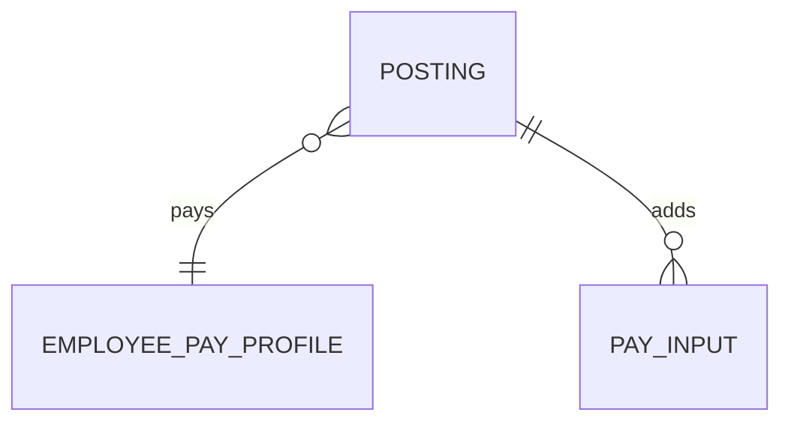
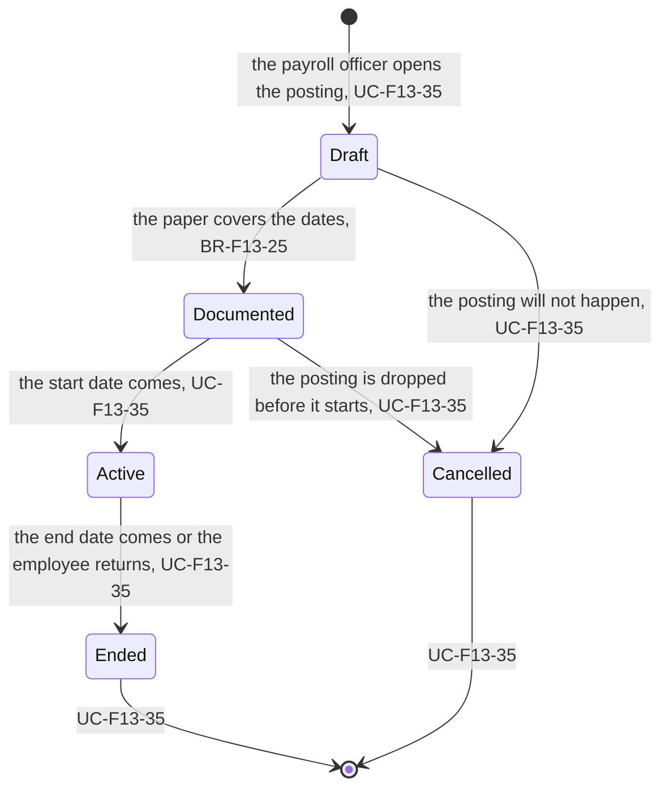

🏠 [Specs](../../../README.md) › 🧩 [Functional capabilities](../../README.md) › 💶 [F13 Payroll (plugin)](../README.md) ›
🗃️ [Data](README.md) › 🗃️ E-F13-28 Posting

# 🗃️ E-F13-28 Posting

**Status:** ✅ specified

## Purpose

A posting: an employee working in another country for a limited time, with its paper, its dates and its allowances
([D532](../../../06-decisions/f13-payroll/d532-benchmark-gaps-f13-payroll.md)).

## Fields

| Name | Type | Required | Validation | Default | Example | Personal data | Custom fields |
|---|---|---|---|---|---|---|---|
| employee | employee (E-F9-01) | yes | an employee of the company | - | Lea M. | yes | no |
| direction | posted abroad, posted to France | yes | one of the two | - | posted abroad | no | no |
| host country | country | yes | an ISO country | - | Belgium | no | no |
| place | text | no | - | - | Antwerp site | no | no |
| start date | date | yes | before the end date | - | 2026-12-01 | no | no |
| end date | date | yes | after the start date | - | 2027-02-28 | no | no |
| paper number | text | no | required to leave Draft | - | A1-26-0412 | no | no |
| paper validity | two dates | no | covers the whole posting | - | 2026-12-01 to 2027-06-30 | no | no |
| host minimum rate | amount per hour | no | 0 or more | - | 12.80 EUR | no | no |
| allowances | amounts per month | no | 0 or more | 0 | 620 EUR and 140 EUR | no | no |
| state | Draft, Documented, Active, Ended, Cancelled | yes | the lifecycle below | Draft | Documented | no | no |
| owner | user | yes | a user of the company | the creator | Claire P. | yes | no |

## Relations

- [E-F13-02 Employee pay profile](e-f13-02-employee-pay-profile.md)
- [E-F13-03 Pay input](e-f13-03-pay-input.md)
- [E-F9-02 Contract](../../f09-hr-and-projects/data/e-f09-02-contract.md)

## Lifecycle

## Indexes and search

By employee, host country, state, paper validity and dates.

## Retention

Kept with the payroll records of the employee, 50 years for what appears on a payslip
([D445](../../../06-decisions/f13-payroll/d445-payslips-fifty-years-from-issue.md)), and at least as long as the paper's
own retention.

## Audit

Every change of dates, paper and allowances, with who, when and the old and new value.

## Import and export

No import. The postings of a year are exported as a CSV for the social declaration check.

## Used by

- [UC-F13-35](../use-cases/10-special-contracts-and-outsourcing/uc-f13-35-pay-posted-workers.md)

## Open questions

None.

---

⬅️ [E-F13-27 Pay simulation](e-f13-27-pay-simulation.md) · ⬆️ [Up](README.md) ·
➡️ [E-F13-29 Days package](e-f13-29-days-package.md)
