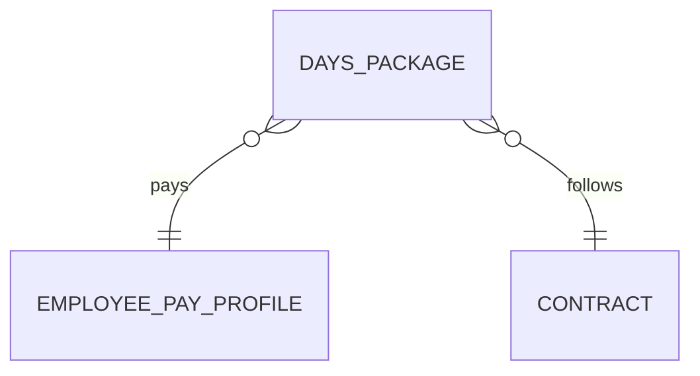
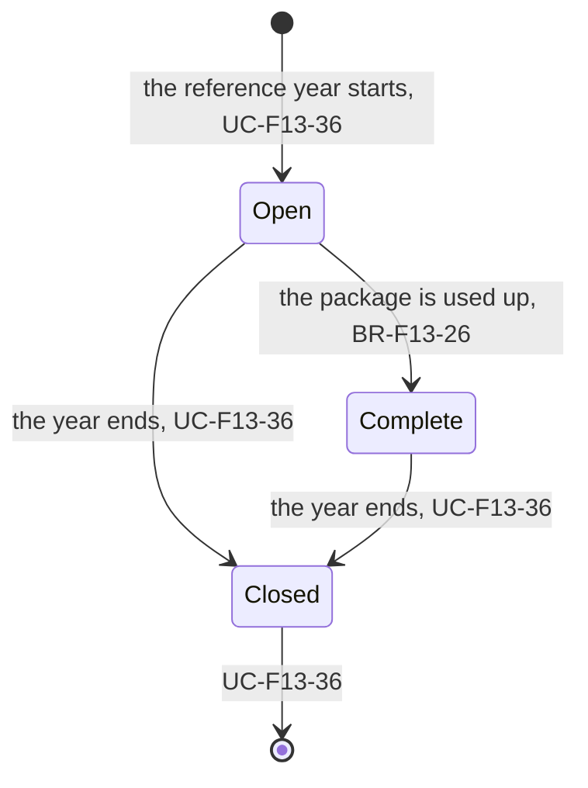

🏠 [Specs](../../../README.md) › 🧩 [Functional capabilities](../../README.md) › 💶 [F13 Payroll (plugin)](../README.md) ›
🗃️ [Data](README.md) › 🗃️ E-F13-29 Days package

# 🗃️ E-F13-29 Days package

**Status:** ✅ specified

## Purpose

The yearly days package of an employee and its follow-up: days worked, days of rest, days left
([D532](../../../06-decisions/f13-payroll/d532-benchmark-gaps-f13-payroll.md)).

## Fields

| Name | Type | Required | Validation | Default | Example | Personal data | Custom fields |
|---|---|---|---|---|---|---|---|
| employee | employee (E-F9-01) | yes | an employee with a days-based contract | - | Lea M. | yes | no |
| reference year | year | yes | the contract's reference year | - | 2026 | no | no |
| package days | number | yes | 1 to 366 | 218 | 218 | no | no |
| days worked | number | yes | 0 to the package | 0 | 187 | no | no |
| rest days | number | yes | 0 or more | 0 | 78 | no | no |
| last month declared | month | no | - | - | 2026-11 | no | no |
| rest check | OK, too few rest days | yes | computed | OK | OK | no | no |
| state | Open, Complete, Closed | yes | the lifecycle below | Open | Complete | no | no |
| owner | user | yes | a user of the company | the creator | Claire P. | yes | no |

## Relations

- [E-F13-02 Employee pay profile](e-f13-02-employee-pay-profile.md)
- [E-F9-02 Contract](../../f09-hr-and-projects/data/e-f09-02-contract.md)

## Lifecycle

## Indexes and search

By employee, year, state and rest check.

## Retention

Kept with the payroll records, at least as long as the working-time records
([CR-FR-047](../../../10-country-packs/france/labour/cr-fr-047-hr-records-retention.md)).

## Audit

Every declaration, confirmation, return and correction, with who, when and the days.

## Import and export

No import. The package of a year is exported as a CSV for the yearly interview.

## Used by

- [UC-F13-36](../use-cases/10-special-contracts-and-outsourcing/uc-f13-36-follow-days-based-contracts.md)

## Open questions

None.

---

⬅️ [E-F13-28 Posting](e-f13-28-posting.md) · ⬆️ [Up](README.md) ·
➡️ [E-F13-30 Payroll handover](e-f13-30-payroll-handover.md)
