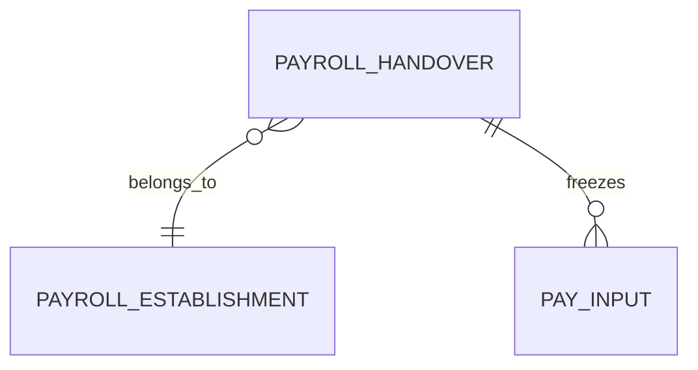
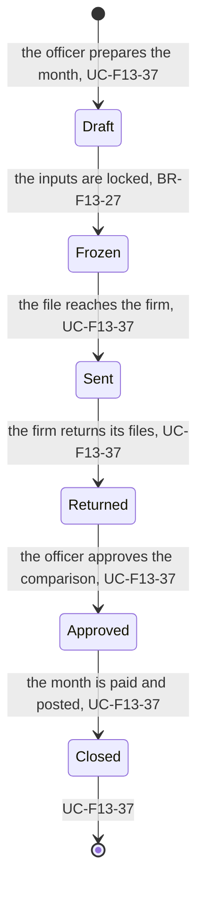

🏠 [Specs](../../../README.md) › 🧩 [Functional capabilities](../../README.md) › 💶 [F13 Payroll (plugin)](../README.md) ›
🗃️ [Data](README.md) › 🗃️ E-F13-30 Payroll handover

# 🗃️ E-F13-30 Payroll handover

**Status:** ✅ specified

## Purpose

One month's handover of pay inputs to an outside payroll firm and what the firm returned
([D532](../../../06-decisions/f13-payroll/d532-benchmark-gaps-f13-payroll.md)).

## Fields

| Name | Type | Required | Validation | Default | Example | Personal data | Custom fields |
|---|---|---|---|---|---|---|---|
| month | month | yes | an open payroll month | - | 2026-11 | no | no |
| firm | payroll firm connection | yes | a connection of the company | - | Payroll firm | no | no |
| employees | number | yes | 1 or more | - | 42 | no | no |
| frozen at | date and time | no | set at the freeze | - | 2026-11-24 09:05 | no | no |
| sent at | date and time | no | after the freeze | - | 2026-11-24 09:12 | no | no |
| acknowledged at | date and time | no | from the firm | - | 2026-11-24 09:13 | no | no |
| returned net total | amount | no | 0 or more | - | 96,420.10 EUR | no | no |
| differences | number | no | 0 or more | 0 | 2 | no | no |
| tolerance | amount | yes | 0 or more | 1.00 EUR | 1.00 EUR | no | no |
| state | Draft, Frozen, Sent, Returned, Approved, Closed | yes | the lifecycle below | Draft | Frozen | no | no |
| owner | user | yes | a user of the company | the creator | Claire P. | yes | no |

## Relations

- [E-F13-01 Payroll establishment](e-f13-01-payroll-establishment.md)
- [E-F13-03 Pay input](e-f13-03-pay-input.md)
- [E-F13-07 Payslip](e-f13-07-payslip.md)

## Lifecycle

## Indexes and search

By month, firm, state and number of differences.

## Retention

Kept with the payroll records of the month; the file sent is kept as sent.

## Audit

Every freeze, send, acknowledgement, return, correction and approval, with who, when and the counts.

## Import and export

No import. The file sent and the returned files are exported as they were exchanged.

## Used by

- [UC-F13-37](../use-cases/10-special-contracts-and-outsourcing/uc-f13-37-hand-pay-inputs-to-an-outsourced-payroll-firm.md)

## Open questions

None.

---

⬅️ [E-F13-29 Days package](e-f13-29-days-package.md) · ⬆️ [Up](README.md) ·
➡️ [E-F13-31 Delegation hours](e-f13-31-delegation-hours.md)
