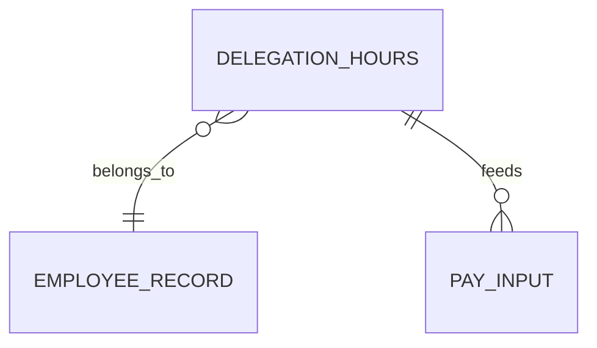
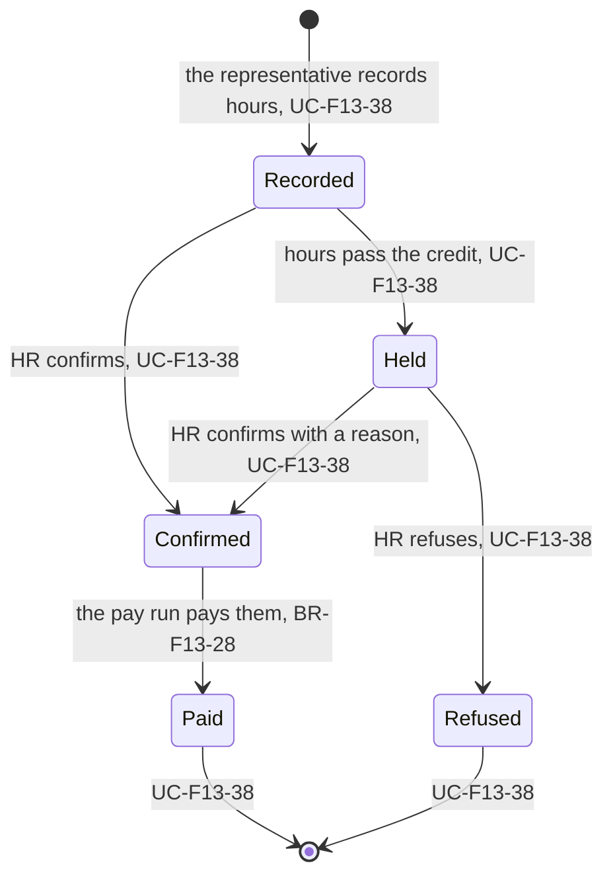

🏠 [Specs](../../../README.md) › 🧩 [Functional capabilities](../../README.md) › 💶 [F13 Payroll (plugin)](../README.md) ›
🗃️ [Data](README.md) › 🗃️ E-F13-31 Delegation hours

# 🗃️ E-F13-31 Delegation hours

**Status:** ✅ specified

## Purpose

The delegation hours of one staff representative for one month: credit, hours used, hours left
([D532](../../../06-decisions/f13-payroll/d532-benchmark-gaps-f13-payroll.md)).

## Fields

| Name | Type | Required | Validation | Default | Example | Personal data | Custom fields |
|---|---|---|---|---|---|---|---|
| person | employee (E-F9-01) | yes | an employee with a mandate | - | Nadia B. | yes | no |
| mandate | text | yes | one of the person's mandates | - | Staff committee | no | no |
| month | month | yes | an open payroll month | - | 2026-11 | no | no |
| monthly credit | hours | yes | 0 or more | - | 20 | no | no |
| hours used | hours | yes | 0 or more | 0 | 14 | no | no |
| carry-over | hours | no | 0 or more | 0 | 0 | no | no |
| held reason | text | no | required when held | - | above credit | yes | no |
| state | Recorded, Confirmed, Held, Refused, Paid | yes | the lifecycle below | Recorded | Confirmed | no | no |
| owner | user | yes | a user of the company | the creator | Claire P. | yes | no |

## Relations

- [E-F9-01 Employee record](../../f09-hr-and-projects/data/e-f09-01-employee-record.md)
- [E-F13-03 Pay input](e-f13-03-pay-input.md)

## Lifecycle

## Indexes and search

By person, mandate, month and state.

## Retention

Kept as long as the payroll records of the month
([D445](../../../06-decisions/f13-payroll/d445-payslips-fifty-years-from-issue.md)).

## Audit

Every hour recorded, held, confirmed, refused or shared, with who, when and the reason.

## Import and export

No import. The hours of a year are exported per mandate as a CSV.

## Used by

- [UC-F13-38](../use-cases/10-special-contracts-and-outsourcing/uc-f13-38-follow-staff-representatives-hours.md)

## Open questions

None.

---

⬅️ [E-F13-30 Payroll handover](e-f13-30-payroll-handover.md) · ⬆️ [Up](README.md)
