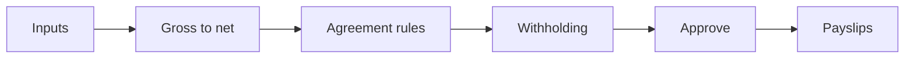

🏠 [Specs](../../../README.md) › 🧩 [Functional capabilities](../../README.md) › 💶 [F13 Payroll (plugin)](../README.md) ›
🔀 [Flows](README.md) › 🔀 FL-F13-02 Monthly pay run

# 🔀 FL-F13-02 Monthly pay run

**Status:** ✅ specified

## Summary

Covers UC-F13-03, UC-F13-04, UC-F13-05, UC-F13-06, UC-F13-07, UC-F13-08.

## Personas

- [U01 Employee](../../../01-users/personas/u01-employee.md)
- [U06 HR](../../../01-users/personas/u06-hr.md)
- [U13 Owner](../../../01-users/personas/u13-owner.md)
- [U45 Payroll officer](../../../01-users/personas/u45-payroll-officer.md)

## Flowchart

## Sequence diagram

See each use case.

## Steps

| Step | Persona | Screen | Use case | What happens |
|---|---|---|---|---|
| 1 | U45, U06 | [S-F13-03](../screens/02-monthly-pay-run/s-f13-03-pay-inputs.md) | [UC-F13-03](../use-cases/02-monthly-pay-run/uc-f13-03-collect-pay-inputs-from-f9.md) | Collect pay inputs from F9 |
| 2 | U45 | [S-F13-04](../screens/02-monthly-pay-run/s-f13-04-pay-computation.md) | [UC-F13-04](../use-cases/02-monthly-pay-run/uc-f13-04-compute-gross-to-net.md) | Compute gross to net |
| 3 | U45 | [S-F13-05](../screens/02-monthly-pay-run/s-f13-05-agreement-rules.md) | [UC-F13-05](../use-cases/02-monthly-pay-run/uc-f13-05-apply-collective-agreement-rules.md) | Apply collective-agreement rules |
| 4 | U45 | [S-F13-06](../screens/02-monthly-pay-run/s-f13-06-withholding.md) | [UC-F13-06](../use-cases/02-monthly-pay-run/uc-f13-06-apply-withholding-tax.md) | Apply withholding tax |
| 5 | U45, U13 | [S-F13-07](../screens/02-monthly-pay-run/s-f13-07-pay-run.md) | [UC-F13-07](../use-cases/02-monthly-pay-run/uc-f13-07-check-and-approve-the-pay-run.md) | Check and approve the pay run |
| 6 | U45, U01 | [S-F13-08](../screens/02-monthly-pay-run/s-f13-08-payslips.md) | [UC-F13-08](../use-cases/02-monthly-pay-run/uc-f13-08-issue-clarified-payslips-digitally.md) | Issue clarified payslips digitally |

### Entities and screens

| Entity | States in this flow | Shown at step and screen | Aggregated view |
|---|---|---|---|
| [E-F13-03 Pay input](../data/e-f13-03-pay-input.md) | Open, Complete, Late, Closed | 1 [S-F13-03](../screens/02-monthly-pay-run/s-f13-03-pay-inputs.md); 3 [S-F13-05](../screens/02-monthly-pay-run/s-f13-05-agreement-rules.md) | Pay inputs |
| [E-F13-23 Agreement family](../data/e-f13-23-agreement-family.md) | Published, Superseded | 3 [S-F13-05](../screens/02-monthly-pay-run/s-f13-05-agreement-rules.md) | Agreement families |
| [E-F13-05 Withholding rate](../data/e-f13-05-withholding-rate.md) | Active | 4 [S-F13-06](../screens/02-monthly-pay-run/s-f13-06-withholding.md) | Withholding rates |
| [E-F13-07 Payslip](../data/e-f13-07-payslip.md) | Published, Available | 6 [S-F13-08](../screens/02-monthly-pay-run/s-f13-08-payslips.md) | Payslips |
| [E-F13-06 Pay run](../data/e-f13-06-pay-run.md) | Recorded | 5 [S-F13-07](../screens/02-monthly-pay-run/s-f13-07-pay-run.md) | Pay runs |

## Errors

As each use case.

## Images

Every step and error, for each persona taking part, in light and dark mode (D120). Steps are numbered as in the Steps
table; E rows are the error cases.

| Step | Persona | Device | Light | Dark |
|---|---|---|---|---|
| 1 | U45 | desktop | [light](../images/02-monthly-pay-run/u45-payroll-officer/1-inputs-desktop-light.png) | [dark](../images/02-monthly-pay-run/u45-payroll-officer/1-inputs-desktop-dark.png) |
| 1 | U06 | desktop | [light](../images/02-monthly-pay-run/u06-hr/1-inputs-desktop-light.png) | [dark](../images/02-monthly-pay-run/u06-hr/1-inputs-desktop-dark.png) |
| 2 | U45 | desktop | [light](../images/02-monthly-pay-run/u45-payroll-officer/2-compute-desktop-light.png) | [dark](../images/02-monthly-pay-run/u45-payroll-officer/2-compute-desktop-dark.png) |
| 3 | U45 | desktop | [light](../images/02-monthly-pay-run/u45-payroll-officer/3-agreement-desktop-light.png) | [dark](../images/02-monthly-pay-run/u45-payroll-officer/3-agreement-desktop-dark.png) |
| 4 | U45 | desktop | [light](../images/02-monthly-pay-run/u45-payroll-officer/4-withholding-desktop-light.png) | [dark](../images/02-monthly-pay-run/u45-payroll-officer/4-withholding-desktop-dark.png) |
| 5 | U13 | desktop | [light](../images/02-monthly-pay-run/u13-owner/5-approve-desktop-light.png) | [dark](../images/02-monthly-pay-run/u13-owner/5-approve-desktop-dark.png) |
| 5 | U13 | phone | [light](../images/02-monthly-pay-run/u13-owner/5-approve-phone-light.png) | [dark](../images/02-monthly-pay-run/u13-owner/5-approve-phone-dark.png) |
| 5 | U45 | desktop | [light](../images/02-monthly-pay-run/u45-payroll-officer/5-approve-desktop-light.png) | [dark](../images/02-monthly-pay-run/u45-payroll-officer/5-approve-desktop-dark.png) |
| 6 | U01 | phone | [light](../images/02-monthly-pay-run/u01-employee/6-payslip-phone-light.png) | [dark](../images/02-monthly-pay-run/u01-employee/6-payslip-phone-dark.png) |
| 6 | U01 | desktop | [light](../images/02-monthly-pay-run/u01-employee/6-payslip-desktop-light.png) | [dark](../images/02-monthly-pay-run/u01-employee/6-payslip-desktop-dark.png) |
| 6 | U45 | desktop | [light](../images/02-monthly-pay-run/u45-payroll-officer/6-payslip-desktop-light.png) | [dark](../images/02-monthly-pay-run/u45-payroll-officer/6-payslip-desktop-dark.png) |
| E1 | U45 | desktop | [light](../images/02-monthly-pay-run/u45-payroll-officer/e1-minimum-wage-desktop-light.png) | [dark](../images/02-monthly-pay-run/u45-payroll-officer/e1-minimum-wage-desktop-dark.png) |

## Open questions

None.

---

⬅️ [FL-F13-01 Set up](fl-f13-01-set-up.md) · ⬆️ [Up](README.md) ·
➡️ [FL-F13-03 Declarations and payments](fl-f13-03-declarations-and-payments.md)
