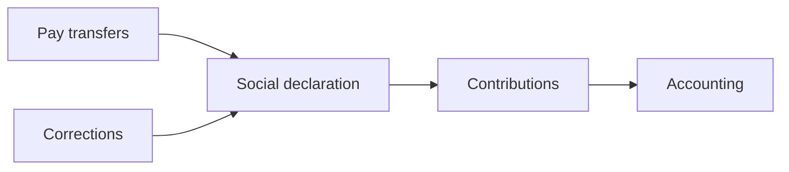

🏠 [Specs](../../../README.md) › 🧩 [Functional capabilities](../../README.md) › 💶 [F13 Payroll (plugin)](../README.md) ›
🔀 [Flows](README.md) › 🔀 FL-F13-03 Declarations and payments

# 🔀 FL-F13-03 Declarations and payments

**Status:** ✅ specified

## Summary

Covers UC-F13-09, UC-F13-10, UC-F13-11, UC-F13-12, UC-F13-13.

## Personas

- [U05 Accounting](../../../01-users/personas/u05-accounting.md)
- [U45 Payroll officer](../../../01-users/personas/u45-payroll-officer.md)

## Flowchart

## Sequence diagram

See each use case.

## Steps

| Step | Persona | Screen | Use case | What happens |
|---|---|---|---|---|
| 1 | U45, U05 | [S-F13-09](../screens/03-declarations-and-payments/s-f13-09-pay-transfers.md) | [UC-F13-09](../use-cases/03-declarations-and-payments/uc-f13-09-pay-employees-by-sepa-transfer.md) | Pay employees by SEPA transfer |
| 2 | U45 | [S-F13-10](../screens/03-declarations-and-payments/s-f13-10-social-declaration.md) | [UC-F13-10](../use-cases/03-declarations-and-payments/uc-f13-10-file-the-monthly-social-declaration-and-handle-returns.md) | File the monthly social declaration and handle returns |
| 3 | U45 | [S-F13-11](../screens/03-declarations-and-payments/s-f13-11-corrections.md) | [UC-F13-11](../use-cases/03-declarations-and-payments/uc-f13-11-correct-a-past-month.md) | Correct a past month |
| 4 | U45, U05 | [S-F13-12](../screens/03-declarations-and-payments/s-f13-12-contributions.md) | [UC-F13-12](../use-cases/03-declarations-and-payments/uc-f13-12-pay-contributions-to-the-collectors.md) | Pay contributions to the collectors |
| 5 | U05, U45 | [S-F13-13](../screens/03-declarations-and-payments/s-f13-13-payroll-entries.md) | [UC-F13-13](../use-cases/03-declarations-and-payments/uc-f13-13-post-payroll-entries-to-accounting.md) | Post payroll entries to accounting |

### Entities and screens

| Entity | States in this flow | Shown at step and screen | Aggregated view |
|---|---|---|---|
| [E-F13-08 Pay transfer](../data/e-f13-08-pay-transfer.md) | Sent, Held | 1 [S-F13-09](../screens/03-declarations-and-payments/s-f13-09-pay-transfers.md) | Pay transfers |
| [E-F13-09 Social declaration](../data/e-f13-09-social-declaration.md) | Accepted, Filed, Late, Rejected, Returned | 2 [S-F13-10](../screens/03-declarations-and-payments/s-f13-10-social-declaration.md) | Social declarations |
| [E-F13-11 Contribution payment](../data/e-f13-11-contribution-payment.md) | Active | 4 [S-F13-12](../screens/03-declarations-and-payments/s-f13-12-contributions.md) | Contribution payments |
| [E-F13-12 Payroll entry](../data/e-f13-12-payroll-entry.md) | Recorded | 5 [S-F13-13](../screens/03-declarations-and-payments/s-f13-13-payroll-entries.md) | Payroll entries |
| [E-F13-10 Correction](../data/e-f13-10-correction.md) | Active | 3 [S-F13-11](../screens/03-declarations-and-payments/s-f13-11-corrections.md) | Corrections |

## Errors

As each use case.

## Images

Every step and error, for each persona taking part, in light and dark mode (D120). Steps are numbered as in the Steps
table; E rows are the error cases.

| Step | Persona | Device | Light | Dark |
|---|---|---|---|---|
| 1 | U05 | desktop | [light](../images/03-declarations-and-payments/u05-accounting/1-transfers-desktop-light.png) | [dark](../images/03-declarations-and-payments/u05-accounting/1-transfers-desktop-dark.png) |
| 1 | U45 | desktop | [light](../images/03-declarations-and-payments/u45-payroll-officer/1-transfers-desktop-light.png) | [dark](../images/03-declarations-and-payments/u45-payroll-officer/1-transfers-desktop-dark.png) |
| 2 | U45 | desktop | [light](../images/03-declarations-and-payments/u45-payroll-officer/2-declaration-desktop-light.png) | [dark](../images/03-declarations-and-payments/u45-payroll-officer/2-declaration-desktop-dark.png) |
| 3 | U45 | desktop | [light](../images/03-declarations-and-payments/u45-payroll-officer/3-correction-desktop-light.png) | [dark](../images/03-declarations-and-payments/u45-payroll-officer/3-correction-desktop-dark.png) |
| 4 | U45 | desktop | [light](../images/03-declarations-and-payments/u45-payroll-officer/4-contributions-desktop-light.png) | [dark](../images/03-declarations-and-payments/u45-payroll-officer/4-contributions-desktop-dark.png) |
| 4 | U05 | desktop | [light](../images/03-declarations-and-payments/u05-accounting/4-contributions-desktop-light.png) | [dark](../images/03-declarations-and-payments/u05-accounting/4-contributions-desktop-dark.png) |
| 5 | U05 | desktop | [light](../images/03-declarations-and-payments/u05-accounting/5-entries-desktop-light.png) | [dark](../images/03-declarations-and-payments/u05-accounting/5-entries-desktop-dark.png) |
| 5 | U45 | desktop | [light](../images/03-declarations-and-payments/u45-payroll-officer/5-entries-desktop-light.png) | [dark](../images/03-declarations-and-payments/u45-payroll-officer/5-entries-desktop-dark.png) |
| E1 | U45 | desktop | [light](../images/03-declarations-and-payments/u45-payroll-officer/e1-rejected-desktop-light.png) | [dark](../images/03-declarations-and-payments/u45-payroll-officer/e1-rejected-desktop-dark.png) |

## Open questions

None.

---

⬅️ [FL-F13-02 Monthly pay run](fl-f13-02-monthly-pay-run.md) · ⬆️ [Up](README.md) ·
➡️ [FL-F13-04 Events](fl-f13-04-events.md)
