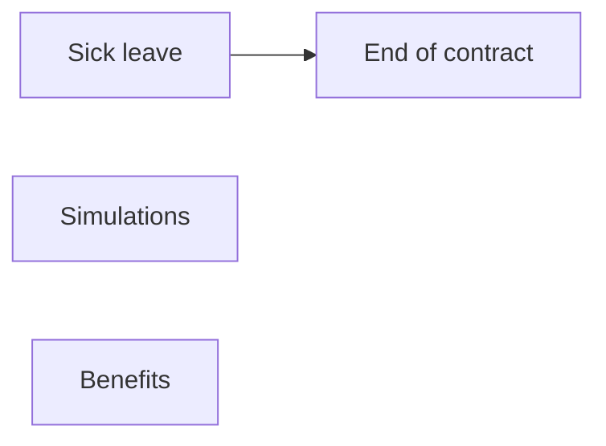

🏠 [Specs](../../../README.md) › 🧩 [Functional capabilities](../../README.md) › 💶 [F13 Payroll (plugin)](../README.md) ›
🔀 [Flows](README.md) › 🔀 FL-F13-04 Events

# 🔀 FL-F13-04 Events

**Status:** ✅ specified

## Summary

Covers UC-F13-14, UC-F13-15, UC-F13-16, UC-F13-17.

## Personas

- [U06 HR](../../../01-users/personas/u06-hr.md)
- [U13 Owner](../../../01-users/personas/u13-owner.md)
- [U45 Payroll officer](../../../01-users/personas/u45-payroll-officer.md)

## Flowchart

## Sequence diagram

See each use case.

## Steps

| Step | Persona | Screen | Use case | What happens |
|---|---|---|---|---|
| 1 | U45, U06 | [S-F13-14](../screens/04-events/s-f13-14-sick-leave.md) | [UC-F13-14](../use-cases/04-events/uc-f13-14-handle-sick-leave-and-daily-allowances.md) | Handle sick leave and daily allowances |
| 2 | U45, U06 | [S-F13-15](../screens/04-events/s-f13-15-end-of-contract.md) | [UC-F13-15](../use-cases/04-events/uc-f13-15-end-a-contract.md) | End a contract |
| 3 | U45, U13 | [S-F13-16](../screens/04-events/s-f13-16-simulations.md) | [UC-F13-16](../use-cases/04-events/uc-f13-16-simulate-pay-and-costs.md) | Simulate pay and costs |
| 4 | U45 | [S-F13-17](../screens/04-events/s-f13-17-benefits.md) | [UC-F13-17](../use-cases/04-events/uc-f13-17-handle-benefits.md) | Handle benefits |

### Entities and screens

| Entity | States in this flow | Shown at step and screen | Aggregated view |
|---|---|---|---|
| [E-F13-13 Sick leave](../data/e-f13-13-sick-leave.md) | New, Paid | 1 [S-F13-14](../screens/04-events/s-f13-14-sick-leave.md) | Sick leaves |
| [E-F13-14 End-of-contract file](../data/e-f13-14-end-of-contract-file.md) | Active | 2 [S-F13-15](../screens/04-events/s-f13-15-end-of-contract.md) | End-of-contract files |
| [E-F13-27 Pay simulation](../data/e-f13-27-pay-simulation.md) | Active | 3 [S-F13-16](../screens/04-events/s-f13-16-simulations.md) | Pay simulations |
| [E-F13-26 Employee benefit](../data/e-f13-26-employee-benefit.md) | Active | 4 [S-F13-17](../screens/04-events/s-f13-17-benefits.md) | Employee benefits |

## Errors

As each use case.

## Images

Every step and error, for each persona taking part, in light and dark mode (D120). Steps are numbered as in the Steps
table; E rows are the error cases.

| Step | Persona | Device | Light | Dark |
|---|---|---|---|---|
| 1 | U45 | desktop | [light](../images/04-events/u45-payroll-officer/1-sick-leave-desktop-light.png) | [dark](../images/04-events/u45-payroll-officer/1-sick-leave-desktop-dark.png) |
| 1 | U06 | desktop | [light](../images/04-events/u06-hr/1-sick-leave-desktop-light.png) | [dark](../images/04-events/u06-hr/1-sick-leave-desktop-dark.png) |
| 2 | U06 | desktop | [light](../images/04-events/u06-hr/2-end-of-contract-desktop-light.png) | [dark](../images/04-events/u06-hr/2-end-of-contract-desktop-dark.png) |
| 2 | U45 | desktop | [light](../images/04-events/u45-payroll-officer/2-end-of-contract-desktop-light.png) | [dark](../images/04-events/u45-payroll-officer/2-end-of-contract-desktop-dark.png) |
| 3 | U13 | desktop | [light](../images/04-events/u13-owner/3-simulation-desktop-light.png) | [dark](../images/04-events/u13-owner/3-simulation-desktop-dark.png) |
| 3 | U13 | phone | [light](../images/04-events/u13-owner/3-simulation-phone-light.png) | [dark](../images/04-events/u13-owner/3-simulation-phone-dark.png) |
| 3 | U45 | desktop | [light](../images/04-events/u45-payroll-officer/3-simulation-desktop-light.png) | [dark](../images/04-events/u45-payroll-officer/3-simulation-desktop-dark.png) |
| 4 | U45 | desktop | [light](../images/04-events/u45-payroll-officer/4-benefits-desktop-light.png) | [dark](../images/04-events/u45-payroll-officer/4-benefits-desktop-dark.png) |
| E1 | U45 | desktop | [light](../images/04-events/u45-payroll-officer/e1-late-event-desktop-light.png) | [dark](../images/04-events/u45-payroll-officer/e1-late-event-desktop-dark.png) |

## Open questions

None.

---

⬅️ [FL-F13-03 Declarations and payments](fl-f13-03-declarations-and-payments.md) · ⬆️ [Up](README.md) ·
➡️ [FL-F13-05 Reports and rules](fl-f13-05-reports-and-rules.md)
