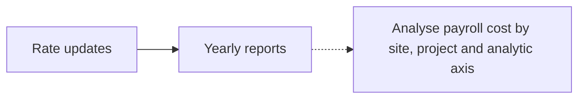

🏠 [Specs](../../../README.md) › 🧩 [Functional capabilities](../../README.md) › 💶 [F13 Payroll (plugin)](../README.md) ›
🔀 [Flows](README.md) › 🔀 FL-F13-05 Reports and rules

# 🔀 FL-F13-05 Reports and rules

**Status:** ✅ specified

## Summary

Covers UC-F13-18, UC-F13-19.

## Personas

- [U07 Administrator](../../../01-users/personas/u07-administrator.md)
- [U13 Owner](../../../01-users/personas/u13-owner.md)
- [U45 Payroll officer](../../../01-users/personas/u45-payroll-officer.md)
- [U05 Accounting](../../../01-users/personas/u05-accounting.md)

## Flowchart

## Sequence diagram

See each use case.

## Steps

| Step | Persona | Screen | Use case | What happens |
|---|---|---|---|---|
| 1 | U45, U13 | [S-F13-18](../screens/05-reports-and-rules/s-f13-18-yearly-reports.md) | [UC-F13-18](../use-cases/05-reports-and-rules/uc-f13-18-report-yearly.md) | Report yearly |
| 2 | U45, U07 | [S-F13-19](../screens/05-reports-and-rules/s-f13-19-rate-updates.md) | [UC-F13-19](../use-cases/05-reports-and-rules/uc-f13-19-update-rates-and-rules-from-the-country-pack.md) | Update rates and rules from the country pack |
| 3 | U13, U05, U45 | [S-F13-27](../screens/05-reports-and-rules/s-f13-27-payroll-analytics.md) | [UC-F13-34](../use-cases/05-reports-and-rules/uc-f13-34-analyse-payroll-cost-by-site-project-and-analytic-axis.md) | Analyse payroll cost by site, project and analytic axis |

### Entities and screens

| Entity | States in this flow | Shown at step and screen | Aggregated view |
|---|---|---|---|
| [E-F13-16 Rate set](../data/e-f13-16-rate-set.md) | Active | 2 [S-F13-19](../screens/05-reports-and-rules/s-f13-19-rate-updates.md) | Rate sets |
| [E-F13-15 Yearly payroll report](../data/e-f13-15-yearly-payroll-report.md) | Checked, Filed | 1 [S-F13-18](../screens/05-reports-and-rules/s-f13-18-yearly-reports.md) | Yearly payroll reports |
| [E-F13-24 Payroll cost allocation](../data/e-f13-24-payroll-cost-allocation.md) | Computed, Posted | 3 [S-F13-27](../screens/05-reports-and-rules/s-f13-27-payroll-analytics.md) | Payroll cost allocations |
| [E-F1-02 Company site](../../f01-administration/data/e-f01-02-company-site.md) | Open, Closed | Shown elsewhere: [S-F1-02 Sites](../../f01-administration/screens/02-manage-sites/s-f01-02-sites.md) | Company sites |
| [E-F9-18 Project and task](../../f09-hr-and-projects/data/e-f09-18-project-and-task.md) | New, Planned, Active, Delivered, Done | Shown elsewhere: [S-F9-17 Projects](../../f09-hr-and-projects/screens/06-plan-and-deliver-work/s-f09-17-projects.md) | Project and tasks |
| [E-F13-25 Analytic axis](../data/e-f13-25-analytic-axis.md) | Active | 3 [S-F13-27](../screens/05-reports-and-rules/s-f13-27-payroll-analytics.md) | Analytic axis |
| [E-T11-01 Country pack](../../../03-technical/t11-legal-corpora/data/e-t11-01-country-pack.md) | Active | Shown elsewhere: [S-T11-01 Country pack](../../../03-technical/t11-legal-corpora/screens/s-t11-01-country-pack.md), from the admin list [S-T11-L01](../../../03-technical/t11-legal-corpora/screens/00-lists/s-t11-l01-country-packs.md) | Country packs |

## Errors

As each use case.

## Images

Every step and error, for each persona taking part, in light and dark mode (D120). Steps are numbered as in the Steps
table; E rows are the error cases.

| Step | Persona | Device | Light | Dark |
|---|---|---|---|---|
| 1 | U07 | desktop | [light](../images/05-reports-and-rules/u07-administrator/1-rate-update-desktop-light.png) | [dark](../images/05-reports-and-rules/u07-administrator/1-rate-update-desktop-dark.png) |
| 1 | U13 | desktop | [light](../images/05-reports-and-rules/u13-owner/1-rate-update-desktop-light.png) | [dark](../images/05-reports-and-rules/u13-owner/1-rate-update-desktop-dark.png) |
| 1 | U13 | phone | [light](../images/05-reports-and-rules/u13-owner/1-rate-update-phone-light.png) | [dark](../images/05-reports-and-rules/u13-owner/1-rate-update-phone-dark.png) |
| 1 | U45 | desktop | [light](../images/05-reports-and-rules/u45-payroll-officer/1-rate-update-desktop-light.png) | [dark](../images/05-reports-and-rules/u45-payroll-officer/1-rate-update-desktop-dark.png) |
| 2 | U45 | desktop | [light](../images/05-reports-and-rules/u45-payroll-officer/2-yearly-desktop-light.png) | [dark](../images/05-reports-and-rules/u45-payroll-officer/2-yearly-desktop-dark.png) |
| 2 | U07 | desktop | [light](../images/05-reports-and-rules/u07-administrator/2-yearly-desktop-light.png) | [dark](../images/05-reports-and-rules/u07-administrator/2-yearly-desktop-dark.png) |
| E1 | U45 | desktop | [light](../images/05-reports-and-rules/u45-payroll-officer/e1-approved-run-desktop-light.png) | [dark](../images/05-reports-and-rules/u45-payroll-officer/e1-approved-run-desktop-dark.png) |
| 3 | U13 | desktop | [light](../images/05-reports-and-rules/u13-owner/3-payroll-analytics-desktop-light.png) | [dark](../images/05-reports-and-rules/u13-owner/3-payroll-analytics-desktop-dark.png) |
| 3 | U13 | phone | [light](../images/05-reports-and-rules/u13-owner/3-payroll-analytics-phone-light.png) | [dark](../images/05-reports-and-rules/u13-owner/3-payroll-analytics-phone-dark.png) |
| 3 | U05 | desktop | [light](../images/05-reports-and-rules/u05-accounting/3-payroll-analytics-desktop-light.png) | [dark](../images/05-reports-and-rules/u05-accounting/3-payroll-analytics-desktop-dark.png) |
| 3 | U45 | desktop | [light](../images/05-reports-and-rules/u45-payroll-officer/3-payroll-analytics-desktop-light.png) | [dark](../images/05-reports-and-rules/u45-payroll-officer/3-payroll-analytics-desktop-dark.png) |

## Open questions

None.

---

⬅️ [FL-F13-04 Events](fl-f13-04-events.md) · ⬆️ [Up](README.md) · ➡️ [FL-F13-06 Assistant](fl-f13-06-assistant.md)
