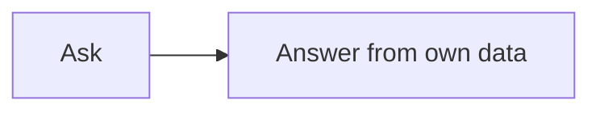

🏠 [Specs](../../../README.md) › 🧩 [Functional capabilities](../../README.md) › 💶 [F13 Payroll (plugin)](../README.md) ›
🔀 [Flows](README.md) › 🔀 FL-F13-06 Assistant

# 🔀 FL-F13-06 Assistant

**Status:** ✅ specified

## Summary

Covers UC-F13-20.

## Personas

- [U01 Employee](../../../01-users/personas/u01-employee.md)
- [U45 Payroll officer](../../../01-users/personas/u45-payroll-officer.md)

## Flowchart

## Sequence diagram

See each use case.

## Steps

| Step | Persona | Screen | Use case | What happens |
|---|---|---|---|---|
| 1 | U01, U45 | [S-F13-20](../screens/06-assistant/s-f13-20-payroll-assistant.md) | [UC-F13-20](../use-cases/06-assistant/uc-f13-20-ask-the-assistant-about-pay.md) | Ask the AI assistant about pay |

### Entities and screens

| Entity | States in this flow | Shown at step and screen | Aggregated view |
|---|---|---|---|
| [E-F3-02 Assistant answer](../../f03-assistant/data/e-f03-02-assistant-answer.md) | Recorded | Shown elsewhere: [S-F3-01 Assistant panel](../../f03-assistant/screens/01-ask-the-assistant/s-f03-01-assistant-panel.md) | Assistant answers |

## Errors

As each use case.

## Images

Every step and error, for each persona taking part, in light and dark mode (D120). Steps are numbered as in the Steps
table; E rows are the error cases.

| Step | Persona | Device | Light | Dark |
|---|---|---|---|---|
| 1 | U01 | phone | [light](../images/06-assistant/u01-employee/1-ask-phone-light.png) | [dark](../images/06-assistant/u01-employee/1-ask-phone-dark.png) |
| 1 | U01 | desktop | [light](../images/06-assistant/u01-employee/1-ask-desktop-light.png) | [dark](../images/06-assistant/u01-employee/1-ask-desktop-dark.png) |
| 1 | U45 | desktop | [light](../images/06-assistant/u45-payroll-officer/1-ask-desktop-light.png) | [dark](../images/06-assistant/u45-payroll-officer/1-ask-desktop-dark.png) |
| E1 | U01 | phone | [light](../images/06-assistant/u01-employee/e1-other-pay-phone-light.png) | [dark](../images/06-assistant/u01-employee/e1-other-pay-phone-dark.png) |
| E1 | U01 | desktop | [light](../images/06-assistant/u01-employee/e1-other-pay-desktop-light.png) | [dark](../images/06-assistant/u01-employee/e1-other-pay-desktop-dark.png) |

## Open questions

None.

---

⬅️ [FL-F13-05 Reports and rules](fl-f13-05-reports-and-rules.md) · ⬆️ [Up](README.md) ·
➡️ [FL-F13-07 Schemes and special contracts](fl-f13-07-schemes-and-special-contracts.md)
