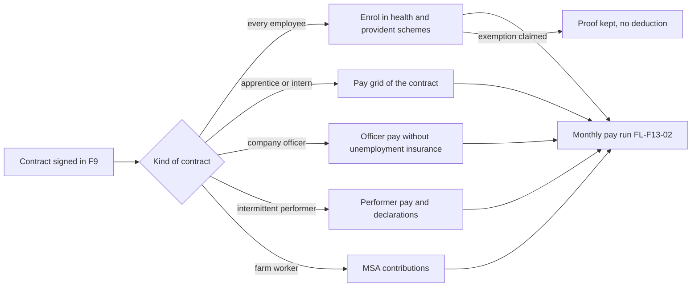
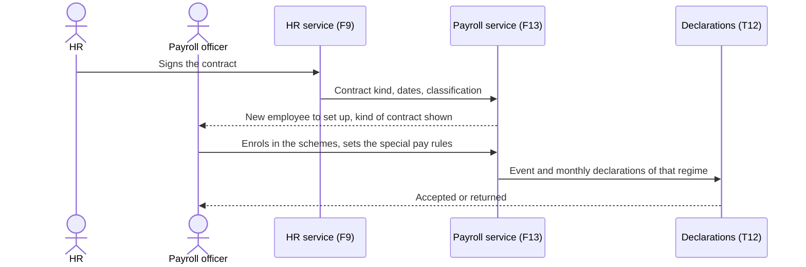

🏠 [Specs](../../../README.md) › 🧩 [Functional capabilities](../../README.md) › 💶 [F13 Payroll (plugin)](../README.md) ›
🔀 [Flows](README.md) › 🔀 FL-F13-07 Schemes and special contracts

# 🔀 FL-F13-07 Schemes and special contracts

**Status:** ✅ specified

## Summary

The payroll officer enrols employees in the mandatory health and provident schemes and pays the contracts that follow
their own rules: apprentices, interns, company officers, intermittent performers and farm workers under the MSA (D470).
Each one starts from the contract in F9 and ends in the monthly pay run (FL-F13-02) and its declaration (FL-F13-03).

## Personas

- [U45 Payroll officer](../../../01-users/personas/u45-payroll-officer.md)
- [U06 Human resources](../../../01-users/personas/u06-hr.md)
- [U13 Owner](../../../01-users/personas/u13-owner.md)
- [U43 Event producer](../../../01-users/personas/u43-event-producer.md)
- [U40 Farmer](../../../01-users/personas/u40-farmer.md)

## Flowchart

## Sequence diagram

## Steps

| Step | Persona | Screen | Use case | What happens |
|---|---|---|---|---|
| 1 | U45, U06 | [S-F13-21](../screens/07-schemes-and-special-contracts/s-f13-21-schemes.md) | [UC-F13-21](../use-cases/07-schemes-and-special-contracts/uc-f13-21-enrol-employees-in-health-and-provident-schemes.md) | Enrol the employee in the health and provident schemes |
| 2 | U45, U06 | [S-F13-22](../screens/07-schemes-and-special-contracts/s-f13-22-special-contracts.md) | [UC-F13-22](../use-cases/07-schemes-and-special-contracts/uc-f13-22-pay-an-apprentice-or-an-intern.md) | Pay an apprentice or an intern |
| 3 | U45, U13 | [S-F13-22](../screens/07-schemes-and-special-contracts/s-f13-22-special-contracts.md) | [UC-F13-23](../use-cases/07-schemes-and-special-contracts/uc-f13-23-pay-a-company-officer.md) | Pay a company officer |
| 4 | U45, U43 | [S-F13-23](../screens/07-schemes-and-special-contracts/s-f13-23-special-regimes.md) | [UC-F13-24](../use-cases/07-schemes-and-special-contracts/uc-f13-24-pay-intermittent-performers.md) | Pay intermittent performers |
| 5 | U45, U40 | [S-F13-23](../screens/07-schemes-and-special-contracts/s-f13-23-special-regimes.md) | [UC-F13-25](../use-cases/07-schemes-and-special-contracts/uc-f13-25-pay-farm-workers-under-the-msa.md) | Pay farm workers under the MSA |

### Entities and screens

| Entity | States in this flow | Shown at step and screen | Aggregated view |
|---|---|---|---|
| [E-F9-02 Contract](../../f09-hr-and-projects/data/e-f09-02-contract.md) | Draft, Running, Expired | Shown elsewhere: [S-F9-35 Employee qualifications](../../f09-hr-and-projects/screens/13-keep-qualifications/s-f09-35-employee-qualifications.md) | Contracts |
| [E-F13-17 Scheme membership](../data/e-f13-17-scheme-membership.md) | Enrolled, Exempted, Ended | 1 [S-F13-21](../screens/07-schemes-and-special-contracts/s-f13-21-schemes.md) | Scheme memberships |
| [E-F13-18 Special pay regime](../data/e-f13-18-special-pay-regime.md) | Active, Changed, Ended | 2, 3 [S-F13-22](../screens/07-schemes-and-special-contracts/s-f13-22-special-contracts.md); 4, 5 [S-F13-23](../screens/07-schemes-and-special-contracts/s-f13-23-special-regimes.md) | Special pay regimes |
| [E-SC16-06 Performer declaration](../../../08-sectors/sc16-events-and-culture/data/e-sc16-06-performer-declaration.md) | Active | Shown elsewhere: [S-SC16-04 Performers](../../../08-sectors/sc16-events-and-culture/screens/01-plan-and-book/s-sc16-04-performers.md) | Performer declarations |
| [E-F13-11 Contribution payment](../data/e-f13-11-contribution-payment.md) | Active | 4, 5 [S-F13-23](../screens/07-schemes-and-special-contracts/s-f13-23-special-regimes.md) | Contribution payments |
| [E-F13-06 Pay run](../data/e-f13-06-pay-run.md) | Recorded | Shown elsewhere: [S-F13-07 Pay run](../screens/02-monthly-pay-run/s-f13-07-pay-run.md) | Pay runs |

## Errors

E1: an employee with no scheme and no exemption blocks the pay run (BR-F13-16); the flow resumes at step 1. E2: a
contract kind with no pay rule in the country pack is flagged on the employee's pay profile and the employee is left out
of the run until set (BR-F13-17); the flow resumes at step 2. E3: a declaration of a special regime is returned; it is
corrected and filed again from step 4 or 5.

## Images

Every step and error, for each persona taking part, in light and dark mode (D120). Steps are numbered as in the Steps
table; E rows are the error cases.

| Step | Persona | Device | Light | Dark |
|---|---|---|---|---|
| 1 | U45 | desktop | [light](../images/07-schemes-and-special-contracts/u45-payroll-officer/1-schemes-desktop-light.png) | [dark](../images/07-schemes-and-special-contracts/u45-payroll-officer/1-schemes-desktop-dark.png) |
| 1 | U06 | desktop | [light](../images/07-schemes-and-special-contracts/u06-hr/1-schemes-desktop-light.png) | [dark](../images/07-schemes-and-special-contracts/u06-hr/1-schemes-desktop-dark.png) |
| 2 | U45 | desktop | [light](../images/07-schemes-and-special-contracts/u45-payroll-officer/2-special-contracts-desktop-light.png) | [dark](../images/07-schemes-and-special-contracts/u45-payroll-officer/2-special-contracts-desktop-dark.png) |
| 2 | U06 | desktop | [light](../images/07-schemes-and-special-contracts/u06-hr/2-special-contracts-desktop-light.png) | [dark](../images/07-schemes-and-special-contracts/u06-hr/2-special-contracts-desktop-dark.png) |
| 3 | U45 | desktop | [light](../images/07-schemes-and-special-contracts/u45-payroll-officer/3-special-contracts-desktop-light.png) | [dark](../images/07-schemes-and-special-contracts/u45-payroll-officer/3-special-contracts-desktop-dark.png) |
| 3 | U13 | desktop | [light](../images/07-schemes-and-special-contracts/u13-owner/3-special-contracts-desktop-light.png) | [dark](../images/07-schemes-and-special-contracts/u13-owner/3-special-contracts-desktop-dark.png) |
| 3 | U13 | phone | [light](../images/07-schemes-and-special-contracts/u13-owner/3-special-contracts-phone-light.png) | [dark](../images/07-schemes-and-special-contracts/u13-owner/3-special-contracts-phone-dark.png) |
| 4 | U45 | desktop | [light](../images/07-schemes-and-special-contracts/u45-payroll-officer/4-special-regimes-desktop-light.png) | [dark](../images/07-schemes-and-special-contracts/u45-payroll-officer/4-special-regimes-desktop-dark.png) |
| 4 | U43 | desktop | [light](../images/07-schemes-and-special-contracts/u43-event-producer/4-special-regimes-desktop-light.png) | [dark](../images/07-schemes-and-special-contracts/u43-event-producer/4-special-regimes-desktop-dark.png) |
| 4 | U43 | phone | [light](../images/07-schemes-and-special-contracts/u43-event-producer/4-special-regimes-phone-light.png) | [dark](../images/07-schemes-and-special-contracts/u43-event-producer/4-special-regimes-phone-dark.png) |
| 5 | U45 | desktop | [light](../images/07-schemes-and-special-contracts/u45-payroll-officer/5-special-regimes-desktop-light.png) | [dark](../images/07-schemes-and-special-contracts/u45-payroll-officer/5-special-regimes-desktop-dark.png) |
| 5 | U40 | desktop | [light](../images/07-schemes-and-special-contracts/u40-farmer/5-special-regimes-desktop-light.png) | [dark](../images/07-schemes-and-special-contracts/u40-farmer/5-special-regimes-desktop-dark.png) |
| 5 | U40 | phone | [light](../images/07-schemes-and-special-contracts/u40-farmer/5-special-regimes-phone-light.png) | [dark](../images/07-schemes-and-special-contracts/u40-farmer/5-special-regimes-phone-dark.png) |
| E1 | U45 | desktop | [light](../images/07-schemes-and-special-contracts/u45-payroll-officer/e1-schemes-refused-desktop-light.png) | [dark](../images/07-schemes-and-special-contracts/u45-payroll-officer/e1-schemes-refused-desktop-dark.png) |

## Open questions

None.

---

⬅️ [FL-F13-06 Assistant](fl-f13-06-assistant.md) · ⬆️ [Up](README.md) ·
➡️ [FL-F13-08 Deductions, savings and leave pay](fl-f13-08-deductions-savings-and-leave-pay.md)
