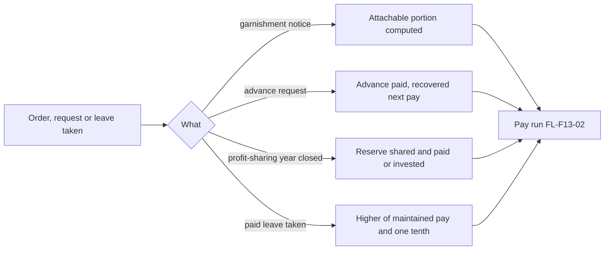
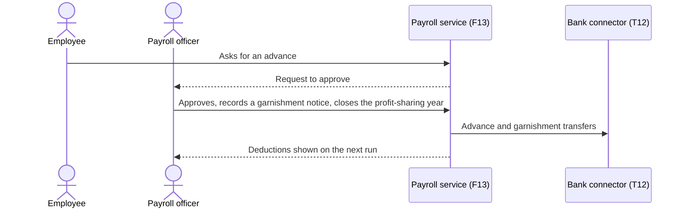

🏠 [Specs](../../../README.md) › 🧩 [Functional capabilities](../../README.md) › 💶 [F13 Payroll (plugin)](../README.md) ›
🔀 [Flows](README.md) › 🔀 FL-F13-08 Deductions, savings and leave pay

# 🔀 FL-F13-08 Deductions, savings and leave pay

**Status:** ✅ specified

## Summary

The payroll officer handles what changes an employee's net besides the pay itself: wage garnishments ordered by a court
or the tax office, pay advances, profit-sharing and employee savings, and the valuation of paid-leave pay as the higher
of maintained pay and one tenth (D470).

## Personas

- [U45 Payroll officer](../../../01-users/personas/u45-payroll-officer.md)
- [U01 Employee](../../../01-users/personas/u01-employee.md)
- [U13 Owner](../../../01-users/personas/u13-owner.md)

## Flowchart

## Sequence diagram

## Steps

| Step | Persona | Screen | Use case | What happens |
|---|---|---|---|---|
| 1 | U45 | [S-F13-24](../screens/08-deductions-savings-and-leave-pay/s-f13-24-garnishments-and-advances.md) | [UC-F13-26](../use-cases/08-deductions-savings-and-leave-pay/uc-f13-26-apply-a-wage-garnishment.md) | Apply a wage garnishment |
| 2 | U01, U45 | [S-F13-24](../screens/08-deductions-savings-and-leave-pay/s-f13-24-garnishments-and-advances.md) | [UC-F13-27](../use-cases/08-deductions-savings-and-leave-pay/uc-f13-27-grant-a-pay-advance.md) | Grant a pay advance |
| 3 | U45, U13, U01 | [S-F13-25](../screens/08-deductions-savings-and-leave-pay/s-f13-25-profit-sharing.md) | [UC-F13-28](../use-cases/08-deductions-savings-and-leave-pay/uc-f13-28-compute-profit-sharing-and-employee-savings.md) | Compute profit-sharing and employee savings |
| 4 | U45 | [S-F13-26](../screens/08-deductions-savings-and-leave-pay/s-f13-26-leave-pay-valuation.md) | [UC-F13-29](../use-cases/08-deductions-savings-and-leave-pay/uc-f13-29-value-paid-leave-pay.md) | Value paid-leave pay |

### Entities and screens

| Entity | States in this flow | Shown at step and screen | Aggregated view |
|---|---|---|---|
| [E-F13-19 Garnishment](../data/e-f13-19-garnishment.md) | Received, Active, Settled, Lifted | 1, 2 [S-F13-24](../screens/08-deductions-savings-and-leave-pay/s-f13-24-garnishments-and-advances.md) | Garnishments |
| [E-F13-20 Pay advance](../data/e-f13-20-pay-advance.md) | Asked, Approved, Refused, Paid, Recovered | 1, 2 [S-F13-24](../screens/08-deductions-savings-and-leave-pay/s-f13-24-garnishments-and-advances.md) | Pay advances |
| [E-F9-09 Time-off request](../../f09-hr-and-projects/data/e-f09-09-time-off-request.md) | To approve, Refused | Shown elsewhere: [S-F9-09 Time off](../../f09-hr-and-projects/screens/03-time/s-f09-09-time-off.md) | Time-off requests |
| [E-F13-21 Profit-sharing year](../data/e-f13-21-profit-sharing-year.md) | Computed | 3 [S-F13-25](../screens/08-deductions-savings-and-leave-pay/s-f13-25-profit-sharing.md) | Profit-sharing years |
| [E-F13-22 Leave pay valuation](../data/e-f13-22-leave-pay-valuation.md) | Computed, Paid, Adjusted | 4 [S-F13-26](../screens/08-deductions-savings-and-leave-pay/s-f13-26-leave-pay-valuation.md) | Leave pay valuations |
| [E-F13-06 Pay run](../data/e-f13-06-pay-run.md) | Recorded | Shown elsewhere: [S-F13-07 Pay run](../screens/02-monthly-pay-run/s-f13-07-pay-run.md) | Pay runs |

## Errors

E1: a garnishment would leave the employee below the protected amount: the deduction is capped (BR-F13-19) and the flow
resumes at step 1. E2: an advance larger than the net to come is refused (BR-F13-20). E3: the profit-sharing reserve has
a negative base: nothing is shared that year and the employees are told.

## Images

Every step and error, for each persona taking part, in light and dark mode (D120). Steps are numbered as in the Steps
table; E rows are the error cases.

| Step | Persona | Device | Light | Dark |
|---|---|---|---|---|
| 1 | U45 | desktop | [light](../images/08-deductions-savings-and-leave-pay/u45-payroll-officer/1-garnishments-and-advances-desktop-light.png) | [dark](../images/08-deductions-savings-and-leave-pay/u45-payroll-officer/1-garnishments-and-advances-desktop-dark.png) |
| 2 | U01 | desktop | [light](../images/08-deductions-savings-and-leave-pay/u01-employee/2-garnishments-and-advances-desktop-light.png) | [dark](../images/08-deductions-savings-and-leave-pay/u01-employee/2-garnishments-and-advances-desktop-dark.png) |
| 2 | U01 | phone | [light](../images/08-deductions-savings-and-leave-pay/u01-employee/2-garnishments-and-advances-phone-light.png) | [dark](../images/08-deductions-savings-and-leave-pay/u01-employee/2-garnishments-and-advances-phone-dark.png) |
| 2 | U45 | desktop | [light](../images/08-deductions-savings-and-leave-pay/u45-payroll-officer/2-garnishments-and-advances-desktop-light.png) | [dark](../images/08-deductions-savings-and-leave-pay/u45-payroll-officer/2-garnishments-and-advances-desktop-dark.png) |
| 3 | U45 | desktop | [light](../images/08-deductions-savings-and-leave-pay/u45-payroll-officer/3-profit-sharing-desktop-light.png) | [dark](../images/08-deductions-savings-and-leave-pay/u45-payroll-officer/3-profit-sharing-desktop-dark.png) |
| 3 | U01 | desktop | [light](../images/08-deductions-savings-and-leave-pay/u01-employee/3-profit-sharing-desktop-light.png) | [dark](../images/08-deductions-savings-and-leave-pay/u01-employee/3-profit-sharing-desktop-dark.png) |
| 3 | U01 | phone | [light](../images/08-deductions-savings-and-leave-pay/u01-employee/3-profit-sharing-phone-light.png) | [dark](../images/08-deductions-savings-and-leave-pay/u01-employee/3-profit-sharing-phone-dark.png) |
| 3 | U13 | desktop | [light](../images/08-deductions-savings-and-leave-pay/u13-owner/3-profit-sharing-desktop-light.png) | [dark](../images/08-deductions-savings-and-leave-pay/u13-owner/3-profit-sharing-desktop-dark.png) |
| 3 | U13 | phone | [light](../images/08-deductions-savings-and-leave-pay/u13-owner/3-profit-sharing-phone-light.png) | [dark](../images/08-deductions-savings-and-leave-pay/u13-owner/3-profit-sharing-phone-dark.png) |
| 4 | U45 | desktop | [light](../images/08-deductions-savings-and-leave-pay/u45-payroll-officer/4-leave-pay-valuation-desktop-light.png) | [dark](../images/08-deductions-savings-and-leave-pay/u45-payroll-officer/4-leave-pay-valuation-desktop-dark.png) |
| E1 | U45 | desktop | [light](../images/08-deductions-savings-and-leave-pay/u45-payroll-officer/e1-garnishments-and-advances-refused-desktop-light.png) | [dark](../images/08-deductions-savings-and-leave-pay/u45-payroll-officer/e1-garnishments-and-advances-refused-desktop-dark.png) |

## Open questions

None.

---

⬅️ [FL-F13-07 Schemes and special contracts](fl-f13-07-schemes-and-special-contracts.md) · ⬆️ [Up](README.md) ·
➡️ [FL-F13-09 Collective agreements by family](fl-f13-09-collective-agreements-by-family.md)
