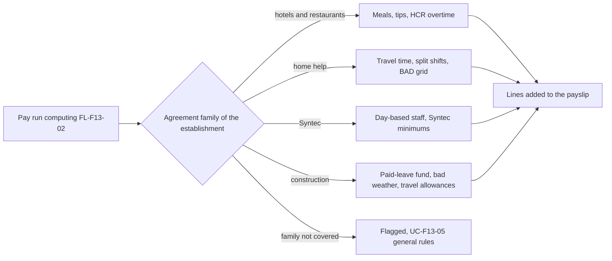
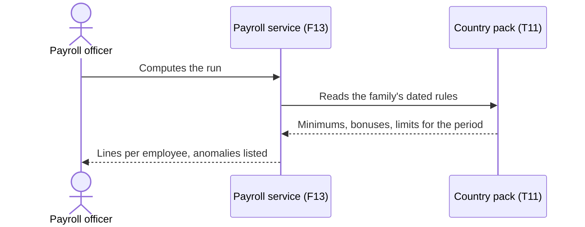

🏠 [Specs](../../../README.md) › 🧩 [Functional capabilities](../../README.md) › 💶 [F13 Payroll (plugin)](../README.md) ›
🔀 [Flows](README.md) › 🔀 FL-F13-09 Collective agreements by family

# 🔀 FL-F13-09 Collective agreements by family

**Status:** ✅ specified

## Summary

UC-F13-05 split per collective-agreement family (D470): each family brings its own minimums, bonuses, working-time rules
and funds, for the sectors that rely on them: hotels and restaurants (SC06), home help (SC04), Syntec engineering and
consulting (SC03, SC14) and construction (SC01). The payroll officer applies them inside the monthly pay run.

## Personas

- [U45 Payroll officer](../../../01-users/personas/u45-payroll-officer.md)
- [U06 Human resources](../../../01-users/personas/u06-hr.md)

## Flowchart

## Sequence diagram

## Steps

| Step | Persona | Screen | Use case | What happens |
|---|---|---|---|---|
| 1 | U45 | [S-F13-05](../screens/02-monthly-pay-run/s-f13-05-agreement-rules.md) | [UC-F13-30](../use-cases/09-collective-agreements-by-family/uc-f13-30-apply-the-hotels-and-restaurants-agreement.md) | Apply the hotels-and-restaurants agreement |
| 2 | U45 | [S-F13-05](../screens/02-monthly-pay-run/s-f13-05-agreement-rules.md) | [UC-F13-31](../use-cases/09-collective-agreements-by-family/uc-f13-31-apply-the-home-help-agreement.md) | Apply the home-help agreement |
| 3 | U45 | [S-F13-05](../screens/02-monthly-pay-run/s-f13-05-agreement-rules.md) | [UC-F13-32](../use-cases/09-collective-agreements-by-family/uc-f13-32-apply-the-syntec-agreement.md) | Apply the Syntec agreement |
| 4 | U45, U06 | [S-F13-05](../screens/02-monthly-pay-run/s-f13-05-agreement-rules.md) | [UC-F13-33](../use-cases/09-collective-agreements-by-family/uc-f13-33-apply-the-construction-agreements.md) | Apply the construction agreements |

### Entities and screens

| Entity | States in this flow | Shown at step and screen | Aggregated view |
|---|---|---|---|
| [E-F13-06 Pay run](../data/e-f13-06-pay-run.md) | Recorded | Shown elsewhere: [S-F13-07 Pay run](../screens/02-monthly-pay-run/s-f13-07-pay-run.md) | Pay runs |
| [E-F13-23 Agreement family](../data/e-f13-23-agreement-family.md) | Published, Superseded | 1, 2, 3, 4 [S-F13-05](../screens/02-monthly-pay-run/s-f13-05-agreement-rules.md) | Agreement families |
| [E-F13-01 Payroll establishment](../data/e-f13-01-payroll-establishment.md) | Active | Shown elsewhere: [S-F13-01 Payroll set-up](../screens/01-set-up/s-f13-01-payroll-set-up.md) | Payroll establishments |
| [E-F13-04 Payslip line](../data/e-f13-04-payslip-line.md) | Recorded | 1, 2, 3, 4 [S-F13-05](../screens/02-monthly-pay-run/s-f13-05-agreement-rules.md) | Payslip lines |
| [E-F13-07 Payslip](../data/e-f13-07-payslip.md) | Published, Available | Shown elsewhere: [S-F13-08 Payslips](../screens/02-monthly-pay-run/s-f13-08-payslips.md) | Payslips |

## Errors

E1: the family's rules for the period are missing in the country pack: the run is flagged and stays a draft (BR-F13-24).
E2: an employee's classification does not exist in the family's grid: the employee is held out of the run until HR
corrects it in F9.

## Images

Every step and error, for each persona taking part, in light and dark mode (D120). Steps are numbered as in the Steps
table; E rows are the error cases.

| Step | Persona | Device | Light | Dark |
|---|---|---|---|---|
| 1 | U45 | desktop | [light](../images/09-collective-agreements-by-family/u45-payroll-officer/1-agreement-rules-desktop-light.png) | [dark](../images/09-collective-agreements-by-family/u45-payroll-officer/1-agreement-rules-desktop-dark.png) |
| 2 | U45 | desktop | [light](../images/09-collective-agreements-by-family/u45-payroll-officer/2-agreement-rules-desktop-light.png) | [dark](../images/09-collective-agreements-by-family/u45-payroll-officer/2-agreement-rules-desktop-dark.png) |
| 3 | U45 | desktop | [light](../images/09-collective-agreements-by-family/u45-payroll-officer/3-agreement-rules-desktop-light.png) | [dark](../images/09-collective-agreements-by-family/u45-payroll-officer/3-agreement-rules-desktop-dark.png) |
| 4 | U45 | desktop | [light](../images/09-collective-agreements-by-family/u45-payroll-officer/4-agreement-rules-desktop-light.png) | [dark](../images/09-collective-agreements-by-family/u45-payroll-officer/4-agreement-rules-desktop-dark.png) |
| 4 | U06 | desktop | [light](../images/09-collective-agreements-by-family/u06-hr/4-agreement-rules-desktop-light.png) | [dark](../images/09-collective-agreements-by-family/u06-hr/4-agreement-rules-desktop-dark.png) |
| E1 | U45 | desktop | [light](../images/09-collective-agreements-by-family/u45-payroll-officer/e1-agreement-rules-refused-desktop-light.png) | [dark](../images/09-collective-agreements-by-family/u45-payroll-officer/e1-agreement-rules-refused-desktop-dark.png) |

## Open questions

None.

---

⬅️ [FL-F13-08 Deductions, savings and leave pay](fl-f13-08-deductions-savings-and-leave-pay.md) · ⬆️ [Up](README.md) ·
➡️ [FL-F13-10 Special contracts and outsourced payroll](fl-f13-10-special-contracts-and-outsourcing.md)
