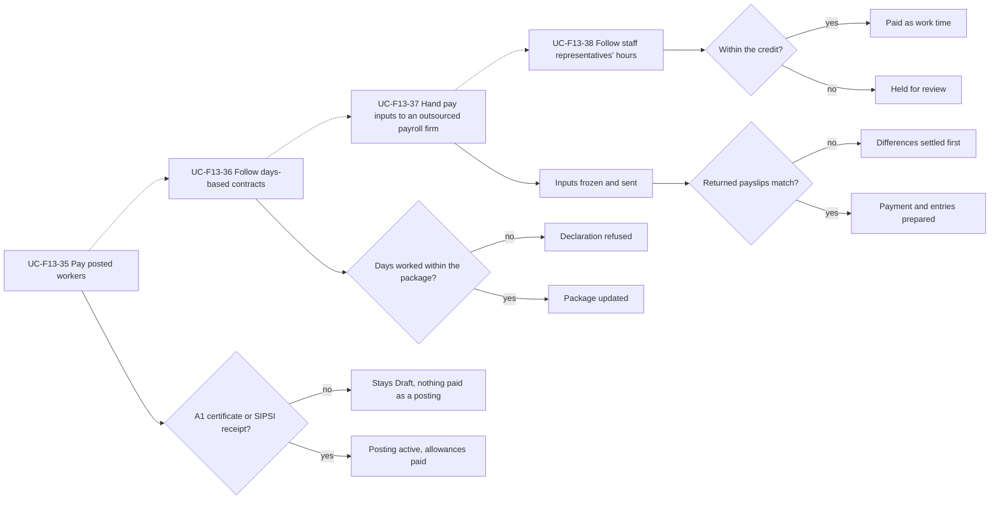
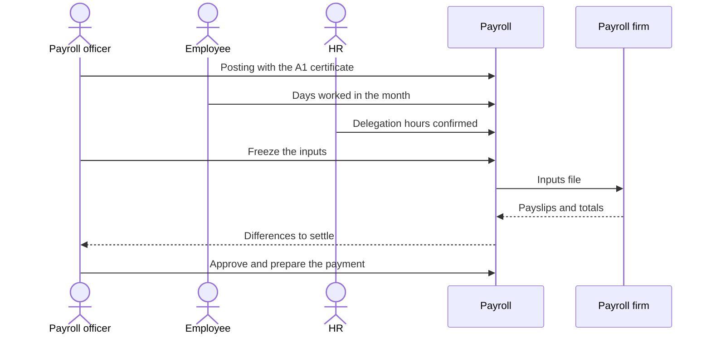

🏠 [Specs](../../../README.md) › 🧩 [Functional capabilities](../../README.md) › 💶 [F13 Payroll (plugin)](../README.md) ›
🔀 [Flows](README.md) › 🔀 FL-F13-10 Special contracts and outsourced payroll

# 🔀 FL-F13-10 Special contracts and outsourced payroll

**Status:** 🔄 waiting for the owner

## Summary

The payroll officer covers four special situations: employees posted to another country with their A1 certificate or
declaration, employees on a yearly days package, the monthly handover of pay inputs to an outside payroll firm, and the
delegation hours of staff representatives, paid as work time
([D532](../../../06-decisions/f13-payroll/d532-benchmark-gaps-f13-payroll.md)).

## Personas

- [U45 Payroll officer](../../../01-users/personas/u45-payroll-officer.md), who pays, hands over and checks
- [U01 Employee](../../../01-users/personas/u01-employee.md), who declares their days from a phone
- [U08 External accountant](../../../01-users/personas/u08-external-accountant.md), who reads the handover
- [U06 Human resources](../../../01-users/personas/u06-hr.md), who follows the representatives' hours

## Flowchart

## Sequence diagram

## Steps

| Step | Persona | Screen | Use case | What happens |
|---|---|---|---|---|
| 1 | [U45](../../../01-users/personas/u45-payroll-officer.md) | [S-F13-28](../screens/10-special-contracts-and-outsourcing/s-f13-28-posted-workers.md) | [UC-F13-35](../use-cases/10-special-contracts-and-outsourcing/uc-f13-35-pay-posted-workers.md) | The payroll officer records a posting with its A1 certificate or declaration receipt and its allowances |
| 2 | [U45](../../../01-users/personas/u45-payroll-officer.md) | [S-F13-29](../screens/10-special-contracts-and-outsourcing/s-f13-29-days-based-contracts.md) | [UC-F13-36](../use-cases/10-special-contracts-and-outsourcing/uc-f13-36-follow-days-based-contracts.md) | The payroll officer follows each days package while employees declare their days from a phone |
| 3 | [U45](../../../01-users/personas/u45-payroll-officer.md) | [S-F13-30](../screens/10-special-contracts-and-outsourcing/s-f13-30-outsourced-payroll.md) | [UC-F13-37](../use-cases/10-special-contracts-and-outsourcing/uc-f13-37-hand-pay-inputs-to-an-outsourced-payroll-firm.md) | The payroll officer freezes the month's inputs, sends them to the payroll firm and checks what comes back |
| 4 | [U06](../../../01-users/personas/u06-hr.md) | [S-F13-31](../screens/10-special-contracts-and-outsourcing/s-f13-31-staff-representatives.md) | [UC-F13-38](../use-cases/10-special-contracts-and-outsourcing/uc-f13-38-follow-staff-representatives-hours.md) | HR follows the staff representatives' credits and confirms hours the payroll pays as work time |

### Entities and screens

| Entity | States in this flow | Shown at step and screen | Aggregated view |
|---|---|---|---|
| [E-F13-28 Posting](../data/e-f13-28-posting.md) | Draft, Documented, Active, Ended, Cancelled | 1 [S-F13-28](../screens/10-special-contracts-and-outsourcing/s-f13-28-posted-workers.md) | Postings |
| [E-F13-29 Days package](../data/e-f13-29-days-package.md) | Open, Complete, Closed | 2 [S-F13-29](../screens/10-special-contracts-and-outsourcing/s-f13-29-days-based-contracts.md) | Days packages |
| [E-F13-30 Payroll handover](../data/e-f13-30-payroll-handover.md) | Draft, Frozen, Sent, Returned, Approved, Closed | 3 [S-F13-30](../screens/10-special-contracts-and-outsourcing/s-f13-30-outsourced-payroll.md) | Payroll handovers |
| [E-F13-31 Delegation hours](../data/e-f13-31-delegation-hours.md) | Recorded, Confirmed, Held, Refused, Paid | 4 [S-F13-31](../screens/10-special-contracts-and-outsourcing/s-f13-31-staff-representatives.md) | Delegation hours |
| [E-F13-03 Pay input](../data/e-f13-03-pay-input.md) | Open, Complete, Late, Closed | Shown elsewhere: [S-F13-03 Pay inputs](../screens/02-monthly-pay-run/s-f13-03-pay-inputs.md) | Pay inputs |

## Errors

- **E1 The A1 certificate is missing.** The posting stays Draft and nothing is paid as a posting
  ([BR-F13-25](../business-rules/br-f13-25-a-posting-needs-an-a1-certificate-or-a-sipsi-declaration.md), step 1).

## Images

Every step and error, for each persona taking part, in light and dark mode (D120). Steps are numbered as in the Steps
table; E rows are the error cases.

| Step | Persona | Device | Light | Dark |
|---|---|---|---|---|
| 1 | U45 | desktop | [light](../images/10-special-contracts-and-outsourcing/u45-payroll-officer/1-posted-workers-desktop-light.png) | [dark](../images/10-special-contracts-and-outsourcing/u45-payroll-officer/1-posted-workers-desktop-dark.png) |
| 2 | U45 | desktop | [light](../images/10-special-contracts-and-outsourcing/u45-payroll-officer/2-days-based-contracts-desktop-light.png) | [dark](../images/10-special-contracts-and-outsourcing/u45-payroll-officer/2-days-based-contracts-desktop-dark.png) |
| 2 | U01 | phone | [light](../images/10-special-contracts-and-outsourcing/u01-employee/2-days-based-contracts-phone-light.png) | [dark](../images/10-special-contracts-and-outsourcing/u01-employee/2-days-based-contracts-phone-dark.png) |
| 3 | U45 | desktop | [light](../images/10-special-contracts-and-outsourcing/u45-payroll-officer/3-outsourced-payroll-desktop-light.png) | [dark](../images/10-special-contracts-and-outsourcing/u45-payroll-officer/3-outsourced-payroll-desktop-dark.png) |
| 3 | U08 | desktop | [light](../images/10-special-contracts-and-outsourcing/u08-external-accountant/3-outsourced-payroll-desktop-light.png) | [dark](../images/10-special-contracts-and-outsourcing/u08-external-accountant/3-outsourced-payroll-desktop-dark.png) |
| 4 | U06 | desktop | [light](../images/10-special-contracts-and-outsourcing/u06-hr/4-staff-representatives-desktop-light.png) | [dark](../images/10-special-contracts-and-outsourcing/u06-hr/4-staff-representatives-desktop-dark.png) |
| 4 | U45 | desktop | [light](../images/10-special-contracts-and-outsourcing/u45-payroll-officer/4-staff-representatives-desktop-light.png) | [dark](../images/10-special-contracts-and-outsourcing/u45-payroll-officer/4-staff-representatives-desktop-dark.png) |
| E1 | U45 | desktop | [light](../images/10-special-contracts-and-outsourcing/u45-payroll-officer/e1-the-a1-certificate-is-missing-desktop-light.png) | [dark](../images/10-special-contracts-and-outsourcing/u45-payroll-officer/e1-the-a1-certificate-is-missing-desktop-dark.png) |

## Open questions

None.

---

⬅️ [FL-F13-09 Collective agreements by family](fl-f13-09-collective-agreements-by-family.md) · ⬆️ [Up](README.md)
