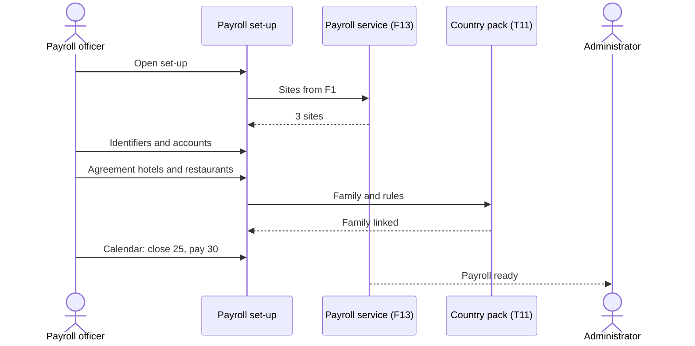

🏠 [Specs](../../../../README.md) › 🧩 [Functional capabilities](../../../README.md) ›
💶 [F13 Payroll (plugin)](../../README.md) › 📝 [Use cases](../README.md) › 📝 [Use cases: FL-F13-01 Set up](README.md) ›
📝 UC-F13-01 Set up the company's payroll

# 📝 UC-F13-01 Set up the company's payroll

**Status:** ✅ specified

## Summary

The payroll officer, with the administrator, sets up the company's payroll: its establishments with their contribution
accounts, the collective agreement of each, and the pay calendar, so that the first run can be computed.

## Personas

- [U45 Payroll officer](../../../../01-users/personas/u45-payroll-officer.md)
- [U07 Administrator](../../../../01-users/personas/u07-administrator.md)

## Goal

Every establishment ready for payroll with its accounts, agreement and calendar.

## Trigger

F13 activated (F21), or a new establishment opened.

## Frequency

Once per company, then once per new establishment.

## Preconditions

- The company and its sites exist (F1); F13 is activated.
- The country pack is installed (BR-F13-01).

## Postconditions

- Success: each establishment has its identifiers, contribution accounts, agreement family and pay calendar.
- Failure: the set-up stays incomplete and no run can start; the missing items are listed.

## Main flow

1. The payroll officer opens Payroll set-up (S-F13-01); SimpleERP lists the company's sites from F1 as candidate
   establishments.
2. For each establishment, the payroll officer enters its identifiers and contribution accounts (collector, tax office,
   pension and provident bodies).
3. The payroll officer chooses the collective agreement from the country pack's list; SimpleERP links its family
   (E-F13-23).
4. The payroll officer sets the pay calendar: inputs closing day, pay day, declaration day.
5. SimpleERP checks completeness and marks payroll ready; the administrator is told.

## Alternative flows

- 1a. Several establishments: each is set separately; one can copy another's accounts.
- 3a. The agreement is not in the country pack: the payroll officer is asked to name it; the run uses the general rules
  and the agreement is flagged as missing.

## Error flows

- 2e. An identifier fails its format check (CR-FR-001): refused with the expected format.
- 5e. A required account is missing: payroll stays "not ready" and the missing account is named.
- Any step: a service does not answer; the call is retried first (BR-F3-32), then the message follows the error pattern
  (D122) and what was typed stays on the screen.

## Business rules

- [BR-F13-01 Payroll follows the country pack](../../business-rules/br-f13-01-payroll-follows-the-country-pack.md)
- [BR-F13-05 Collective-agreement rules applied](../../business-rules/br-f13-05-agreement-rules-applied.md)
- [BR-F13-24 Agreement family rules dated and complete](../../business-rules/br-f13-24-agreement-family-rules-dated-and-complete.md)

## Entities

- [E-F13-01 Payroll establishment](../../data/e-f13-01-payroll-establishment.md)
- [E-F13-23 Agreement family](../../data/e-f13-23-agreement-family.md)

## Permissions

Payroll officer and administrator change the set-up; HR and the owner read it.

## Notifications

- The administrator is told when payroll is ready; payroll and the administrator when an agreement is missing.

## Audit events

Each establishment, account, agreement and calendar change, with who, when, old and new value.

## AI involvement

The AI assistant may pre-fill establishments from the company's identifiers and suggest the agreement from the activity
code, for the payroll officer to confirm.

## API, MCP and A2A exposure

Through T5 and T6 with the caller's rights (BR-F3-34).

## Screens

- [S-F13-01 Payroll set-up](../../screens/01-set-up/s-f13-01-payroll-set-up.md)

## Flowchart

See [FL-F13-01 Set up](../../flows/fl-f13-01-set-up.md#flowchart).

## Sequence diagram

## Acceptance criteria

1. **Given** the restaurant example company with 3 sites **when** the payroll officer sets each with its accounts,
   agreement and calendar **then** payroll is marked ready and the administrator is told.
2. **Given** an establishment identifier of 13 digits **when** it is saved **then** it is refused with the 14-digit
   format expected.
3. **Given** an agreement not in the country pack **when** it is named **then** it is flagged as missing and the general
   rules apply.
4. **Given** the collector account missing **when** completeness is checked **then** payroll stays "not ready" and names
   the account.

## Non-functional notes

D408's targets ([Performance](../../../../05-non-functional/performance.md)): 95 % of screens within 1 second; lists
paged on the server, the first page within 1 second; reports within 5 seconds or in the background.

## Regulatory references

Payroll rules of the France country pack:
[CR-FR-182 The payslip](../../../../10-country-packs/france/payroll/cr-fr-182-payslip.md),
[CR-FR-183 Monthly social declaration (DSN)](../../../../10-country-packs/france/payroll/cr-fr-183-dsn-monthly-declaration.md),
[CR-FR-184 Withholding tax on wages](../../../../10-country-packs/france/payroll/cr-fr-184-withholding-tax.md),
[CR-FR-185 Minimum wage (SMIC)](../../../../10-country-packs/france/payroll/cr-fr-185-minimum-wage.md),
[CR-FR-186 End-of-contract documents](../../../../10-country-packs/france/payroll/cr-fr-186-end-of-contract-documents.md),
[CR-FR-187 Equal-pay index](../../../../10-country-packs/france/payroll/cr-fr-187-equal-pay-index.md),
[CR-FR-042 Working time and rest](../../../../10-country-packs/france/labour/cr-fr-042-working-time-and-rest.md),
[CR-FR-043 Overtime](../../../../10-country-packs/france/labour/cr-fr-043-overtime.md),
[CR-FR-044 Paid leave](../../../../10-country-packs/france/labour/cr-fr-044-paid-leave.md),
[CR-FR-047 HR records retention](../../../../10-country-packs/france/labour/cr-fr-047-hr-records-retention.md),
[CR-FR-023 SEPA payment formats](../../../../10-country-packs/france/payments/cr-fr-023-sepa-formats.md),
[CR-FR-114 Staff meals as a benefit in kind](../../../../10-country-packs/france/labour/cr-fr-114-staff-meals-benefit.md),
[CR-FR-112 Meal vouchers (titres-restaurant)](../../../../10-country-packs/france/payments/cr-fr-112-meal-vouchers.md).

## Related use cases

- [UC-F13-02 Set up employees' pay](uc-f13-02-set-up-employees-pay.md)
- [UC-F13-19 Update rates and rules from the country pack](../05-reports-and-rules/uc-f13-19-update-rates-and-rules-from-the-country-pack.md)
- [UC-F13-21 Enrol employees in health and provident schemes](../07-schemes-and-special-contracts/uc-f13-21-enrol-employees-in-health-and-provident-schemes.md)

## Open questions

None.

---

⬆️ [Up](README.md) · ➡️ [UC-F13-02 Set up employees' pay](uc-f13-02-set-up-employees-pay.md)
