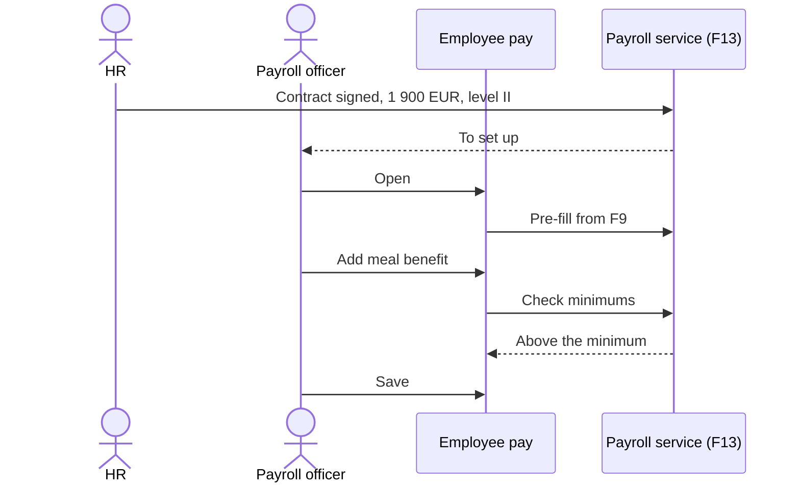

🏠 [Specs](../../../../README.md) › 🧩 [Functional capabilities](../../../README.md) ›
💶 [F13 Payroll (plugin)](../../README.md) › 📝 [Use cases](../README.md) › 📝 [Use cases: FL-F13-01 Set up](README.md) ›
📝 UC-F13-02 Set up employees' pay

# 📝 UC-F13-02 Set up employees' pay

**Status:** ✅ specified

## Summary

The payroll officer, with HR, sets each employee's pay from their F9 contract: salary, classification and pay elements,
checked against the agreement's minimum.

## Personas

- [U45 Payroll officer](../../../../01-users/personas/u45-payroll-officer.md)
- [U06 HR](../../../../01-users/personas/u06-hr.md)

## Goal

Every employee's pay profile complete and at least the agreement's minimum before their first run.

## Trigger

A contract signed or changed in F9.

## Frequency

At each hire or contract change; about 10 a month for the home-care example company.

## Preconditions

- Payroll set-up is ready (UC-F13-01).
- The contract exists in F9 with its hours, salary and classification.

## Postconditions

- Success: a pay profile with salary, classification and pay elements, used by the next run.
- Failure: the employee is held out of the run, listed as "to set up".

## Main flow

1. HR signs the contract in F9; the employee appears in "To set up" on Employee pay (S-F13-02).
2. The payroll officer opens the employee; simple-ERP pre-fills hours, salary and classification from the contract.
3. The payroll officer adds the pay elements: bonuses, benefits, special regime if any.
4. simple-ERP checks the salary against the agreement's minimum for the classification and the minimum wage.
5. The payroll officer saves; the profile is used from the contract's start date.

## Alternative flows

- 2a. Part time: the hours and the minimum are prorated.
- 3a. A special contract (apprentice, intern, officer): the payroll officer goes to UC-F13-22 or UC-F13-23.

## Error flows

- 4e. Below the agreement's minimum: refused with the minimum shown (BR-F13-05).
- 4e2. Below the minimum wage for the hours: refused (BR-F13-04).
- Any step: a service does not answer; the call is retried first (BR-F3-32), then the message follows the error pattern
  (D122) and what was typed stays on the screen.

## Business rules

- [BR-F13-05 Collective-agreement rules applied](../../business-rules/br-f13-05-agreement-rules-applied.md)
- [BR-F13-04 Never below the minimum wage](../../business-rules/br-f13-04-never-below-the-minimum-wage.md)
- [BR-F13-12 Payroll data restricted](../../business-rules/br-f13-12-payroll-data-restricted.md)

## Entities

- [E-F13-02 Employee pay profile](../../data/e-f13-02-employee-pay-profile.md)

## Permissions

Payroll officer edits; HR reads and changes contracts in F9; the employee reads their own profile.

## Notifications

- The payroll officer is told of each new or changed contract.

## Audit events

Profile created and changed, with who, when, old and new values.

## AI involvement

The AI assistant may list employees with incomplete profiles and explain a refusal; it never sets a salary.

## API, MCP and A2A exposure

Through T5 and T6 with the caller's rights (BR-F3-34).

## Screens

- [S-F13-02 Employee pay](../../screens/01-set-up/s-f13-02-employee-pay.md)

## Flowchart

See [FL-F13-01 Set up](../../flows/fl-f13-01-set-up.md#flowchart).

## Sequence diagram

## Acceptance criteria

1. **Given** a cook hired at 1 900.00 EUR for 35 hours at level II **when** the payroll officer saves **then** the
   profile is used from the contract's start.
2. **Given** a salary 40.00 EUR below the agreement's minimum **when** it is saved **then** it is refused and the
   minimum is shown.
3. **Given** a part-time contract of 24 hours **when** the profile is checked **then** the minimum is prorated to 24
   hours.
4. **Given** an apprentice contract **when** it is opened **then** the payroll officer is sent to Special contracts.

## Non-functional notes

D408's targets ([Performance](../../../../05-non-functional/performance.md)): 95 % of screens within 1 second; lists
paged on the server, the first page within 1 second; reports within 5 seconds or in the background.

## Regulatory references

Payroll rules of the France country pack:
[CR-FR-182 The payslip](../../../../10-country-packs/france/payroll/cr-fr-182-payslip.md),
[CR-FR-183 Monthly social declaration (DSN)](../../../../10-country-packs/france/payroll/cr-fr-183-dsn-monthly-declaration.md),
[CR-FR-184 Withholding tax on wages](../../../../10-country-packs/france/payroll/cr-fr-184-withholding-tax.md),
[CR-FR-185 Minimum wage (SMIC)](../../../../10-country-packs/france/payroll/cr-fr-185-minimum-wage.md),
[CR-FR-186 End-of-contract documents](../../../../10-country-packs/france/payroll/cr-fr-186-end-of-contract-documents.md),
[CR-FR-187 Equal-pay index](../../../../10-country-packs/france/payroll/cr-fr-187-equal-pay-index.md),
[CR-FR-042 Working time and rest](../../../../10-country-packs/france/labour/cr-fr-042-working-time-and-rest.md),
[CR-FR-043 Overtime](../../../../10-country-packs/france/labour/cr-fr-043-overtime.md),
[CR-FR-044 Paid leave](../../../../10-country-packs/france/labour/cr-fr-044-paid-leave.md),
[CR-FR-047 HR records retention](../../../../10-country-packs/france/labour/cr-fr-047-hr-records-retention.md),
[CR-FR-023 SEPA payment formats](../../../../10-country-packs/france/payments/cr-fr-023-sepa-formats.md),
[CR-FR-114 Staff meals as a benefit in kind](../../../../10-country-packs/france/labour/cr-fr-114-staff-meals-benefit.md),
[CR-FR-112 Meal vouchers (titres-restaurant)](../../../../10-country-packs/france/payments/cr-fr-112-meal-vouchers.md).

## Related use cases

- [UC-F13-01 Set up the company's payroll](uc-f13-01-set-up-the-company-s-payroll.md)
- [UC-F13-22 Pay an apprentice or an intern](../07-schemes-and-special-contracts/uc-f13-22-pay-an-apprentice-or-an-intern.md)
- [UC-F13-21 Enrol employees in health and provident schemes](../07-schemes-and-special-contracts/uc-f13-21-enrol-employees-in-health-and-provident-schemes.md)

## Open questions

None.

---

⬅️ [UC-F13-01 Set up the company's payroll](uc-f13-01-set-up-the-company-s-payroll.md) · ⬆️ [Up](README.md) ·
➡️ [UC-F13-03 Collect pay inputs from F9](../02-monthly-pay-run/uc-f13-03-collect-pay-inputs-from-f9.md)
