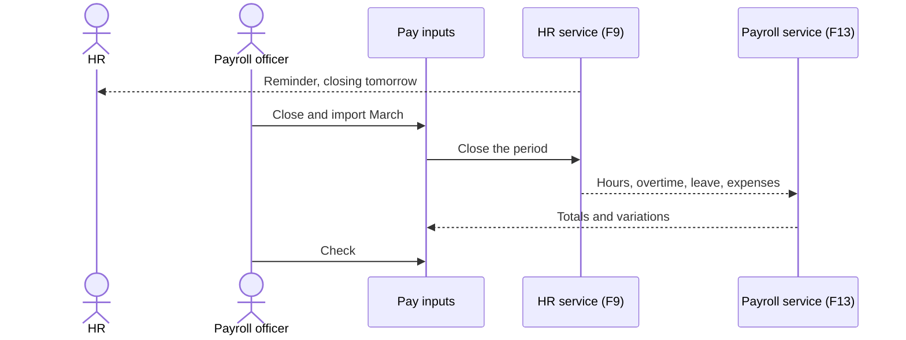

🏠 [Specs](../../../../README.md) › 🧩 [Functional capabilities](../../../README.md) ›
💶 [F13 Payroll (plugin)](../../README.md) › 📝 [Use cases](../README.md) ›
📝 [Use cases: FL-F13-02 Monthly pay run](README.md) › 📝 UC-F13-03 Collect pay inputs from F9

# 📝 UC-F13-03 Collect pay inputs from F9

**Status:** ✅ specified

## Summary

The payroll officer and HR close the period's inputs in F9 (time, overtime, leave, absences, expenses) and import them
into the pay run; inputs arriving after closing go to the next period.

## Personas

- [U45 Payroll officer](../../../../01-users/personas/u45-payroll-officer.md)
- [U06 HR](../../../../01-users/personas/u06-hr.md)

## Goal

Complete inputs for every employee before the run is computed.

## Trigger

The closing day of the pay calendar.

## Frequency

Monthly.

## Preconditions

- The period's time, leave and expenses are recorded in F9.

## Postconditions

- Success: pay inputs for each employee, closed for the period.
- Failure: the run cannot start; the employees with open inputs are listed.

## Main flow

1. The day before closing, HR and the payroll officer are reminded; HR checks the open items in F9.
2. On closing day the payroll officer opens Pay inputs (S-F13-03) and chooses "Close and import".
3. SimpleERP closes the period in F9 and imports each employee's hours, overtime, leave, absences and expenses.
4. The payroll officer checks the totals per employee and the variations from last month.
5. The inputs are ready for the computation (UC-F13-04).

## Alternative flows

- 3a. A late input after closing: it is accepted in the next period and shown as "carried" (BR-F13-03).
- 4a. Inputs from the rounds of the home-care sector (SC04): the travel and visits come with the hours.

## Error flows

- 2e. Some time sheets are not approved by managers: the payroll officer sees the list and can close anyway, the
  unapproved hours going to the next period.
- 3e. An expense without a receipt: imported as "to check" and not paid until cleared.
- Any step: a service does not answer; the call is retried first (BR-F3-32), then the message follows the error pattern
  (D122) and what was typed stays on the screen.

## Business rules

- [BR-F13-03 Inputs closed before the run](../../business-rules/br-f13-03-inputs-closed-before-the-run.md)

## Entities

- [E-F13-03 Pay input](../../data/e-f13-03-pay-input.md)

## Permissions

Payroll officer closes and imports; HR checks the inputs in F9; managers approve time in F9.

## Notifications

- HR and payroll the day before closing (inputs not closed).

## Audit events

Closing, import and every carried input, with who and when.

## AI involvement

The AI assistant may list the employees with open items before closing and draft reminders for managers.

## API, MCP and A2A exposure

Through T5 and T6 with the caller's rights (BR-F3-34).

## Screens

- [S-F13-03 Pay inputs](../../screens/02-monthly-pay-run/s-f13-03-pay-inputs.md)

## Flowchart

See [FL-F13-02 Monthly pay run](../../flows/fl-f13-02-monthly-pay-run.md#flowchart).

## Sequence diagram

## Acceptance criteria

1. **Given** closing day 25 March **when** the payroll officer closes and imports **then** each employee's hours,
   overtime, leave and expenses of March are in the run.
2. **Given** a leave entered on 27 March **when** it arrives **then** it is carried to April and shown as carried.
3. **Given** 3 time sheets not approved **when** the payroll officer closes **then** their hours go to April and the
   list is shown.
4. **Given** an expense of 42.00 EUR with no receipt **when** imported **then** it is "to check" and not paid.

## Non-functional notes

D408's targets ([Performance](../../../../05-non-functional/performance.md)): 95 % of screens within 1 second; lists
paged on the server, the first page within 1 second; reports within 5 seconds or in the background.

## Regulatory references

Payroll rules of the France country pack:
[CR-FR-182 The payslip](../../../../10-country-packs/france/payroll/cr-fr-182-payslip.md),
[CR-FR-183 Monthly social declaration (DSN)](../../../../10-country-packs/france/payroll/cr-fr-183-dsn-monthly-declaration.md),
[CR-FR-184 Withholding tax on wages](../../../../10-country-packs/france/payroll/cr-fr-184-withholding-tax.md),
[CR-FR-185 Minimum wage (SMIC)](../../../../10-country-packs/france/payroll/cr-fr-185-minimum-wage.md),
[CR-FR-186 End-of-contract documents](../../../../10-country-packs/france/payroll/cr-fr-186-end-of-contract-documents.md),
[CR-FR-187 Equal-pay index](../../../../10-country-packs/france/payroll/cr-fr-187-equal-pay-index.md),
[CR-FR-042 Working time and rest](../../../../10-country-packs/france/labour/cr-fr-042-working-time-and-rest.md),
[CR-FR-043 Overtime](../../../../10-country-packs/france/labour/cr-fr-043-overtime.md),
[CR-FR-044 Paid leave](../../../../10-country-packs/france/labour/cr-fr-044-paid-leave.md),
[CR-FR-047 HR records retention](../../../../10-country-packs/france/labour/cr-fr-047-hr-records-retention.md),
[CR-FR-023 SEPA payment formats](../../../../10-country-packs/france/payments/cr-fr-023-sepa-formats.md),
[CR-FR-114 Staff meals as a benefit in kind](../../../../10-country-packs/france/labour/cr-fr-114-staff-meals-benefit.md),
[CR-FR-112 Meal vouchers (titres-restaurant)](../../../../10-country-packs/france/payments/cr-fr-112-meal-vouchers.md).

## Related use cases

- [UC-F13-04 Compute gross to net](uc-f13-04-compute-gross-to-net.md)
- [UC-F13-31 Apply the home-help agreement](../09-collective-agreements-by-family/uc-f13-31-apply-the-home-help-agreement.md)

## Open questions

None.

---

⬅️ [UC-F13-02 Set up employees' pay](../01-set-up/uc-f13-02-set-up-employees-pay.md) · ⬆️ [Up](README.md) ·
➡️ [UC-F13-04 Compute gross to net](uc-f13-04-compute-gross-to-net.md)
