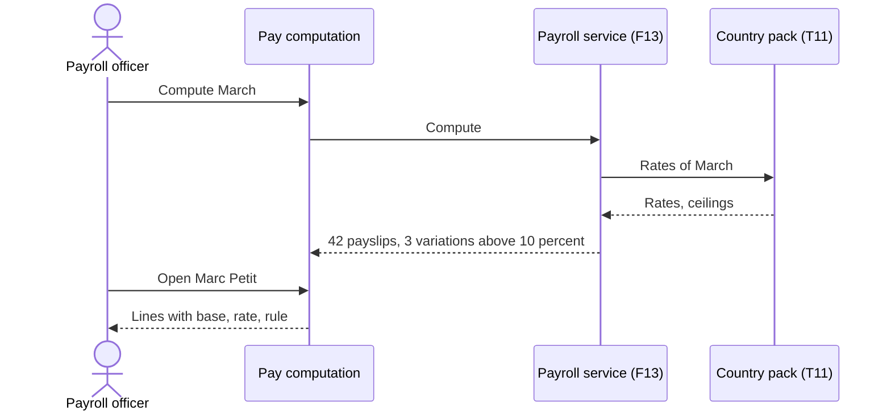

🏠 [Specs](../../../../README.md) › 🧩 [Functional capabilities](../../../README.md) ›
💶 [F13 Payroll (plugin)](../../README.md) › 📝 [Use cases](../README.md) ›
📝 [Use cases: FL-F13-02 Monthly pay run](README.md) › 📝 UC-F13-04 Compute gross to net

# 📝 UC-F13-04 Compute gross to net

**Status:** ✅ specified

## Summary

The payroll officer computes every employee's gross to net for the period with the country pack's rates in force,
reviews the variations and explains them, and the run is blocked when a pay falls below the minimum wage.

## Personas

- [U45 Payroll officer](../../../../01-users/personas/u45-payroll-officer.md)

## Goal

A correct gross, contributions and net for every employee.

## Trigger

The inputs are closed (UC-F13-03).

## Frequency

Monthly; also for corrections and simulations.

## Preconditions

- Inputs are closed; rate sets for the period exist (BR-F13-02).

## Postconditions

- Success: payslip lines for each employee; the run is ready for checks.
- Failure: the run stays a draft with the blocking employees listed.

## Main flow

1. The payroll officer opens Pay computation (S-F13-04) and chooses "Compute".
2. SimpleERP computes gross from the profile and inputs, then each contribution with the rates and ceilings of the
   period.
3. SimpleERP applies the agreement rules (UC-F13-05), the withholding (UC-F13-06), and the deductions of FL-F13-08.
4. The payroll officer reviews the variations from last month, sorted by size.
5. The payroll officer opens a payslip and sees each line with its base, rate and the rule behind it.

## Alternative flows

- 2a. The social security ceiling is crossed over several months: the regularisation is computed across the months.

## Error flows

- 2e. A pay below the minimum wage for the hours: the run is blocked for that employee (BR-F13-04).
- 2e2. A rate set is missing for the period: the run stays a draft; the administrator is warned.
- Any step: a service does not answer; the call is retried first (BR-F3-32), then the message follows the error pattern
  (D122) and what was typed stays on the screen.

## Business rules

- [BR-F13-02 Rates dated by period](../../business-rules/br-f13-02-rates-dated-by-period.md)
- [BR-F13-04 Never below the minimum wage](../../business-rules/br-f13-04-never-below-the-minimum-wage.md)
- [BR-F13-12 Payroll data restricted](../../business-rules/br-f13-12-payroll-data-restricted.md)
- [BR-F13-01 Payroll follows the country pack](../../business-rules/br-f13-01-payroll-follows-the-country-pack.md)

## Entities

- [E-F13-04 Payslip line](../../data/e-f13-04-payslip-line.md)

## Permissions

Payroll officer only.

## Notifications

- Payroll at once when anomalies appear.

## Audit events

Computation runs with the rate sets used, and every manual line, with who and when.

## AI involvement

The AI assistant may explain a variation ("why is Marc's net 120 EUR lower") with the lines behind it; it never edits a
line.

## API, MCP and A2A exposure

Through T5 and T6 with the caller's rights (BR-F3-34).

## Screens

- [S-F13-04 Pay computation](../../screens/02-monthly-pay-run/s-f13-04-pay-computation.md)

## Flowchart

See [FL-F13-02 Monthly pay run](../../flows/fl-f13-02-monthly-pay-run.md#flowchart).

## Sequence diagram

## Acceptance criteria

1. **Given** a gross of 3 400.00 EUR in March 2026 **when** the run is computed **then** the old-age line uses the rate
   of March and shows its base and rate.
2. **Given** a part-timer paid 11.90 EUR an hour **when** the run is computed **then** the run is blocked for them as
   below 12.31 EUR.
3. **Given** a rate set missing for the period **when** the run starts **then** it stays a draft and the administrator
   is warned.
4. **Given** Marc's net 120.00 EUR lower than February **when** the payroll officer opens the variation **then** the
   lines that changed are shown.

## Non-functional notes

D408's targets ([Performance](../../../../05-non-functional/performance.md)): 95 % of screens within 1 second; lists
paged on the server, the first page within 1 second; reports within 5 seconds or in the background.

## Regulatory references

Payroll rules of the France country pack:
[CR-FR-182 The payslip](../../../../10-country-packs/france/payroll/cr-fr-182-payslip.md),
[CR-FR-183 Monthly social declaration (DSN)](../../../../10-country-packs/france/payroll/cr-fr-183-dsn-monthly-declaration.md),
[CR-FR-184 Withholding tax on wages](../../../../10-country-packs/france/payroll/cr-fr-184-withholding-tax.md),
[CR-FR-185 Minimum wage (SMIC)](../../../../10-country-packs/france/payroll/cr-fr-185-minimum-wage.md),
[CR-FR-186 End-of-contract documents](../../../../10-country-packs/france/payroll/cr-fr-186-end-of-contract-documents.md),
[CR-FR-187 Equal-pay index](../../../../10-country-packs/france/payroll/cr-fr-187-equal-pay-index.md),
[CR-FR-042 Working time and rest](../../../../10-country-packs/france/labour/cr-fr-042-working-time-and-rest.md),
[CR-FR-043 Overtime](../../../../10-country-packs/france/labour/cr-fr-043-overtime.md),
[CR-FR-044 Paid leave](../../../../10-country-packs/france/labour/cr-fr-044-paid-leave.md),
[CR-FR-047 HR records retention](../../../../10-country-packs/france/labour/cr-fr-047-hr-records-retention.md),
[CR-FR-023 SEPA payment formats](../../../../10-country-packs/france/payments/cr-fr-023-sepa-formats.md),
[CR-FR-114 Staff meals as a benefit in kind](../../../../10-country-packs/france/labour/cr-fr-114-staff-meals-benefit.md),
[CR-FR-112 Meal vouchers (titres-restaurant)](../../../../10-country-packs/france/payments/cr-fr-112-meal-vouchers.md).

## Related use cases

- [UC-F13-03 Collect pay inputs from F9](uc-f13-03-collect-pay-inputs-from-f9.md)
- [UC-F13-05 Apply collective-agreement rules](uc-f13-05-apply-collective-agreement-rules.md)
- [UC-F13-07 Check and approve the pay run](uc-f13-07-check-and-approve-the-pay-run.md)

## Open questions

None.

---

⬅️ [UC-F13-03 Collect pay inputs from F9](uc-f13-03-collect-pay-inputs-from-f9.md) · ⬆️ [Up](README.md) ·
➡️ [UC-F13-05 Apply collective-agreement rules](uc-f13-05-apply-collective-agreement-rules.md)
