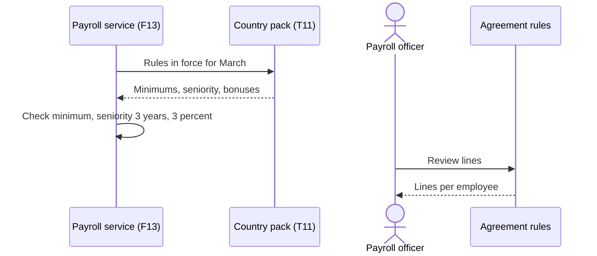

🏠 [Specs](../../../../README.md) › 🧩 [Functional capabilities](../../../README.md) ›
💶 [F13 Payroll (plugin)](../../README.md) › 📝 [Use cases](../README.md) ›
📝 [Use cases: FL-F13-02 Monthly pay run](README.md) › 📝 UC-F13-05 Apply collective-agreement rules

# 📝 UC-F13-05 Apply collective-agreement rules

**Status:** ✅ specified

## Summary

In the monthly run, SimpleERP applies the general rules of each employee's collective agreement (minimum per
classification, seniority bonus, other bonuses and their bases), dated by period; the rules of each agreement family are
in UC-F13-30 to UC-F13-33.

## Personas

- [U45 Payroll officer](../../../../01-users/personas/u45-payroll-officer.md)

## Goal

No employee paid below their agreement, and bonuses computed on the right bases.

## Trigger

The computation of the run (UC-F13-04).

## Frequency

Monthly.

## Preconditions

- Each establishment has its agreement (UC-F13-01) and each employee their classification.

## Postconditions

- Success: agreement lines on each payslip.
- Failure: the employee is flagged and the run cannot be approved for them.

## Main flow

1. During the computation, SimpleERP reads the agreement rules in force for the period (S-F13-05).
2. SimpleERP checks each employee's base pay against the minimum of their classification.
3. SimpleERP computes the seniority bonus from the hire date and the other bonuses of the agreement.
4. SimpleERP adds the family's own rules (UC-F13-30 to UC-F13-33).
5. The payroll officer reviews the agreement lines per employee.

## Alternative flows

- 2a. A change of classification during the month: the new minimum applies from its date, prorated.

## Error flows

- 1e. A rule is missing for the period: flagged, the run stays a draft (BR-F13-24).
- 2e. Below the classification's minimum: the employee is flagged and blocks approval.
- Any step: a service does not answer; the call is retried first (BR-F3-32), then the message follows the error pattern
  (D122) and what was typed stays on the screen.

## Business rules

- [BR-F13-05 Collective-agreement rules applied](../../business-rules/br-f13-05-agreement-rules-applied.md)
- [BR-F13-24 Agreement family rules dated and complete](../../business-rules/br-f13-24-agreement-family-rules-dated-and-complete.md)

## Entities

- [E-F13-04 Payslip line](../../data/e-f13-04-payslip-line.md)
- [E-F13-23 Agreement family](../../data/e-f13-23-agreement-family.md)

## Permissions

Payroll officer.

## Notifications

- Payroll and administrator when a rule is missing.

## Audit events

The agreement and rule set used for each run and employee.

## AI involvement

The AI assistant may explain a bonus line to the employee; it never changes a rule.

## API, MCP and A2A exposure

Through T5 and T6 with the caller's rights (BR-F3-34).

## Screens

- [S-F13-05 Agreement rules](../../screens/02-monthly-pay-run/s-f13-05-agreement-rules.md)

## Flowchart

See [FL-F13-02 Monthly pay run](../../flows/fl-f13-02-monthly-pay-run.md#flowchart).

## Sequence diagram

## Acceptance criteria

1. **Given** an employee with 3 years of seniority and an agreement giving 3 % **when** the run is computed **then** a
   seniority bonus of 3 % of the base appears.
2. **Given** a promotion from level II to level III on 15 March **when** the run is computed **then** the minimum of
   level III applies from 15 March.
3. **Given** a base 20.00 EUR below the classification's minimum **when** the run is computed **then** the employee is
   flagged and blocks approval.
4. **Given** the agreement's March rules missing **when** the run starts **then** it stays a draft.

## Non-functional notes

D408's targets ([Performance](../../../../05-non-functional/performance.md)): 95 % of screens within 1 second; lists
paged on the server, the first page within 1 second; reports within 5 seconds or in the background.

## Regulatory references

Payroll rules of the France country pack:
[CR-FR-182 The payslip](../../../../10-country-packs/france/payroll/cr-fr-182-payslip.md),
[CR-FR-183 Monthly social declaration (DSN)](../../../../10-country-packs/france/payroll/cr-fr-183-dsn-monthly-declaration.md),
[CR-FR-184 Withholding tax on wages](../../../../10-country-packs/france/payroll/cr-fr-184-withholding-tax.md),
[CR-FR-185 Minimum wage (SMIC)](../../../../10-country-packs/france/payroll/cr-fr-185-minimum-wage.md),
[CR-FR-186 End-of-contract documents](../../../../10-country-packs/france/payroll/cr-fr-186-end-of-contract-documents.md),
[CR-FR-187 Equal-pay index](../../../../10-country-packs/france/payroll/cr-fr-187-equal-pay-index.md),
[CR-FR-042 Working time and rest](../../../../10-country-packs/france/labour/cr-fr-042-working-time-and-rest.md),
[CR-FR-043 Overtime](../../../../10-country-packs/france/labour/cr-fr-043-overtime.md),
[CR-FR-044 Paid leave](../../../../10-country-packs/france/labour/cr-fr-044-paid-leave.md),
[CR-FR-047 HR records retention](../../../../10-country-packs/france/labour/cr-fr-047-hr-records-retention.md),
[CR-FR-023 SEPA payment formats](../../../../10-country-packs/france/payments/cr-fr-023-sepa-formats.md),
[CR-FR-114 Staff meals as a benefit in kind](../../../../10-country-packs/france/labour/cr-fr-114-staff-meals-benefit.md),
[CR-FR-112 Meal vouchers (titres-restaurant)](../../../../10-country-packs/france/payments/cr-fr-112-meal-vouchers.md).

## Related use cases

- [UC-F13-30 Apply the hotels-and-restaurants agreement](../09-collective-agreements-by-family/uc-f13-30-apply-the-hotels-and-restaurants-agreement.md)
- [UC-F13-31 Apply the home-help agreement](../09-collective-agreements-by-family/uc-f13-31-apply-the-home-help-agreement.md)
- [UC-F13-32 Apply the Syntec agreement](../09-collective-agreements-by-family/uc-f13-32-apply-the-syntec-agreement.md)
- [UC-F13-33 Apply the construction agreements](../09-collective-agreements-by-family/uc-f13-33-apply-the-construction-agreements.md)

## Open questions

None.

---

⬅️ [UC-F13-04 Compute gross to net](uc-f13-04-compute-gross-to-net.md) · ⬆️ [Up](README.md) ·
➡️ [UC-F13-06 Apply withholding tax](uc-f13-06-apply-withholding-tax.md)
