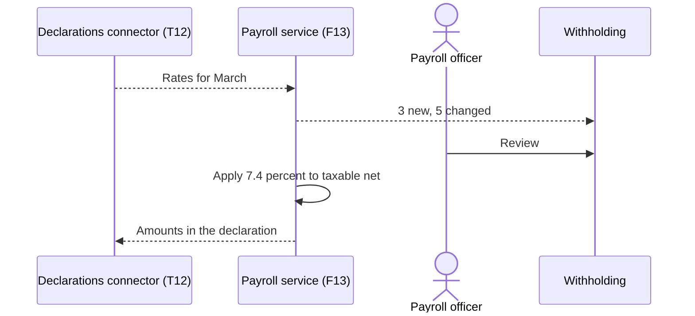

🏠 [Specs](../../../../README.md) › 🧩 [Functional capabilities](../../../README.md) ›
💶 [F13 Payroll (plugin)](../../README.md) › 📝 [Use cases](../README.md) ›
📝 [Use cases: FL-F13-02 Monthly pay run](README.md) › 📝 UC-F13-06 Apply withholding tax

# 📝 UC-F13-06 Apply withholding tax

**Status:** ✅ specified

## Summary

simple-ERP imports the withholding rates the tax office sends, applies each employee's rate (or the neutral rate without
one) to the taxable net, and the amounts go into the monthly declaration.

## Personas

- [U45 Payroll officer](../../../../01-users/personas/u45-payroll-officer.md)

## Goal

Tax withheld at the rate in force for each employee.

## Trigger

Rates received through the declaration's return; the run's computation.

## Frequency

Monthly.

## Preconditions

- The previous declarations are filed so that rates come back (UC-F13-10).

## Postconditions

- Success: a withholding line per employee and the amounts in the declaration.
- Failure: the neutral rate applies and the employee is flagged.

## Main flow

1. simple-ERP receives the rates returned for the period and shows them on Withholding (S-F13-06).
2. The payroll officer sees the new and changed rates.
3. During the computation simple-ERP applies each rate to the taxable net (BR-F13-06).
4. The withheld amounts go to the declaration (UC-F13-10) and are paid with it (UC-F13-12).

## Alternative flows

- 1a. A new employee with no rate yet: the neutral rate by the scale applies.

## Error flows

- 1e. A rate older than 60 days: still applied, flagged for the payroll officer.
- 1e2. The rate file is not received: last month's rates apply and the payroll officer is warned.
- Any step: a service does not answer; the call is retried first (BR-F3-32), then the message follows the error pattern
  (D122) and what was typed stays on the screen.

## Business rules

- [BR-F13-06 Withholding at the sent rate](../../business-rules/br-f13-06-withholding-at-the-sent-rate.md)
- [BR-F13-12 Payroll data restricted](../../business-rules/br-f13-12-payroll-data-restricted.md)

## Entities

- [E-F13-05 Withholding rate](../../data/e-f13-05-withholding-rate.md)

## Permissions

Payroll officer; rates are never edited by hand.

## Notifications

- Payroll when rates are received or late.

## Audit events

Rate received, applied, with its date and the employee.

## AI involvement

The AI assistant may explain to an employee why their rate changed; it never changes a rate.

## API, MCP and A2A exposure

Through T5 and T6 with the caller's rights (BR-F3-34).

## Screens

- [S-F13-06 Withholding](../../screens/02-monthly-pay-run/s-f13-06-withholding.md)

## Flowchart

See [FL-F13-02 Monthly pay run](../../flows/fl-f13-02-monthly-pay-run.md#flowchart).

## Sequence diagram

## Acceptance criteria

1. **Given** Sophie Bernard's rate of 7.4 % received on 3 March **when** March is computed **then** 7.4 % of her taxable
   net is withheld.
2. **Given** a new employee with no rate **when** the run is computed **then** the neutral rate applies.
3. **Given** a rate received 75 days ago **when** the run is computed **then** it is applied and flagged.
4. **Given** no rate file received this month **when** the run is computed **then** February's rates apply and payroll
   is warned.

## Non-functional notes

D408's targets ([Performance](../../../../05-non-functional/performance.md)): 95 % of screens within 1 second; lists
paged on the server, the first page within 1 second; reports within 5 seconds or in the background.

## Regulatory references

Payroll rules of the France country pack:
[CR-FR-182 The payslip](../../../../10-country-packs/france/payroll/cr-fr-182-payslip.md),
[CR-FR-183 Monthly social declaration (DSN)](../../../../10-country-packs/france/payroll/cr-fr-183-dsn-monthly-declaration.md),
[CR-FR-184 Withholding tax on wages](../../../../10-country-packs/france/payroll/cr-fr-184-withholding-tax.md),
[CR-FR-185 Minimum wage (SMIC)](../../../../10-country-packs/france/payroll/cr-fr-185-minimum-wage.md),
[CR-FR-186 End-of-contract documents](../../../../10-country-packs/france/payroll/cr-fr-186-end-of-contract-documents.md),
[CR-FR-187 Equal-pay index](../../../../10-country-packs/france/payroll/cr-fr-187-equal-pay-index.md),
[CR-FR-042 Working time and rest](../../../../10-country-packs/france/labour/cr-fr-042-working-time-and-rest.md),
[CR-FR-043 Overtime](../../../../10-country-packs/france/labour/cr-fr-043-overtime.md),
[CR-FR-044 Paid leave](../../../../10-country-packs/france/labour/cr-fr-044-paid-leave.md),
[CR-FR-047 HR records retention](../../../../10-country-packs/france/labour/cr-fr-047-hr-records-retention.md),
[CR-FR-023 SEPA payment formats](../../../../10-country-packs/france/payments/cr-fr-023-sepa-formats.md),
[CR-FR-114 Staff meals as a benefit in kind](../../../../10-country-packs/france/labour/cr-fr-114-staff-meals-benefit.md),
[CR-FR-112 Meal vouchers (titres-restaurant)](../../../../10-country-packs/france/payments/cr-fr-112-meal-vouchers.md).

## Related use cases

- [UC-F13-04 Compute gross to net](uc-f13-04-compute-gross-to-net.md)
- [UC-F13-10 File the monthly social declaration and handle returns](../03-declarations-and-payments/uc-f13-10-file-the-monthly-social-declaration-and-handle-returns.md)

## Open questions

None.

---

⬅️ [UC-F13-05 Apply collective-agreement rules](uc-f13-05-apply-collective-agreement-rules.md) · ⬆️ [Up](README.md) ·
➡️ [UC-F13-07 Check and approve the pay run](uc-f13-07-check-and-approve-the-pay-run.md)
