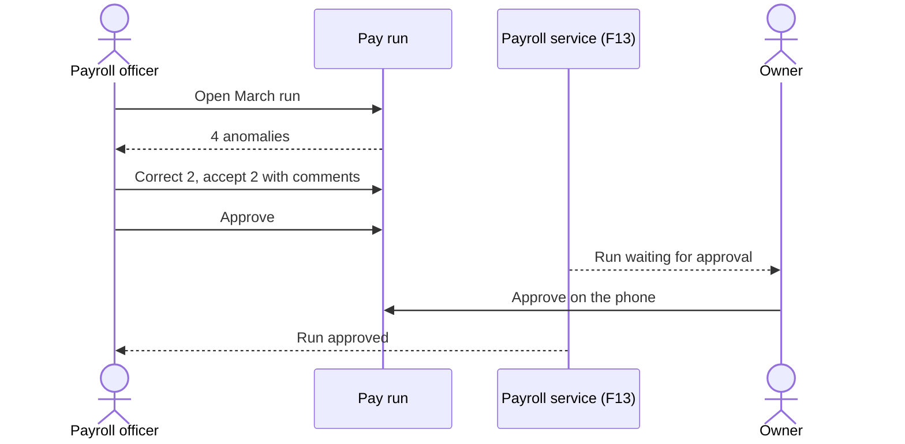

🏠 [Specs](../../../../README.md) › 🧩 [Functional capabilities](../../../README.md) ›
💶 [F13 Payroll (plugin)](../../README.md) › 📝 [Use cases](../README.md) ›
📝 [Use cases: FL-F13-02 Monthly pay run](README.md) › 📝 UC-F13-07 Check and approve the pay run

# 📝 UC-F13-07 Check and approve the pay run

**Status:** ✅ specified

## Summary

The payroll officer reviews the run's anomalies (variations, negative nets, missing inputs, minimum wage), clears or
accepts each, and approves; the owner approves as second approver.

## Personas

- [U45 Payroll officer](../../../../01-users/personas/u45-payroll-officer.md)
- [U13 Owner](../../../../01-users/personas/u13-owner.md)

## Goal

An approved run with every anomaly explained.

## Trigger

The computation is done (UC-F13-04).

## Frequency

Monthly.

## Preconditions

- The run is computed.

## Postconditions

- Success: the run is approved; payslips and transfers can be issued.
- Failure: the run stays computed with its open anomalies.

## Main flow

1. The payroll officer opens the pay run (S-F13-07); SimpleERP lists the anomalies by severity.
2. For each, the payroll officer opens the employee, corrects the cause or accepts it with a comment.
3. When none is open, the payroll officer approves.
4. The owner is notified and approves as second approver, on desktop or phone.
5. The run is approved; payslips (UC-F13-08) and transfers (UC-F13-09) can start.

## Alternative flows

- 4a. No second approver is set: the payroll officer's approval is enough.
- 4b. The owner refuses with a comment: the run returns to the payroll officer.

## Error flows

- 3e. An anomaly is open: approval is refused (BR-F13-07).
- 2e. An employee below the minimum wage cannot be accepted: it must be corrected (BR-F13-04).
- Any step: a service does not answer; the call is retried first (BR-F3-32), then the message follows the error pattern
  (D122) and what was typed stays on the screen.

## Business rules

- [BR-F13-07 Anomalies checked before approval](../../business-rules/br-f13-07-anomalies-checked-before-approval.md)
- [BR-F13-04 Never below the minimum wage](../../business-rules/br-f13-04-never-below-the-minimum-wage.md)

## Entities

- [E-F13-06 Pay run](../../data/e-f13-06-pay-run.md)

## Permissions

Payroll officer approves first; the owner is second approver.

## Notifications

- Payroll at once on anomalies; the owner when the run waits for approval.

## Audit events

Each anomaly cleared or accepted with its comment, each approval or refusal, with who and when.

## AI involvement

The AI assistant may summarise the run for the owner (totals, top variations) before approval; it never approves.

## API, MCP and A2A exposure

Through T5 and T6 with the caller's rights (BR-F3-34).

## Screens

- [S-F13-07 Pay run](../../screens/02-monthly-pay-run/s-f13-07-pay-run.md)

## Flowchart

See [FL-F13-02 Monthly pay run](../../flows/fl-f13-02-monthly-pay-run.md#flowchart).

## Sequence diagram

## Acceptance criteria

1. **Given** a run with 4 anomalies **when** 2 are corrected and 2 accepted with comments **then** the payroll officer
   can approve.
2. **Given** one anomaly open **when** the payroll officer approves **then** approval is refused.
3. **Given** the payroll officer's approval **when** the owner approves on the phone **then** the run is approved and
   transfers can be prepared.
4. **Given** the owner refuses with "check overtime" **when** refused **then** the run returns to the payroll officer
   with the comment.

## Non-functional notes

D408's targets ([Performance](../../../../05-non-functional/performance.md)): 95 % of screens within 1 second; lists
paged on the server, the first page within 1 second; reports within 5 seconds or in the background.

## Regulatory references

Payroll rules of the France country pack:
[CR-FR-182 The payslip](../../../../10-country-packs/france/payroll/cr-fr-182-payslip.md),
[CR-FR-183 Monthly social declaration (DSN)](../../../../10-country-packs/france/payroll/cr-fr-183-dsn-monthly-declaration.md),
[CR-FR-184 Withholding tax on wages](../../../../10-country-packs/france/payroll/cr-fr-184-withholding-tax.md),
[CR-FR-185 Minimum wage (SMIC)](../../../../10-country-packs/france/payroll/cr-fr-185-minimum-wage.md),
[CR-FR-186 End-of-contract documents](../../../../10-country-packs/france/payroll/cr-fr-186-end-of-contract-documents.md),
[CR-FR-187 Equal-pay index](../../../../10-country-packs/france/payroll/cr-fr-187-equal-pay-index.md),
[CR-FR-042 Working time and rest](../../../../10-country-packs/france/labour/cr-fr-042-working-time-and-rest.md),
[CR-FR-043 Overtime](../../../../10-country-packs/france/labour/cr-fr-043-overtime.md),
[CR-FR-044 Paid leave](../../../../10-country-packs/france/labour/cr-fr-044-paid-leave.md),
[CR-FR-047 HR records retention](../../../../10-country-packs/france/labour/cr-fr-047-hr-records-retention.md),
[CR-FR-023 SEPA payment formats](../../../../10-country-packs/france/payments/cr-fr-023-sepa-formats.md),
[CR-FR-114 Staff meals as a benefit in kind](../../../../10-country-packs/france/labour/cr-fr-114-staff-meals-benefit.md),
[CR-FR-112 Meal vouchers (titres-restaurant)](../../../../10-country-packs/france/payments/cr-fr-112-meal-vouchers.md).

## Related use cases

- [UC-F13-04 Compute gross to net](uc-f13-04-compute-gross-to-net.md)
- [UC-F13-08 Issue clarified payslips digitally](uc-f13-08-issue-clarified-payslips-digitally.md)
- [UC-F13-09 Pay employees by SEPA transfer](../03-declarations-and-payments/uc-f13-09-pay-employees-by-sepa-transfer.md)

## Open questions

None.

---

⬅️ [UC-F13-06 Apply withholding tax](uc-f13-06-apply-withholding-tax.md) · ⬆️ [Up](README.md) ·
➡️ [UC-F13-08 Issue clarified payslips digitally](uc-f13-08-issue-clarified-payslips-digitally.md)
