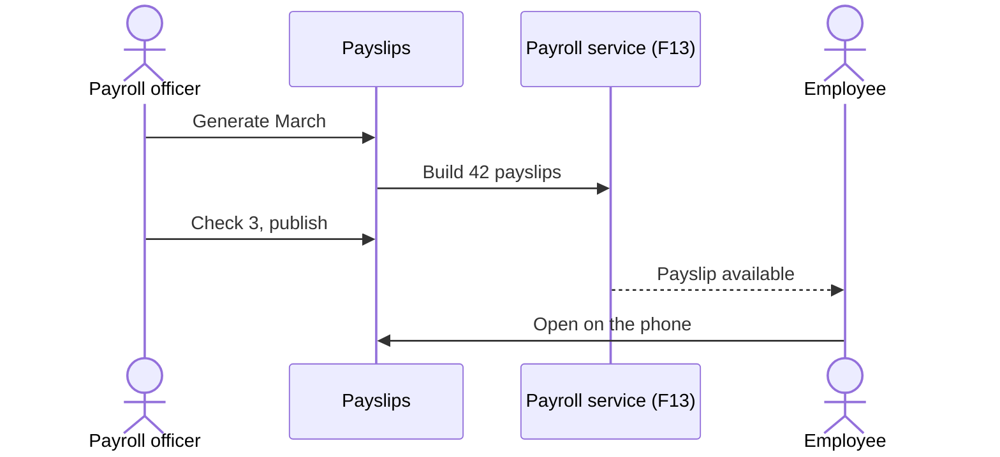

🏠 [Specs](../../../../README.md) › 🧩 [Functional capabilities](../../../README.md) ›
💶 [F13 Payroll (plugin)](../../README.md) › 📝 [Use cases](../README.md) ›
📝 [Use cases: FL-F13-02 Monthly pay run](README.md) › 📝 UC-F13-08 Issue clarified payslips digitally

# 📝 UC-F13-08 Issue clarified payslips digitally

**Status:** ✅ specified

## Summary

Once the run is approved, SimpleERP generates the clarified payslips and publishes them in each employee's space;
employees who refused digital delivery receive paper.

## Personas

- [U45 Payroll officer](../../../../01-users/personas/u45-payroll-officer.md)
- [U01 Employee](../../../../01-users/personas/u01-employee.md)

## Goal

Every employee has their payslip on pay day, in the legal format.

## Trigger

The run is approved (UC-F13-07).

## Frequency

Monthly.

## Preconditions

- The run is approved.

## Postconditions

- Success: payslips published and kept for the legal period (BR-F13-13).
- Failure: the payslips stay generated, not published.

## Main flow

1. The payroll officer opens Payslips (S-F13-08) and chooses "Generate".
2. SimpleERP produces each payslip in the clarified format with the net social amount (BR-F13-08).
3. The payroll officer checks a sample and publishes.
4. Each employee is notified and reads their payslip in their space, on the phone or desktop.

## Alternative flows

- 3a. An employee refused digital delivery: a PDF is printed for paper delivery.

## Error flows

- 4e. The employee has no account: the payslip waits in their space and paper is printed.
- Any step: a service does not answer; the call is retried first (BR-F3-32), then the message follows the error pattern
  (D122) and what was typed stays on the screen.

## Business rules

- [BR-F13-08 Payslip in the legal format](../../business-rules/br-f13-08-payslip-in-the-legal-format.md)
- [BR-F13-13 Payslips kept](../../business-rules/br-f13-13-payslips-kept.md)
- [BR-F13-12 Payroll data restricted](../../business-rules/br-f13-12-payroll-data-restricted.md)

## Entities

- [E-F13-07 Payslip](../../data/e-f13-07-payslip.md)

## Permissions

Payroll officer generates and publishes; each employee reads only their own.

## Notifications

- Each employee when their payslip is available (email, push).

## Audit events

Generation, publication, each opening by the employee.

## AI involvement

The AI assistant may explain a line to the employee (UC-F13-20).

## API, MCP and A2A exposure

Through T5 and T6 with the caller's rights (BR-F3-34).

## Screens

- [S-F13-08 Payslips](../../screens/02-monthly-pay-run/s-f13-08-payslips.md)

## Flowchart

See [FL-F13-02 Monthly pay run](../../flows/fl-f13-02-monthly-pay-run.md#flowchart).

## Sequence diagram

## Acceptance criteria

1. **Given** the March run approved **when** the payroll officer publishes **then** 42 employees are notified and see
   their payslip with the net social amount.
2. **Given** an employee who refused digital delivery **when** published **then** a paper copy is printed for them.
3. **Given** an employee **when** they open the payslips **then** they see only their own.
4. **Given** a payslip published **when** anyone opens it **then** the opening is logged.

## Non-functional notes

D408's targets ([Performance](../../../../05-non-functional/performance.md)): 95 % of screens within 1 second; lists
paged on the server, the first page within 1 second; reports within 5 seconds or in the background.

## Regulatory references

Payroll rules of the France country pack:
[CR-FR-182 The payslip](../../../../10-country-packs/france/payroll/cr-fr-182-payslip.md),
[CR-FR-183 Monthly social declaration (DSN)](../../../../10-country-packs/france/payroll/cr-fr-183-dsn-monthly-declaration.md),
[CR-FR-184 Withholding tax on wages](../../../../10-country-packs/france/payroll/cr-fr-184-withholding-tax.md),
[CR-FR-185 Minimum wage (SMIC)](../../../../10-country-packs/france/payroll/cr-fr-185-minimum-wage.md),
[CR-FR-186 End-of-contract documents](../../../../10-country-packs/france/payroll/cr-fr-186-end-of-contract-documents.md),
[CR-FR-187 Equal-pay index](../../../../10-country-packs/france/payroll/cr-fr-187-equal-pay-index.md),
[CR-FR-042 Working time and rest](../../../../10-country-packs/france/labour/cr-fr-042-working-time-and-rest.md),
[CR-FR-043 Overtime](../../../../10-country-packs/france/labour/cr-fr-043-overtime.md),
[CR-FR-044 Paid leave](../../../../10-country-packs/france/labour/cr-fr-044-paid-leave.md),
[CR-FR-047 HR records retention](../../../../10-country-packs/france/labour/cr-fr-047-hr-records-retention.md),
[CR-FR-023 SEPA payment formats](../../../../10-country-packs/france/payments/cr-fr-023-sepa-formats.md),
[CR-FR-114 Staff meals as a benefit in kind](../../../../10-country-packs/france/labour/cr-fr-114-staff-meals-benefit.md),
[CR-FR-112 Meal vouchers (titres-restaurant)](../../../../10-country-packs/france/payments/cr-fr-112-meal-vouchers.md).

## Related use cases

- [UC-F13-07 Check and approve the pay run](uc-f13-07-check-and-approve-the-pay-run.md)
- [UC-F13-20 Ask the AI assistant about pay](../06-assistant/uc-f13-20-ask-the-assistant-about-pay.md)

## Open questions

None.

---

⬅️ [UC-F13-07 Check and approve the pay run](uc-f13-07-check-and-approve-the-pay-run.md) · ⬆️ [Up](README.md) ·
➡️ [UC-F13-09](../03-declarations-and-payments/uc-f13-09-pay-employees-by-sepa-transfer.md)
