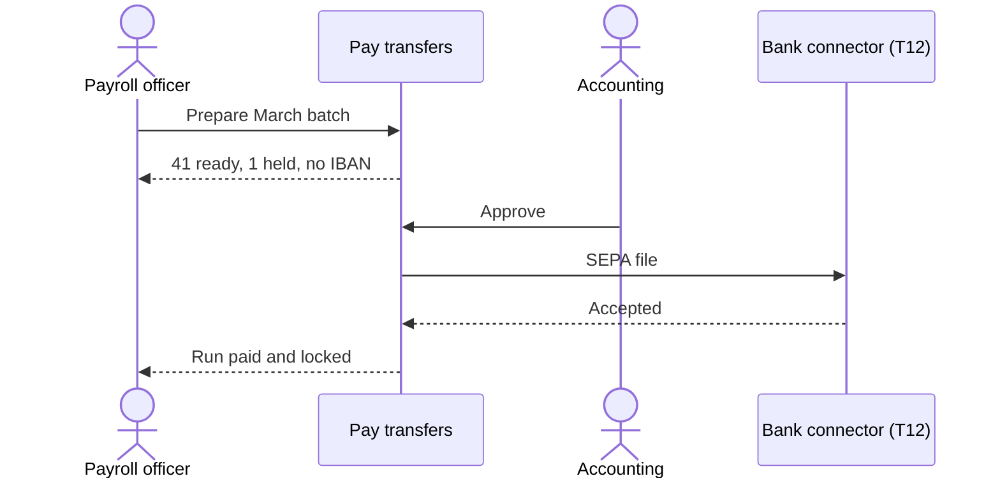

🏠 [Specs](../../../../README.md) › 🧩 [Functional capabilities](../../../README.md) ›
💶 [F13 Payroll (plugin)](../../README.md) › 📝 [Use cases](../README.md) ›
📝 [Use cases: FL-F13-03 Declarations and payments](README.md) › 📝 UC-F13-09 Pay employees by SEPA transfer

# 📝 UC-F13-09 Pay employees by SEPA transfer

**Status:** ✅ specified

## Summary

The payroll officer prepares the SEPA transfers of the net pay, advances and garnishments of an approved run; accounting
approves and sends the file to the bank, and the run is locked once paid.

## Personas

- [U45 Payroll officer](../../../../01-users/personas/u45-payroll-officer.md)
- [U05 Accounting](../../../../01-users/personas/u05-accounting.md)

## Goal

Every employee paid on pay day; the run locked.

## Trigger

The run is approved.

## Frequency

Monthly, plus advances.

## Preconditions

- The run is approved; each employee has a valid IBAN.

## Postconditions

- Success: transfers sent; the run is paid and locked (BR-F13-10).
- Failure: the file is not sent; the held transfers are listed.

## Main flow

1. The payroll officer opens Pay transfers (S-F13-09) and prepares the batch.
2. simple-ERP builds the SEPA file with net pays, advances (UC-F13-27) and payments to creditors (UC-F13-26).
3. Accounting reviews and approves; the owner approves above the company's threshold.
4. simple-ERP sends the file through the bank connector and marks the run paid and locked.

## Alternative flows

- 2a. An advance on pay: it is a separate transfer in the next batch.

## Error flows

- 2e. An IBAN is missing or invalid: that transfer is held; the others go.
- 4e. The bank refuses the file: shown with the reason; the run stays approved, not paid.
- Any step: a service does not answer; the call is retried first (BR-F3-32), then the message follows the error pattern
  (D122) and what was typed stays on the screen.

## Business rules

- [BR-F13-10 Pay run locked after payment](../../business-rules/br-f13-10-pay-run-locked-after-payment.md)
- [BR-F13-20 Advances recovered from the next pay](../../business-rules/br-f13-20-advances-recovered-from-the-next-pay.md)
- [BR-F13-19 Garnishment within the attachable portion](../../business-rules/br-f13-19-garnishment-within-the-attachable-portion.md)

## Entities

- [E-F13-08 Pay transfer](../../data/e-f13-08-pay-transfer.md)
- [E-F13-20 Pay advance](../../data/e-f13-20-pay-advance.md)
- [E-F13-19 Garnishment](../../data/e-f13-19-garnishment.md)

## Permissions

Payroll officer prepares; accounting approves and sends; the owner approves above the threshold.

## Notifications

- Accounting when a batch waits for approval; payroll when the bank accepts or refuses.

## Audit events

Batch prepared, approved, sent, accepted or refused, with amounts and who.

## AI involvement

None beyond explaining a held transfer.

## API, MCP and A2A exposure

Through T5 and T6 with the caller's rights (BR-F3-34).

## Screens

- [S-F13-09 Pay transfers](../../screens/03-declarations-and-payments/s-f13-09-pay-transfers.md)

## Flowchart

See [FL-F13-03 Declarations and payments](../../flows/fl-f13-03-declarations-and-payments.md#flowchart).

## Sequence diagram

## Acceptance criteria

1. **Given** 42 employees and one without IBAN **when** the batch is prepared **then** 41 transfers are in the file and
   one is held.
2. **Given** the file accepted by the bank **when** it is sent **then** the run is marked paid and cannot be edited.
3. **Given** an advance of 300.00 EUR approved **when** the next batch is built **then** it holds the 300.00 EUR
   transfer.
4. **Given** the bank refuses the file **when** it answers **then** the run stays approved with the reason shown.

## Non-functional notes

D408's targets ([Performance](../../../../05-non-functional/performance.md)): 95 % of screens within 1 second; lists
paged on the server, the first page within 1 second; reports within 5 seconds or in the background.

## Regulatory references

Payroll rules of the France country pack:
[CR-FR-182 The payslip](../../../../10-country-packs/france/payroll/cr-fr-182-payslip.md),
[CR-FR-183 Monthly social declaration (DSN)](../../../../10-country-packs/france/payroll/cr-fr-183-dsn-monthly-declaration.md),
[CR-FR-184 Withholding tax on wages](../../../../10-country-packs/france/payroll/cr-fr-184-withholding-tax.md),
[CR-FR-185 Minimum wage (SMIC)](../../../../10-country-packs/france/payroll/cr-fr-185-minimum-wage.md),
[CR-FR-186 End-of-contract documents](../../../../10-country-packs/france/payroll/cr-fr-186-end-of-contract-documents.md),
[CR-FR-187 Equal-pay index](../../../../10-country-packs/france/payroll/cr-fr-187-equal-pay-index.md),
[CR-FR-042 Working time and rest](../../../../10-country-packs/france/labour/cr-fr-042-working-time-and-rest.md),
[CR-FR-043 Overtime](../../../../10-country-packs/france/labour/cr-fr-043-overtime.md),
[CR-FR-044 Paid leave](../../../../10-country-packs/france/labour/cr-fr-044-paid-leave.md),
[CR-FR-047 HR records retention](../../../../10-country-packs/france/labour/cr-fr-047-hr-records-retention.md),
[CR-FR-023 SEPA payment formats](../../../../10-country-packs/france/payments/cr-fr-023-sepa-formats.md),
[CR-FR-114 Staff meals as a benefit in kind](../../../../10-country-packs/france/labour/cr-fr-114-staff-meals-benefit.md),
[CR-FR-112 Meal vouchers (titres-restaurant)](../../../../10-country-packs/france/payments/cr-fr-112-meal-vouchers.md).

## Related use cases

- [UC-F13-07 Check and approve the pay run](../02-monthly-pay-run/uc-f13-07-check-and-approve-the-pay-run.md)
- [UC-F13-27 Grant a pay advance](../08-deductions-savings-and-leave-pay/uc-f13-27-grant-a-pay-advance.md)
- [UC-F13-26 Apply a wage garnishment](../08-deductions-savings-and-leave-pay/uc-f13-26-apply-a-wage-garnishment.md)

## Open questions

None.

---

⬅️ [UC-F13-08](../02-monthly-pay-run/uc-f13-08-issue-clarified-payslips-digitally.md) · ⬆️ [Up](README.md) ·
➡️ [UC-F13-10](uc-f13-10-file-the-monthly-social-declaration-and-handle-returns.md)
