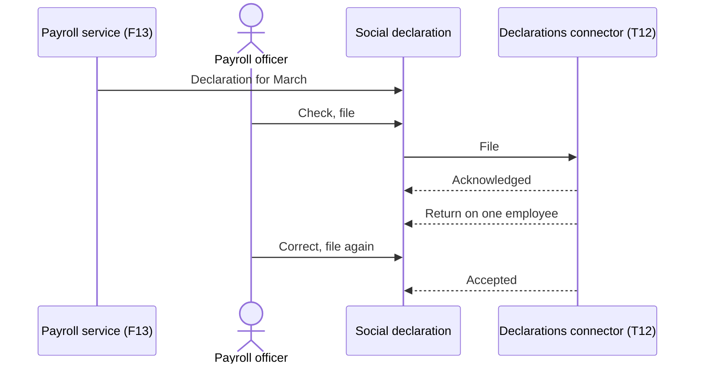

🏠 [Specs](../../../../README.md) › 🧩 [Functional capabilities](../../../README.md) ›
💶 [F13 Payroll (plugin)](../../README.md) › 📝 [Use cases](../README.md) ›
📝 [Use cases: FL-F13-03 Declarations and payments](README.md) ›
📝 UC-F13-10 File the monthly social declaration and handle returns

# 📝 UC-F13-10 File the monthly social declaration and handle returns

**Status:** ✅ specified

## Summary

The payroll officer files the monthly social declaration built from the paid run, follows its acceptance and handles its
returns, and files event declarations (sick leave, end of contract) within their delays.

## Personas

- [U45 Payroll officer](../../../../01-users/personas/u45-payroll-officer.md)

## Goal

Every declaration accepted by its deadline.

## Trigger

The run is paid; an event happens.

## Frequency

Monthly, plus events.

## Preconditions

- The run is paid.

## Postconditions

- Success: the declaration is accepted.
- Failure: the declaration is rejected or returned; the deadline stays visible.

## Main flow

1. SimpleERP builds the declaration from the paid run (S-F13-10).
2. The payroll officer checks the control report and files it through the connector (T12).
3. SimpleERP tracks the acknowledgement and the returns.
4. For each return, the payroll officer sees the reason and the employee or block concerned and corrects it.
5. The declaration is accepted; the deadline is met (BR-F13-09).

## Alternative flows

- 1a. An event declaration (sick leave, end of contract) is filed separately within its delay.
- 2a. Special regimes are filed to their own bodies (UC-F13-24, UC-F13-25).

## Error flows

- 2e. The declaration is rejected: corrected in a new filing before the deadline.
- 3e. The deadline is near with no acknowledgement: the payroll officer is warned.
- Any step: a service does not answer; the call is retried first (BR-F3-32), then the message follows the error pattern
  (D122) and what was typed stays on the screen.

## Business rules

- [BR-F13-09 Declaration by the deadline](../../business-rules/br-f13-09-declaration-by-the-deadline.md)
- [BR-F13-18 Special regimes declared to their own bodies](../../business-rules/br-f13-18-special-regimes-declared-to-their-own-bodies.md)

## Entities

- [E-F13-09 Social declaration](../../data/e-f13-09-social-declaration.md)

## Permissions

Payroll officer files; accounting and the owner read the state.

## Notifications

- Payroll before the deadline and at once when rejected.

## Audit events

Built, filed, acknowledged, returned, accepted, with who and when.

## AI involvement

The AI assistant may explain a return in plain words and point to the line to fix; it never files.

## API, MCP and A2A exposure

Through T5 and T6 with the caller's rights (BR-F3-34).

## Screens

- [S-F13-10 Social declaration](../../screens/03-declarations-and-payments/s-f13-10-social-declaration.md)

## Flowchart

See [FL-F13-03 Declarations and payments](../../flows/fl-f13-03-declarations-and-payments.md#flowchart).

## Sequence diagram

## Acceptance criteria

1. **Given** the March run paid **when** the payroll officer files on 5 April **then** the acknowledgement is shown.
2. **Given** a return on one employee's identifier **when** it arrives **then** the employee and the field are shown.
3. **Given** a rejection **when** the payroll officer corrects and files again before the deadline **then** the
   declaration is accepted.
4. **Given** 2 days to the deadline with no acknowledgement **when** the day comes **then** payroll is warned.

## Non-functional notes

D408's targets ([Performance](../../../../05-non-functional/performance.md)): 95 % of screens within 1 second; lists
paged on the server, the first page within 1 second; reports within 5 seconds or in the background.

## Regulatory references

Payroll rules of the France country pack:
[CR-FR-182 The payslip](../../../../10-country-packs/france/payroll/cr-fr-182-payslip.md),
[CR-FR-183 Monthly social declaration (DSN)](../../../../10-country-packs/france/payroll/cr-fr-183-dsn-monthly-declaration.md),
[CR-FR-184 Withholding tax on wages](../../../../10-country-packs/france/payroll/cr-fr-184-withholding-tax.md),
[CR-FR-185 Minimum wage (SMIC)](../../../../10-country-packs/france/payroll/cr-fr-185-minimum-wage.md),
[CR-FR-186 End-of-contract documents](../../../../10-country-packs/france/payroll/cr-fr-186-end-of-contract-documents.md),
[CR-FR-187 Equal-pay index](../../../../10-country-packs/france/payroll/cr-fr-187-equal-pay-index.md),
[CR-FR-042 Working time and rest](../../../../10-country-packs/france/labour/cr-fr-042-working-time-and-rest.md),
[CR-FR-043 Overtime](../../../../10-country-packs/france/labour/cr-fr-043-overtime.md),
[CR-FR-044 Paid leave](../../../../10-country-packs/france/labour/cr-fr-044-paid-leave.md),
[CR-FR-047 HR records retention](../../../../10-country-packs/france/labour/cr-fr-047-hr-records-retention.md),
[CR-FR-023 SEPA payment formats](../../../../10-country-packs/france/payments/cr-fr-023-sepa-formats.md),
[CR-FR-114 Staff meals as a benefit in kind](../../../../10-country-packs/france/labour/cr-fr-114-staff-meals-benefit.md),
[CR-FR-112 Meal vouchers (titres-restaurant)](../../../../10-country-packs/france/payments/cr-fr-112-meal-vouchers.md).

## Related use cases

- [UC-F13-09 Pay employees by SEPA transfer](uc-f13-09-pay-employees-by-sepa-transfer.md)
- [UC-F13-12 Pay contributions to the collectors](uc-f13-12-pay-contributions-to-the-collectors.md)
- [UC-F13-14 Handle sick leave and daily allowances](../04-events/uc-f13-14-handle-sick-leave-and-daily-allowances.md)

## Open questions

None.

---

⬅️ [UC-F13-09 Pay employees by SEPA transfer](uc-f13-09-pay-employees-by-sepa-transfer.md) · ⬆️ [Up](README.md) ·
➡️ [UC-F13-11 Correct a past month](uc-f13-11-correct-a-past-month.md)
