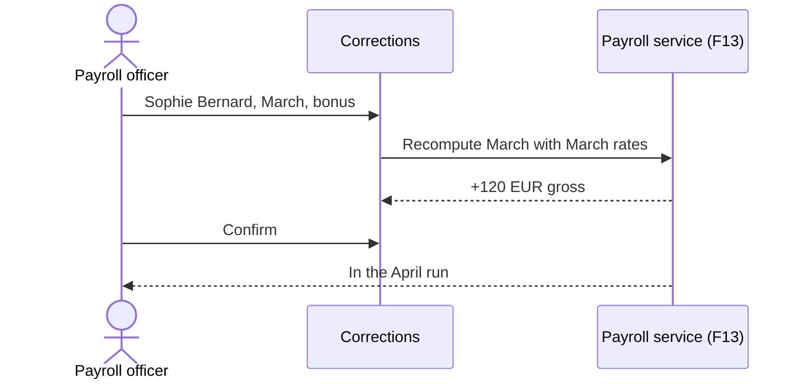

🏠 [Specs](../../../../README.md) › 🧩 [Functional capabilities](../../../README.md) ›
💶 [F13 Payroll (plugin)](../../README.md) › 📝 [Use cases](../README.md) ›
📝 [Use cases: FL-F13-03 Declarations and payments](README.md) › 📝 UC-F13-11 Correct a past month

# 📝 UC-F13-11 Correct a past month

**Status:** ✅ specified

## Summary

The payroll officer corrects an error in a past month in the next run, with that month's rates, and declares the
correction; the paid run itself is never changed.

## Personas

- [U45 Payroll officer](../../../../01-users/personas/u45-payroll-officer.md)

## Goal

The employee's pay right without reopening a locked run.

## Trigger

An error found after payment.

## Frequency

A few a month.

## Preconditions

- The past run is paid and locked (BR-F13-10).

## Postconditions

- Success: correction lines in the next run and in the next declaration.
- Failure: nothing changes; the correction stays a draft.

## Main flow

1. The payroll officer opens Corrections (S-F13-11) and chooses the employee, the month and the item.
2. simple-ERP recomputes that month with its rates (BR-F13-02) and shows the difference.
3. The payroll officer confirms; the difference waits for the next run.
4. The next run includes it as a correction line and the declaration carries it.

## Alternative flows

- 1a. Several months: each is recomputed with its own rates and listed.

## Error flows

- 2e. A month older than the rate sets kept: refused; the correction is entered by hand with a comment.
- Any step: a service does not answer; the call is retried first (BR-F3-32), then the message follows the error pattern
  (D122) and what was typed stays on the screen.

## Business rules

- [BR-F13-02 Rates dated by period](../../business-rules/br-f13-02-rates-dated-by-period.md)
- [BR-F13-10 Pay run locked after payment](../../business-rules/br-f13-10-pay-run-locked-after-payment.md)
- [BR-F13-12 Payroll data restricted](../../business-rules/br-f13-12-payroll-data-restricted.md)

## Entities

- [E-F13-10 Correction](../../data/e-f13-10-correction.md)

## Permissions

Payroll officer.

## Notifications

- The employee is told of the correction on their next payslip.

## Audit events

Correction created with the month, item, difference, who and when.

## AI involvement

The AI assistant may draft the correction from a described error, for the payroll officer to confirm.

## API, MCP and A2A exposure

Through T5 and T6 with the caller's rights (BR-F3-34).

## Screens

- [S-F13-11 Corrections](../../screens/03-declarations-and-payments/s-f13-11-corrections.md)

## Flowchart

See [FL-F13-03 Declarations and payments](../../flows/fl-f13-03-declarations-and-payments.md#flowchart).

## Sequence diagram

## Acceptance criteria

1. **Given** a forgotten bonus of 120.00 EUR for March **when** the correction is confirmed **then** the April payslip
   shows a March correction of 120.00 EUR gross.
2. **Given** corrections for January and February **when** recomputed **then** each uses its own month's rates.
3. **Given** a locked March run **when** someone opens it **then** it cannot be edited.
4. **Given** the correction **when** April is declared **then** it carries the correction.

## Non-functional notes

D408's targets ([Performance](../../../../05-non-functional/performance.md)): 95 % of screens within 1 second; lists
paged on the server, the first page within 1 second; reports within 5 seconds or in the background.

## Regulatory references

Payroll rules of the France country pack:
[CR-FR-182 The payslip](../../../../10-country-packs/france/payroll/cr-fr-182-payslip.md),
[CR-FR-183 Monthly social declaration (DSN)](../../../../10-country-packs/france/payroll/cr-fr-183-dsn-monthly-declaration.md),
[CR-FR-184 Withholding tax on wages](../../../../10-country-packs/france/payroll/cr-fr-184-withholding-tax.md),
[CR-FR-185 Minimum wage (SMIC)](../../../../10-country-packs/france/payroll/cr-fr-185-minimum-wage.md),
[CR-FR-186 End-of-contract documents](../../../../10-country-packs/france/payroll/cr-fr-186-end-of-contract-documents.md),
[CR-FR-187 Equal-pay index](../../../../10-country-packs/france/payroll/cr-fr-187-equal-pay-index.md),
[CR-FR-042 Working time and rest](../../../../10-country-packs/france/labour/cr-fr-042-working-time-and-rest.md),
[CR-FR-043 Overtime](../../../../10-country-packs/france/labour/cr-fr-043-overtime.md),
[CR-FR-044 Paid leave](../../../../10-country-packs/france/labour/cr-fr-044-paid-leave.md),
[CR-FR-047 HR records retention](../../../../10-country-packs/france/labour/cr-fr-047-hr-records-retention.md),
[CR-FR-023 SEPA payment formats](../../../../10-country-packs/france/payments/cr-fr-023-sepa-formats.md),
[CR-FR-114 Staff meals as a benefit in kind](../../../../10-country-packs/france/labour/cr-fr-114-staff-meals-benefit.md),
[CR-FR-112 Meal vouchers (titres-restaurant)](../../../../10-country-packs/france/payments/cr-fr-112-meal-vouchers.md).

## Related use cases

- [UC-F13-04 Compute gross to net](../02-monthly-pay-run/uc-f13-04-compute-gross-to-net.md)
- [UC-F13-10 File the monthly social declaration and handle returns](uc-f13-10-file-the-monthly-social-declaration-and-handle-returns.md)

## Open questions

None.

---

⬅️ [UC-F13-10](uc-f13-10-file-the-monthly-social-declaration-and-handle-returns.md) · ⬆️ [Up](README.md) ·
➡️ [UC-F13-12 Pay contributions to the collectors](uc-f13-12-pay-contributions-to-the-collectors.md)
