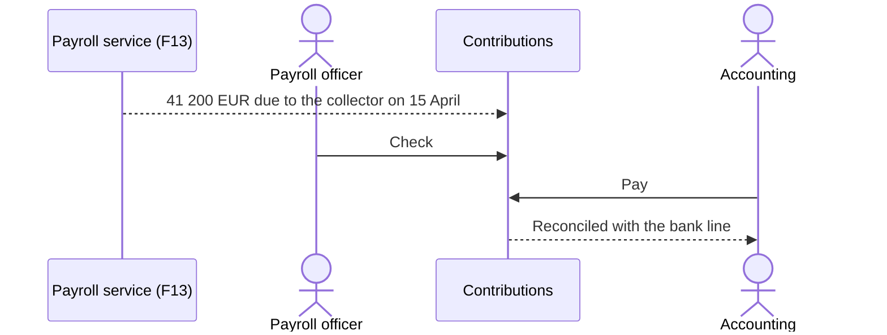

🏠 [Specs](../../../../README.md) › 🧩 [Functional capabilities](../../../README.md) ›
💶 [F13 Payroll (plugin)](../../README.md) › 📝 [Use cases](../README.md) ›
📝 [Use cases: FL-F13-03 Declarations and payments](README.md) › 📝 UC-F13-12 Pay contributions to the collectors

# 📝 UC-F13-12 Pay contributions to the collectors

**Status:** ✅ specified

## Summary

The payroll officer computes the contributions and withholding due to each collector for the period, accounting pays
them and reconciles them with the bank.

## Personas

- [U45 Payroll officer](../../../../01-users/personas/u45-payroll-officer.md)
- [U05 Accounting](../../../../01-users/personas/u05-accounting.md)

## Goal

Every collector paid by its due date.

## Trigger

The declaration is filed.

## Frequency

Monthly or quarterly per collector.

## Preconditions

- The declaration is filed (UC-F13-10).

## Postconditions

- Success: payments made and reconciled.
- Failure: amounts stay due; late penalties are computed.

## Main flow

1. SimpleERP lists the amounts due per collector and due date (S-F13-12).
2. The payroll officer checks them against the declaration.
3. Accounting pays by direct debit or transfer.
4. SimpleERP reconciles the payment with the bank line in F8.

## Alternative flows

- 1a. Quarterly withholding for small companies: due each quarter.
- 1b. The MSA or the performers' funds have their own due dates (UC-F13-25, UC-F13-24).

## Error flows

- 3e. Paid late: the penalty is computed and shown.
- Any step: a service does not answer; the call is retried first (BR-F3-32), then the message follows the error pattern
  (D122) and what was typed stays on the screen.

## Business rules

- [BR-F13-09 Declaration by the deadline](../../business-rules/br-f13-09-declaration-by-the-deadline.md)
- [BR-F13-18 Special regimes declared to their own bodies](../../business-rules/br-f13-18-special-regimes-declared-to-their-own-bodies.md)

## Entities

- [E-F13-11 Contribution payment](../../data/e-f13-11-contribution-payment.md)

## Permissions

Payroll officer computes; accounting pays; the owner reads.

## Notifications

- Accounting before each due date.

## Audit events

Amounts due, payments, reconciliation, with who and when.

## AI involvement

None beyond answering what is due.

## API, MCP and A2A exposure

Through T5 and T6 with the caller's rights (BR-F3-34).

## Screens

- [S-F13-12 Contributions](../../screens/03-declarations-and-payments/s-f13-12-contributions.md)

## Flowchart

See [FL-F13-03 Declarations and payments](../../flows/fl-f13-03-declarations-and-payments.md#flowchart).

## Sequence diagram

## Acceptance criteria

1. **Given** 41 200.00 EUR due on 15 April **when** accounting pays on 14 April **then** it is marked paid and
   reconciled.
2. **Given** a payment on 18 April **when** it is recorded **then** the penalty is computed.
3. **Given** a company with quarterly withholding **when** the quarter ends **then** the amount for the quarter is due.

## Non-functional notes

D408's targets ([Performance](../../../../05-non-functional/performance.md)): 95 % of screens within 1 second; lists
paged on the server, the first page within 1 second; reports within 5 seconds or in the background.

## Regulatory references

Payroll rules of the France country pack:
[CR-FR-182 The payslip](../../../../10-country-packs/france/payroll/cr-fr-182-payslip.md),
[CR-FR-183 Monthly social declaration (DSN)](../../../../10-country-packs/france/payroll/cr-fr-183-dsn-monthly-declaration.md),
[CR-FR-184 Withholding tax on wages](../../../../10-country-packs/france/payroll/cr-fr-184-withholding-tax.md),
[CR-FR-185 Minimum wage (SMIC)](../../../../10-country-packs/france/payroll/cr-fr-185-minimum-wage.md),
[CR-FR-186 End-of-contract documents](../../../../10-country-packs/france/payroll/cr-fr-186-end-of-contract-documents.md),
[CR-FR-187 Equal-pay index](../../../../10-country-packs/france/payroll/cr-fr-187-equal-pay-index.md),
[CR-FR-042 Working time and rest](../../../../10-country-packs/france/labour/cr-fr-042-working-time-and-rest.md),
[CR-FR-043 Overtime](../../../../10-country-packs/france/labour/cr-fr-043-overtime.md),
[CR-FR-044 Paid leave](../../../../10-country-packs/france/labour/cr-fr-044-paid-leave.md),
[CR-FR-047 HR records retention](../../../../10-country-packs/france/labour/cr-fr-047-hr-records-retention.md),
[CR-FR-023 SEPA payment formats](../../../../10-country-packs/france/payments/cr-fr-023-sepa-formats.md),
[CR-FR-114 Staff meals as a benefit in kind](../../../../10-country-packs/france/labour/cr-fr-114-staff-meals-benefit.md),
[CR-FR-112 Meal vouchers (titres-restaurant)](../../../../10-country-packs/france/payments/cr-fr-112-meal-vouchers.md).

## Related use cases

- [UC-F13-10 File the monthly social declaration and handle returns](uc-f13-10-file-the-monthly-social-declaration-and-handle-returns.md)
- [UC-F13-13 Post payroll entries to accounting](uc-f13-13-post-payroll-entries-to-accounting.md)

## Open questions

None.

---

⬅️ [UC-F13-11 Correct a past month](uc-f13-11-correct-a-past-month.md) · ⬆️ [Up](README.md) ·
➡️ [UC-F13-13 Post payroll entries to accounting](uc-f13-13-post-payroll-entries-to-accounting.md)
