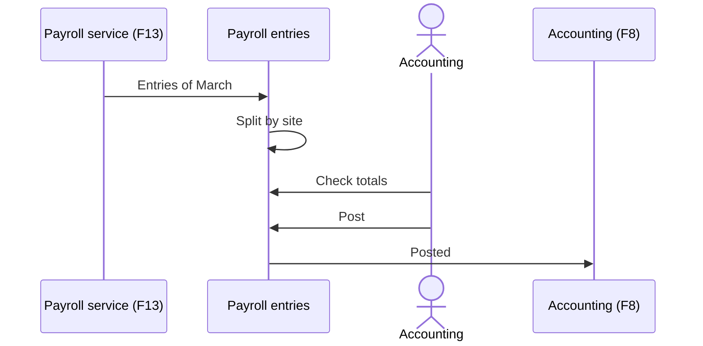

🏠 [Specs](../../../../README.md) › 🧩 [Functional capabilities](../../../README.md) ›
💶 [F13 Payroll (plugin)](../../README.md) › 📝 [Use cases](../README.md) ›
📝 [Use cases: FL-F13-03 Declarations and payments](README.md) › 📝 UC-F13-13 Post payroll entries to accounting

# 📝 UC-F13-13 Post payroll entries to accounting

**Status:** ✅ specified

## Summary

SimpleERP generates the payroll entries of each paid run, split by the analytic axes; accounting checks and posts them
to F8.

## Personas

- [U05 Accounting](../../../../01-users/personas/u05-accounting.md)
- [U45 Payroll officer](../../../../01-users/personas/u45-payroll-officer.md)

## Goal

Payroll in the books each month, with its analytic split.

## Trigger

The run is paid.

## Frequency

Monthly.

## Preconditions

- The run is paid; the payroll accounts are mapped.

## Postconditions

- Success: entries posted in F8.
- Failure: entries held; the missing account is named.

## Main flow

1. SimpleERP generates the entries of the run (S-F13-13).
2. It splits the costs by site and project (BR-F13-23, UC-F13-34).
3. Accounting checks the totals against the run.
4. Accounting posts; the entries become inalterable (CR-FR-003).

## Alternative flows

- 2a. No analytic axes used: the entries are posted without split.

## Error flows

- 1e. An account is missing in the mapping: the entries are held until it is set.
- Any step: a service does not answer; the call is retried first (BR-F3-32), then the message follows the error pattern
  (D122) and what was typed stays on the screen.

## Business rules

- [BR-F13-10 Pay run locked after payment](../../business-rules/br-f13-10-pay-run-locked-after-payment.md)
- [BR-F13-23 Payroll cost split by the analytic axes](../../business-rules/br-f13-23-payroll-cost-split-by-the-analytic-axes.md)

## Entities

- [E-F13-12 Payroll entry](../../data/e-f13-12-payroll-entry.md)
- [E-F13-24 Payroll cost allocation](../../data/e-f13-24-payroll-cost-allocation.md)

## Permissions

Accounting posts; the payroll officer reads.

## Notifications

- Accounting when the entries are ready.

## Audit events

Generation and posting, with who and when.

## AI involvement

The AI assistant may explain a payroll entry to accounting.

## API, MCP and A2A exposure

Through T5 and T6 with the caller's rights (BR-F3-34).

## Screens

- [S-F13-13 Payroll entries](../../screens/03-declarations-and-payments/s-f13-13-payroll-entries.md)

## Flowchart

See [FL-F13-03 Declarations and payments](../../flows/fl-f13-03-declarations-and-payments.md#flowchart).

## Sequence diagram

## Acceptance criteria

1. **Given** the March run paid with 182 000.00 EUR of gross **when** entries are generated **then** account 641 holds
   182 000.00 EUR split by site.
2. **Given** an account missing **when** generated **then** the entries are held and the account named.
3. **Given** posted entries **when** someone tries to change them **then** it is refused.

## Non-functional notes

D408's targets ([Performance](../../../../05-non-functional/performance.md)): 95 % of screens within 1 second; lists
paged on the server, the first page within 1 second; reports within 5 seconds or in the background.

## Regulatory references

Payroll rules of the France country pack:
[CR-FR-182 The payslip](../../../../10-country-packs/france/payroll/cr-fr-182-payslip.md),
[CR-FR-183 Monthly social declaration (DSN)](../../../../10-country-packs/france/payroll/cr-fr-183-dsn-monthly-declaration.md),
[CR-FR-184 Withholding tax on wages](../../../../10-country-packs/france/payroll/cr-fr-184-withholding-tax.md),
[CR-FR-185 Minimum wage (SMIC)](../../../../10-country-packs/france/payroll/cr-fr-185-minimum-wage.md),
[CR-FR-186 End-of-contract documents](../../../../10-country-packs/france/payroll/cr-fr-186-end-of-contract-documents.md),
[CR-FR-187 Equal-pay index](../../../../10-country-packs/france/payroll/cr-fr-187-equal-pay-index.md),
[CR-FR-042 Working time and rest](../../../../10-country-packs/france/labour/cr-fr-042-working-time-and-rest.md),
[CR-FR-043 Overtime](../../../../10-country-packs/france/labour/cr-fr-043-overtime.md),
[CR-FR-044 Paid leave](../../../../10-country-packs/france/labour/cr-fr-044-paid-leave.md),
[CR-FR-047 HR records retention](../../../../10-country-packs/france/labour/cr-fr-047-hr-records-retention.md),
[CR-FR-023 SEPA payment formats](../../../../10-country-packs/france/payments/cr-fr-023-sepa-formats.md),
[CR-FR-114 Staff meals as a benefit in kind](../../../../10-country-packs/france/labour/cr-fr-114-staff-meals-benefit.md),
[CR-FR-112 Meal vouchers (titres-restaurant)](../../../../10-country-packs/france/payments/cr-fr-112-meal-vouchers.md).

## Related use cases

- [UC-F13-34 Analyse payroll cost by site, project and analytic axis](../05-reports-and-rules/uc-f13-34-analyse-payroll-cost-by-site-project-and-analytic-axis.md)
- [UC-F13-12 Pay contributions to the collectors](uc-f13-12-pay-contributions-to-the-collectors.md)

## Open questions

None.

---

⬅️ [UC-F13-12 Pay contributions to the collectors](uc-f13-12-pay-contributions-to-the-collectors.md) ·
⬆️ [Up](README.md) · ➡️ [UC-F13-14](../04-events/uc-f13-14-handle-sick-leave-and-daily-allowances.md)
