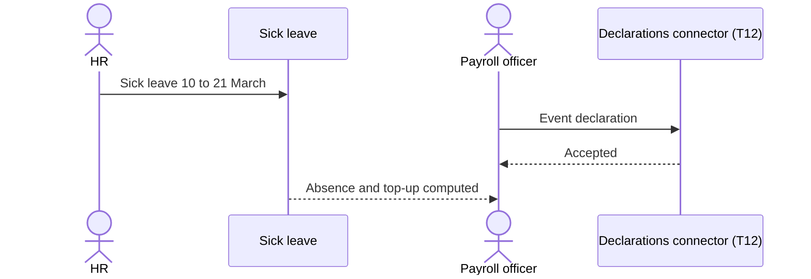

🏠 [Specs](../../../../README.md) › 🧩 [Functional capabilities](../../../README.md) ›
💶 [F13 Payroll (plugin)](../../README.md) › 📝 [Use cases](../README.md) › 📝 [Use cases: FL-F13-04 Events](README.md) ›
📝 UC-F13-14 Handle sick leave and daily allowances

# 📝 UC-F13-14 Handle sick leave and daily allowances

**Status:** ✅ specified

## Summary

The payroll officer records a sick leave from F9, files the event declaration so the employee receives daily allowances,
and applies the employer's top-up or the advance of allowances.

## Personas

- [U45 Payroll officer](../../../../01-users/personas/u45-payroll-officer.md)
- [U06 HR](../../../../01-users/personas/u06-hr.md)

## Goal

The employee paid right during sick leave and the allowances claimed.

## Trigger

A sick leave recorded in F9.

## Frequency

A few a month.

## Preconditions

- The sick leave is recorded with its dates and certificate.

## Postconditions

- Success: the event declared, the absence and top-up on the payslip.
- Failure: the event is late; an alert is shown.

## Main flow

1. HR records the sick leave in F9; it appears on Sick leave (S-F13-14).
2. The payroll officer files the event declaration within its delay.
3. SimpleERP computes the absence deduction and the top-up from the agreement.
4. When allowances arrive, SimpleERP reconciles them with the top-up.

## Alternative flows

- 3a. The employer advances the allowances (subrogation): the full pay is kept and the allowances come to the company.

## Error flows

- 2e. The event declaration is late: alert to the payroll officer.
- Any step: a service does not answer; the call is retried first (BR-F3-32), then the message follows the error pattern
  (D122) and what was typed stays on the screen.

## Business rules

- [BR-F13-09 Declaration by the deadline](../../business-rules/br-f13-09-declaration-by-the-deadline.md)
- [BR-F13-12 Payroll data restricted](../../business-rules/br-f13-12-payroll-data-restricted.md)

## Entities

- [E-F13-03 Pay input](../../data/e-f13-03-pay-input.md)
- [E-F13-13 Sick leave](../../data/e-f13-13-sick-leave.md)

## Permissions

Payroll officer; HR records in F9; managers never see the reason.

## Notifications

- Payroll at once on a new sick leave.

## Audit events

Event recorded, declared, allowances received, with who and when.

## AI involvement

The AI assistant may compute the expected top-up for HR; it never sees the medical reason.

## API, MCP and A2A exposure

Through T5 and T6 with the caller's rights (BR-F3-34).

## Screens

- [S-F13-14 Sick leave](../../screens/04-events/s-f13-14-sick-leave.md)

## Flowchart

See [FL-F13-04 Events](../../flows/fl-f13-04-events.md#flowchart).

## Sequence diagram

## Acceptance criteria

1. **Given** a sick leave from 10 to 21 March **when** the payroll officer files the event **then** it is accepted and
   the absence is on March's payslip.
2. **Given** subrogation **when** the run is computed **then** full pay is kept and allowances of 210.00 EUR are
   expected by the company.
3. **Given** a declaration not filed after its delay **when** the day passes **then** payroll is alerted.

## Non-functional notes

D408's targets ([Performance](../../../../05-non-functional/performance.md)): 95 % of screens within 1 second; lists
paged on the server, the first page within 1 second; reports within 5 seconds or in the background.

## Regulatory references

Payroll rules of the France country pack:
[CR-FR-182 The payslip](../../../../10-country-packs/france/payroll/cr-fr-182-payslip.md),
[CR-FR-183 Monthly social declaration (DSN)](../../../../10-country-packs/france/payroll/cr-fr-183-dsn-monthly-declaration.md),
[CR-FR-184 Withholding tax on wages](../../../../10-country-packs/france/payroll/cr-fr-184-withholding-tax.md),
[CR-FR-185 Minimum wage (SMIC)](../../../../10-country-packs/france/payroll/cr-fr-185-minimum-wage.md),
[CR-FR-186 End-of-contract documents](../../../../10-country-packs/france/payroll/cr-fr-186-end-of-contract-documents.md),
[CR-FR-187 Equal-pay index](../../../../10-country-packs/france/payroll/cr-fr-187-equal-pay-index.md),
[CR-FR-042 Working time and rest](../../../../10-country-packs/france/labour/cr-fr-042-working-time-and-rest.md),
[CR-FR-043 Overtime](../../../../10-country-packs/france/labour/cr-fr-043-overtime.md),
[CR-FR-044 Paid leave](../../../../10-country-packs/france/labour/cr-fr-044-paid-leave.md),
[CR-FR-047 HR records retention](../../../../10-country-packs/france/labour/cr-fr-047-hr-records-retention.md),
[CR-FR-023 SEPA payment formats](../../../../10-country-packs/france/payments/cr-fr-023-sepa-formats.md),
[CR-FR-114 Staff meals as a benefit in kind](../../../../10-country-packs/france/labour/cr-fr-114-staff-meals-benefit.md),
[CR-FR-112 Meal vouchers (titres-restaurant)](../../../../10-country-packs/france/payments/cr-fr-112-meal-vouchers.md).

## Related use cases

- [UC-F13-10 File the monthly social declaration and handle returns](../03-declarations-and-payments/uc-f13-10-file-the-monthly-social-declaration-and-handle-returns.md)
- [UC-F13-04 Compute gross to net](../02-monthly-pay-run/uc-f13-04-compute-gross-to-net.md)

## Open questions

None.

---

⬅️ [UC-F13-13](../03-declarations-and-payments/uc-f13-13-post-payroll-entries-to-accounting.md) · ⬆️ [Up](README.md) ·
➡️ [UC-F13-15 End a contract](uc-f13-15-end-a-contract.md)
