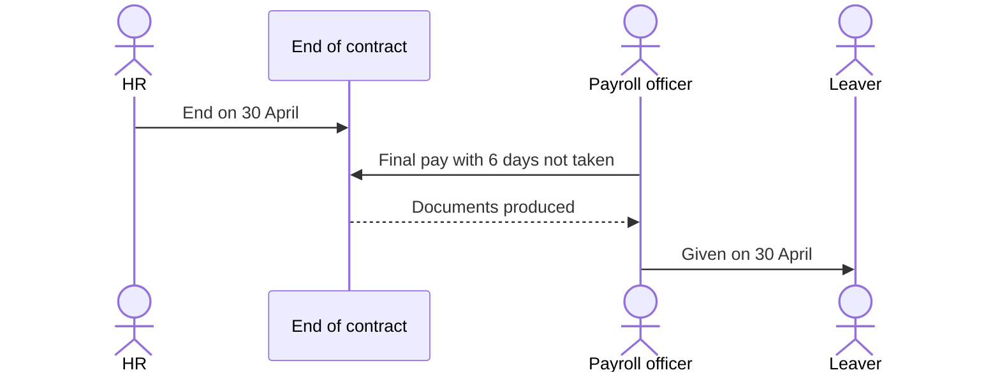

🏠 [Specs](../../../../README.md) › 🧩 [Functional capabilities](../../../README.md) ›
💶 [F13 Payroll (plugin)](../../README.md) › 📝 [Use cases](../README.md) › 📝 [Use cases: FL-F13-04 Events](README.md) ›
📝 UC-F13-15 End a contract

# 📝 UC-F13-15 End a contract

**Status:** ✅ specified

## Summary

When a contract ends, the payroll officer computes the final pay (leave not taken, notice, end-of-contract payments) and
produces the work certificate, unemployment certificate and final receipt, ready on the last day.

## Personas

- [U45 Payroll officer](../../../../01-users/personas/u45-payroll-officer.md)
- [U06 HR](../../../../01-users/personas/u06-hr.md)

## Goal

The leaver leaves on the last day with their pay and documents.

## Trigger

An end of contract recorded in F9.

## Frequency

A few a month.

## Preconditions

- The end date and reason are recorded in F9.

## Postconditions

- Success: final payslip, documents given and declared (BR-F13-11).
- Failure: documents not ready; the delay is shown.

## Main flow

1. HR records the end; it appears on End of contract (S-F13-15).
2. The payroll officer computes the final pay with the leave not taken (with the comparison of UC-F13-29) and any
   payments due.
3. simple-ERP produces the documents.
4. The payroll officer checks and gives them to the leaver on the last day; the event is declared.

## Alternative flows

- 2a. Dismissal with notice: the notice is paid or worked as decided.

## Error flows

- 4e. The last day is today and documents are not ready: an alert is shown.
- Any step: a service does not answer; the call is retried first (BR-F3-32), then the message follows the error pattern
  (D122) and what was typed stays on the screen.

## Business rules

- [BR-F13-11 End documents ready on the last day](../../business-rules/br-f13-11-end-documents-ready-on-the-last-day.md)
- [BR-F13-22 Leave pay is the higher of two methods](../../business-rules/br-f13-22-leave-pay-is-the-higher-of-two-methods.md)

## Entities

- [E-F13-14 End-of-contract file](../../data/e-f13-14-end-of-contract-file.md)

## Permissions

Payroll officer; HR reads.

## Notifications

- Payroll when an end is recorded; the leaver when the documents are available.

## Audit events

Final pay, documents, declaration, with who and when.

## AI involvement

The AI assistant may prepare the final pay draft for the payroll officer.

## API, MCP and A2A exposure

Through T5 and T6 with the caller's rights (BR-F3-34).

## Screens

- [S-F13-15 End of contract](../../screens/04-events/s-f13-15-end-of-contract.md)

## Flowchart

See [FL-F13-04 Events](../../flows/fl-f13-04-events.md#flowchart).

## Sequence diagram

## Acceptance criteria

1. **Given** an end on 30 April with 6 days of leave not taken **when** the final pay is computed **then** the 6 days
   are paid by the most favourable method.
2. **Given** the documents **when** the last day comes **then** the certificate, unemployment certificate and final
   receipt are ready.
3. **Given** the last day today with documents not ready **when** the screen opens **then** an alert is shown.

## Non-functional notes

D408's targets ([Performance](../../../../05-non-functional/performance.md)): 95 % of screens within 1 second; lists
paged on the server, the first page within 1 second; reports within 5 seconds or in the background.

## Regulatory references

Payroll rules of the France country pack:
[CR-FR-182 The payslip](../../../../10-country-packs/france/payroll/cr-fr-182-payslip.md),
[CR-FR-183 Monthly social declaration (DSN)](../../../../10-country-packs/france/payroll/cr-fr-183-dsn-monthly-declaration.md),
[CR-FR-184 Withholding tax on wages](../../../../10-country-packs/france/payroll/cr-fr-184-withholding-tax.md),
[CR-FR-185 Minimum wage (SMIC)](../../../../10-country-packs/france/payroll/cr-fr-185-minimum-wage.md),
[CR-FR-186 End-of-contract documents](../../../../10-country-packs/france/payroll/cr-fr-186-end-of-contract-documents.md),
[CR-FR-187 Equal-pay index](../../../../10-country-packs/france/payroll/cr-fr-187-equal-pay-index.md),
[CR-FR-042 Working time and rest](../../../../10-country-packs/france/labour/cr-fr-042-working-time-and-rest.md),
[CR-FR-043 Overtime](../../../../10-country-packs/france/labour/cr-fr-043-overtime.md),
[CR-FR-044 Paid leave](../../../../10-country-packs/france/labour/cr-fr-044-paid-leave.md),
[CR-FR-047 HR records retention](../../../../10-country-packs/france/labour/cr-fr-047-hr-records-retention.md),
[CR-FR-023 SEPA payment formats](../../../../10-country-packs/france/payments/cr-fr-023-sepa-formats.md),
[CR-FR-114 Staff meals as a benefit in kind](../../../../10-country-packs/france/labour/cr-fr-114-staff-meals-benefit.md),
[CR-FR-112 Meal vouchers (titres-restaurant)](../../../../10-country-packs/france/payments/cr-fr-112-meal-vouchers.md).

## Related use cases

- [UC-F13-29 Value paid-leave pay](../08-deductions-savings-and-leave-pay/uc-f13-29-value-paid-leave-pay.md)
- [UC-F13-10 File the monthly social declaration and handle returns](../03-declarations-and-payments/uc-f13-10-file-the-monthly-social-declaration-and-handle-returns.md)

## Open questions

None.

---

⬅️ [UC-F13-14 Handle sick leave and daily allowances](uc-f13-14-handle-sick-leave-and-daily-allowances.md) ·
⬆️ [Up](README.md) · ➡️ [UC-F13-16 Simulate pay and costs](uc-f13-16-simulate-pay-and-costs.md)
