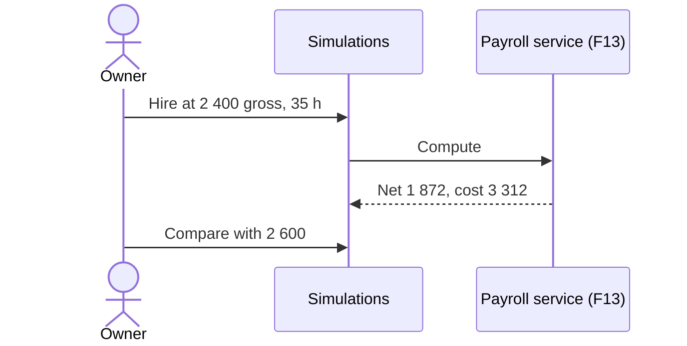

🏠 [Specs](../../../../README.md) › 🧩 [Functional capabilities](../../../README.md) ›
💶 [F13 Payroll (plugin)](../../README.md) › 📝 [Use cases](../README.md) › 📝 [Use cases: FL-F13-04 Events](README.md) ›
📝 UC-F13-16 Simulate pay and costs

# 📝 UC-F13-16 Simulate pay and costs

**Status:** ✅ specified

## Summary

The payroll officer or the owner simulates the cost of a hire or a raise, from gross to net or net to gross, with the
rates in force, without changing any pay.

## Personas

- [U45 Payroll officer](../../../../01-users/personas/u45-payroll-officer.md)
- [U13 Owner](../../../../01-users/personas/u13-owner.md)

## Goal

Know the employer cost and the net before deciding.

## Trigger

A hiring or raise decision to prepare.

## Frequency

A few a month.

## Preconditions

- Rates for the period exist.

## Postconditions

- Success: the simulation saved and shareable.
- Failure: a missing rule is shown.

## Main flow

1. The owner opens Simulations (S-F13-16) and enters the case: gross, hours, classification.
2. simple-ERP computes net, contributions and employer cost.
3. The owner compares with another case side by side.
4. The owner saves and shares it with the payroll officer.

## Alternative flows

- 1a. Net to gross: the owner enters the net wished.

## Error flows

- 2e. A rule is missing for the period: shown, the simulation is approximate.
- Any step: a service does not answer; the call is retried first (BR-F3-32), then the message follows the error pattern
  (D122) and what was typed stays on the screen.

## Business rules

- [BR-F13-02 Rates dated by period](../../business-rules/br-f13-02-rates-dated-by-period.md)

## Entities

- [E-F13-04 Payslip line](../../data/e-f13-04-payslip-line.md)
- [E-F13-27 Pay simulation](../../data/e-f13-27-pay-simulation.md)

## Permissions

Payroll officer and owner.

## Notifications

- None.

## Audit events

Simulations saved, with who and when.

## AI involvement

The AI assistant may run a simulation from a sentence ("a carer at 1 900 gross") and show it.

## API, MCP and A2A exposure

Through T5 and T6 with the caller's rights (BR-F3-34).

## Screens

- [S-F13-16 Simulations](../../screens/04-events/s-f13-16-simulations.md)

## Flowchart

See [FL-F13-04 Events](../../flows/fl-f13-04-events.md#flowchart).

## Sequence diagram

## Acceptance criteria

1. **Given** a hire at 2 400.00 EUR gross **when** simulated **then** net and employer cost are shown with the rates in
   force.
2. **Given** a net wished of 2 000.00 EUR **when** simulated net to gross **then** the gross needed is shown.
3. **Given** a simulation **when** saved **then** no pay profile changes.

## Non-functional notes

D408's targets ([Performance](../../../../05-non-functional/performance.md)): 95 % of screens within 1 second; lists
paged on the server, the first page within 1 second; reports within 5 seconds or in the background.

## Regulatory references

Payroll rules of the France country pack:
[CR-FR-182 The payslip](../../../../10-country-packs/france/payroll/cr-fr-182-payslip.md),
[CR-FR-183 Monthly social declaration (DSN)](../../../../10-country-packs/france/payroll/cr-fr-183-dsn-monthly-declaration.md),
[CR-FR-184 Withholding tax on wages](../../../../10-country-packs/france/payroll/cr-fr-184-withholding-tax.md),
[CR-FR-185 Minimum wage (SMIC)](../../../../10-country-packs/france/payroll/cr-fr-185-minimum-wage.md),
[CR-FR-186 End-of-contract documents](../../../../10-country-packs/france/payroll/cr-fr-186-end-of-contract-documents.md),
[CR-FR-187 Equal-pay index](../../../../10-country-packs/france/payroll/cr-fr-187-equal-pay-index.md),
[CR-FR-042 Working time and rest](../../../../10-country-packs/france/labour/cr-fr-042-working-time-and-rest.md),
[CR-FR-043 Overtime](../../../../10-country-packs/france/labour/cr-fr-043-overtime.md),
[CR-FR-044 Paid leave](../../../../10-country-packs/france/labour/cr-fr-044-paid-leave.md),
[CR-FR-047 HR records retention](../../../../10-country-packs/france/labour/cr-fr-047-hr-records-retention.md),
[CR-FR-023 SEPA payment formats](../../../../10-country-packs/france/payments/cr-fr-023-sepa-formats.md),
[CR-FR-114 Staff meals as a benefit in kind](../../../../10-country-packs/france/labour/cr-fr-114-staff-meals-benefit.md),
[CR-FR-112 Meal vouchers (titres-restaurant)](../../../../10-country-packs/france/payments/cr-fr-112-meal-vouchers.md).

## Related use cases

- [UC-F13-23 Pay a company officer](../07-schemes-and-special-contracts/uc-f13-23-pay-a-company-officer.md)
- [UC-F13-02 Set up employees' pay](../01-set-up/uc-f13-02-set-up-employees-pay.md)

## Open questions

None.

---

⬅️ [UC-F13-15 End a contract](uc-f13-15-end-a-contract.md) · ⬆️ [Up](README.md) ·
➡️ [UC-F13-17 Handle benefits](uc-f13-17-handle-benefits.md)
