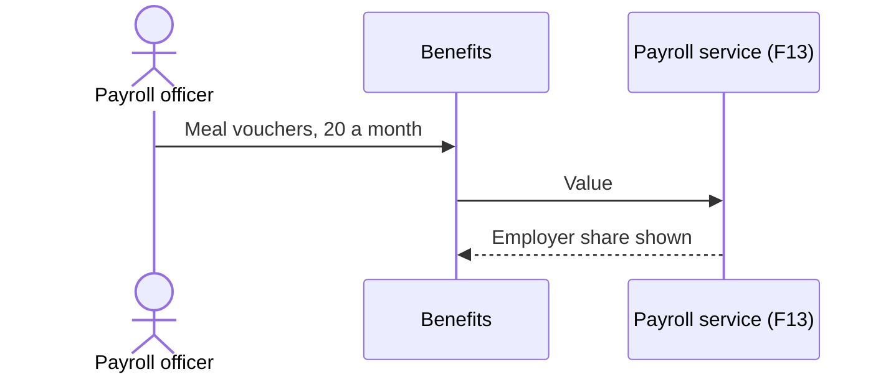

🏠 [Specs](../../../../README.md) › 🧩 [Functional capabilities](../../../README.md) ›
💶 [F13 Payroll (plugin)](../../README.md) › 📝 [Use cases](../README.md) › 📝 [Use cases: FL-F13-04 Events](README.md) ›
📝 UC-F13-17 Handle benefits

# 📝 UC-F13-17 Handle benefits

**Status:** ✅ specified

## Summary

The payroll officer sets the benefits an employee receives (meal vouchers, transport, company car) and simple-ERP values
them and counts them in the pay.

## Personas

- [U45 Payroll officer](../../../../01-users/personas/u45-payroll-officer.md)

## Goal

Benefits valued and counted right.

## Trigger

A benefit granted or changed.

## Frequency

A few a month.

## Preconditions

- The employee has a pay profile.

## Postconditions

- Success: benefit lines on the payslip.
- Failure: the benefit is blocked until valued.

## Main flow

1. The payroll officer opens Benefits (S-F13-17) and chooses the employee.
2. The payroll officer adds the benefit (meal vouchers, transport pass, company car) with its start date and quantity.
3. simple-ERP values it by the country pack (BR-F13-14) and shows the employer and employee shares.
4. The next payslip includes the value, the employee share and, for benefits in kind, the taxable amount.

## Alternative flows

- 1a. Mobility allowance: paid per day of use.

## Error flows

- 2e. The value is missing: blocked.
- Any step: a service does not answer; the call is retried first (BR-F3-32), then the message follows the error pattern
  (D122) and what was typed stays on the screen.

## Business rules

- [BR-F13-14 Benefits valued](../../business-rules/br-f13-14-benefits-valued.md)

## Entities

- [E-F13-02 Employee pay profile](../../data/e-f13-02-employee-pay-profile.md)
- [E-F13-26 Employee benefit](../../data/e-f13-26-employee-benefit.md)

## Permissions

Payroll officer.

## Notifications

- None.

## Audit events

Benefit added, changed, ended, with who and when.

## AI involvement

The AI assistant may explain a benefit line to the employee.

## API, MCP and A2A exposure

Through T5 and T6 with the caller's rights (BR-F3-34).

## Screens

- [S-F13-17 Benefits](../../screens/04-events/s-f13-17-benefits.md)

## Flowchart

See [FL-F13-04 Events](../../flows/fl-f13-04-events.md#flowchart).

## Sequence diagram

## Acceptance criteria

1. **Given** 20 meal vouchers a month **when** the run is computed **then** the employer and employee shares appear.
2. **Given** a company car **when** valued **then** the benefit in kind is added to the taxable gross.
3. **Given** a benefit with no value **when** the run is computed **then** it is blocked.

## Non-functional notes

D408's targets ([Performance](../../../../05-non-functional/performance.md)): 95 % of screens within 1 second; lists
paged on the server, the first page within 1 second; reports within 5 seconds or in the background.

## Regulatory references

Payroll rules of the France country pack:
[CR-FR-182 The payslip](../../../../10-country-packs/france/payroll/cr-fr-182-payslip.md),
[CR-FR-183 Monthly social declaration (DSN)](../../../../10-country-packs/france/payroll/cr-fr-183-dsn-monthly-declaration.md),
[CR-FR-184 Withholding tax on wages](../../../../10-country-packs/france/payroll/cr-fr-184-withholding-tax.md),
[CR-FR-185 Minimum wage (SMIC)](../../../../10-country-packs/france/payroll/cr-fr-185-minimum-wage.md),
[CR-FR-186 End-of-contract documents](../../../../10-country-packs/france/payroll/cr-fr-186-end-of-contract-documents.md),
[CR-FR-187 Equal-pay index](../../../../10-country-packs/france/payroll/cr-fr-187-equal-pay-index.md),
[CR-FR-042 Working time and rest](../../../../10-country-packs/france/labour/cr-fr-042-working-time-and-rest.md),
[CR-FR-043 Overtime](../../../../10-country-packs/france/labour/cr-fr-043-overtime.md),
[CR-FR-044 Paid leave](../../../../10-country-packs/france/labour/cr-fr-044-paid-leave.md),
[CR-FR-047 HR records retention](../../../../10-country-packs/france/labour/cr-fr-047-hr-records-retention.md),
[CR-FR-023 SEPA payment formats](../../../../10-country-packs/france/payments/cr-fr-023-sepa-formats.md),
[CR-FR-114 Staff meals as a benefit in kind](../../../../10-country-packs/france/labour/cr-fr-114-staff-meals-benefit.md),
[CR-FR-112 Meal vouchers (titres-restaurant)](../../../../10-country-packs/france/payments/cr-fr-112-meal-vouchers.md).

## Related use cases

- [UC-F13-30 Apply the hotels-and-restaurants agreement](../09-collective-agreements-by-family/uc-f13-30-apply-the-hotels-and-restaurants-agreement.md)
- [UC-F13-04 Compute gross to net](../02-monthly-pay-run/uc-f13-04-compute-gross-to-net.md)

## Open questions

None.

---

⬅️ [UC-F13-16 Simulate pay and costs](uc-f13-16-simulate-pay-and-costs.md) · ⬆️ [Up](README.md) ·
➡️ [UC-F13-18 Report yearly](../05-reports-and-rules/uc-f13-18-report-yearly.md)
