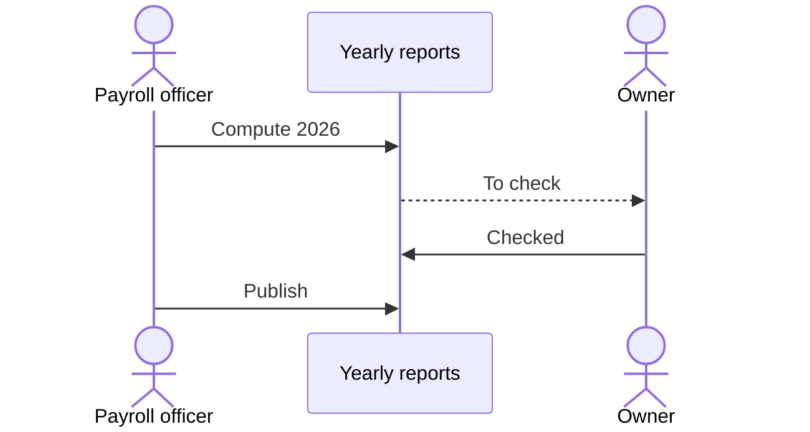

🏠 [Specs](../../../../README.md) › 🧩 [Functional capabilities](../../../README.md) ›
💶 [F13 Payroll (plugin)](../../README.md) › 📝 [Use cases](../README.md) ›
📝 [Use cases: FL-F13-05 Reports and rules](README.md) › 📝 UC-F13-18 Report yearly

# 📝 UC-F13-18 Report yearly

**Status:** ✅ specified

## Summary

Each year the payroll officer computes the payroll ledger, headcount report and equal-pay index, the owner checks them,
and they are filed or published.

## Personas

- [U45 Payroll officer](../../../../01-users/personas/u45-payroll-officer.md)
- [U13 Owner](../../../../01-users/personas/u13-owner.md)

## Goal

Yearly duties met on time.

## Trigger

The year closes.

## Frequency

Yearly.

## Preconditions

- Every run of the year is paid.

## Postconditions

- Success: reports filed or published.
- Failure: missing data listed.

## Main flow

1. After the last run of the year is paid, the payroll officer opens Yearly reports (S-F13-18) and computes them.
2. SimpleERP produces the payroll ledger, the headcount report and the equal-pay index (CR-FR-187) and lists any data
   missing.
3. The owner checks the figures and the index.
4. The payroll officer files or publishes each report by its deadline; SimpleERP records the date.

## Alternative flows

- 1a. Per establishment.

## Error flows

- 1e. Data missing: listed with the employees concerned.
- Any step: a service does not answer; the call is retried first (BR-F3-32), then the message follows the error pattern
  (D122) and what was typed stays on the screen.

## Business rules

- [BR-F13-13 Payslips kept](../../business-rules/br-f13-13-payslips-kept.md)
- [BR-F13-12 Payroll data restricted](../../business-rules/br-f13-12-payroll-data-restricted.md)

## Entities

- [E-F13-15 Yearly payroll report](../../data/e-f13-15-yearly-payroll-report.md)

## Permissions

Payroll officer and owner.

## Notifications

- Payroll before each deadline.

## Audit events

Computed, checked, filed, with who and when.

## AI involvement

The AI assistant may summarise the equal-pay index's results.

## API, MCP and A2A exposure

Through T5 and T6 with the caller's rights (BR-F3-34).

## Screens

- [S-F13-18 Yearly reports](../../screens/05-reports-and-rules/s-f13-18-yearly-reports.md)

## Flowchart

See [FL-F13-05 Reports and rules](../../flows/fl-f13-05-reports-and-rules.md#flowchart).

## Sequence diagram

## Acceptance criteria

1. **Given** 2026 closed **when** computed **then** the payroll ledger and equal-pay index are produced.
2. **Given** an employee with missing data **when** computed **then** they are listed.
3. **Given** the reports checked **when** published **then** the date is recorded.

## Non-functional notes

D408's targets ([Performance](../../../../05-non-functional/performance.md)): 95 % of screens within 1 second; lists
paged on the server, the first page within 1 second; reports within 5 seconds or in the background.

## Regulatory references

Payroll rules of the France country pack:
[CR-FR-182 The payslip](../../../../10-country-packs/france/payroll/cr-fr-182-payslip.md),
[CR-FR-183 Monthly social declaration (DSN)](../../../../10-country-packs/france/payroll/cr-fr-183-dsn-monthly-declaration.md),
[CR-FR-184 Withholding tax on wages](../../../../10-country-packs/france/payroll/cr-fr-184-withholding-tax.md),
[CR-FR-185 Minimum wage (SMIC)](../../../../10-country-packs/france/payroll/cr-fr-185-minimum-wage.md),
[CR-FR-186 End-of-contract documents](../../../../10-country-packs/france/payroll/cr-fr-186-end-of-contract-documents.md),
[CR-FR-187 Equal-pay index](../../../../10-country-packs/france/payroll/cr-fr-187-equal-pay-index.md),
[CR-FR-042 Working time and rest](../../../../10-country-packs/france/labour/cr-fr-042-working-time-and-rest.md),
[CR-FR-043 Overtime](../../../../10-country-packs/france/labour/cr-fr-043-overtime.md),
[CR-FR-044 Paid leave](../../../../10-country-packs/france/labour/cr-fr-044-paid-leave.md),
[CR-FR-047 HR records retention](../../../../10-country-packs/france/labour/cr-fr-047-hr-records-retention.md),
[CR-FR-023 SEPA payment formats](../../../../10-country-packs/france/payments/cr-fr-023-sepa-formats.md),
[CR-FR-114 Staff meals as a benefit in kind](../../../../10-country-packs/france/labour/cr-fr-114-staff-meals-benefit.md),
[CR-FR-112 Meal vouchers (titres-restaurant)](../../../../10-country-packs/france/payments/cr-fr-112-meal-vouchers.md).

## Related use cases

- [UC-F13-34 Analyse payroll cost by site, project and analytic axis](uc-f13-34-analyse-payroll-cost-by-site-project-and-analytic-axis.md)
- [UC-F13-28 Compute profit-sharing and employee savings](../08-deductions-savings-and-leave-pay/uc-f13-28-compute-profit-sharing-and-employee-savings.md)

## Open questions

None.

---

⬅️ [UC-F13-17 Handle benefits](../04-events/uc-f13-17-handle-benefits.md) · ⬆️ [Up](README.md) ·
➡️ [UC-F13-19 Update rates and rules from the country pack](uc-f13-19-update-rates-and-rules-from-the-country-pack.md)
