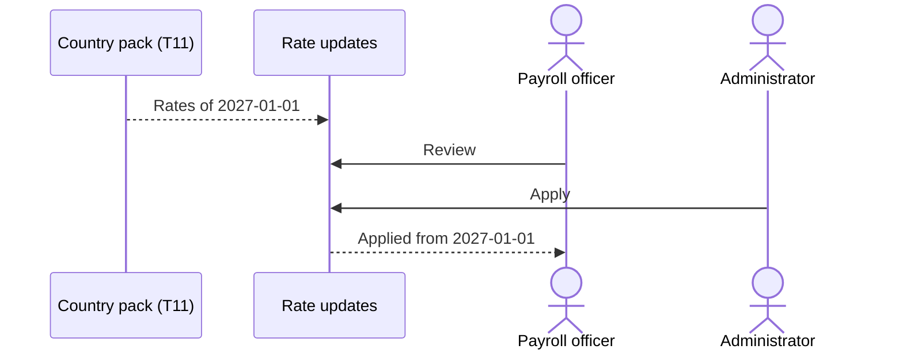

🏠 [Specs](../../../../README.md) › 🧩 [Functional capabilities](../../../README.md) ›
💶 [F13 Payroll (plugin)](../../README.md) › 📝 [Use cases](../README.md) ›
📝 [Use cases: FL-F13-05 Reports and rules](README.md) › 📝 UC-F13-19 Update rates and rules from the country pack

# 📝 UC-F13-19 Update rates and rules from the country pack

**Status:** ✅ specified

## Summary

The country pack delivers new rates and rules each period; the payroll officer reviews the changes and the administrator
applies them from their date.

## Personas

- [U45 Payroll officer](../../../../01-users/personas/u45-payroll-officer.md)
- [U07 Administrator](../../../../01-users/personas/u07-administrator.md)

## Goal

Every run uses the rates in force.

## Trigger

An update of the country pack (each 1 January and 1 July, D365).

## Frequency

Twice a year, plus mid-year changes.

## Preconditions

- The country pack is installed.

## Postconditions

- Success: the new rate set applies from its date.
- Failure: the old set stays; a warning is shown.

## Main flow

1. SimpleERP receives the update and lists it on Rate updates (S-F13-19).
2. The payroll officer reviews the changes and the runs affected.
3. The administrator applies it from its date.
4. Runs of the new period use it.

## Alternative flows

- 1a. A mid-year change: applied from its date, past runs untouched.

## Error flows

- 3e. A run of that period is already approved: warned; a correction may be needed (UC-F13-11).
- Any step: a service does not answer; the call is retried first (BR-F3-32), then the message follows the error pattern
  (D122) and what was typed stays on the screen.

## Business rules

- [BR-F13-01 Payroll follows the country pack](../../business-rules/br-f13-01-payroll-follows-the-country-pack.md)
- [BR-F13-02 Rates dated by period](../../business-rules/br-f13-02-rates-dated-by-period.md)
- [BR-F13-24 Agreement family rules dated and complete](../../business-rules/br-f13-24-agreement-family-rules-dated-and-complete.md)

## Entities

- [E-F13-16 Rate set](../../data/e-f13-16-rate-set.md)
- [E-F13-23 Agreement family](../../data/e-f13-23-agreement-family.md)

## Permissions

Payroll officer reviews; administrator applies.

## Notifications

- Payroll and administrator at once on a new update.

## Audit events

Update received, reviewed, applied, with who and when.

## AI involvement

The AI assistant may summarise the changes in plain words.

## API, MCP and A2A exposure

Through T5 and T6 with the caller's rights (BR-F3-34).

## Screens

- [S-F13-19 Rate updates](../../screens/05-reports-and-rules/s-f13-19-rate-updates.md)

## Flowchart

See [FL-F13-05 Reports and rules](../../flows/fl-f13-05-reports-and-rules.md#flowchart).

## Sequence diagram

## Acceptance criteria

1. **Given** rates from 2027-01-01 **when** applied **then** January's run uses them and December's does not.
2. **Given** a mid-year change on 1 July **when** applied **then** June's run is untouched.
3. **Given** an approved run of the period **when** the update applies **then** a warning is shown.

## Non-functional notes

D408's targets ([Performance](../../../../05-non-functional/performance.md)): 95 % of screens within 1 second; lists
paged on the server, the first page within 1 second; reports within 5 seconds or in the background.

## Regulatory references

Payroll rules of the France country pack:
[CR-FR-182 The payslip](../../../../10-country-packs/france/payroll/cr-fr-182-payslip.md),
[CR-FR-183 Monthly social declaration (DSN)](../../../../10-country-packs/france/payroll/cr-fr-183-dsn-monthly-declaration.md),
[CR-FR-184 Withholding tax on wages](../../../../10-country-packs/france/payroll/cr-fr-184-withholding-tax.md),
[CR-FR-185 Minimum wage (SMIC)](../../../../10-country-packs/france/payroll/cr-fr-185-minimum-wage.md),
[CR-FR-186 End-of-contract documents](../../../../10-country-packs/france/payroll/cr-fr-186-end-of-contract-documents.md),
[CR-FR-187 Equal-pay index](../../../../10-country-packs/france/payroll/cr-fr-187-equal-pay-index.md),
[CR-FR-042 Working time and rest](../../../../10-country-packs/france/labour/cr-fr-042-working-time-and-rest.md),
[CR-FR-043 Overtime](../../../../10-country-packs/france/labour/cr-fr-043-overtime.md),
[CR-FR-044 Paid leave](../../../../10-country-packs/france/labour/cr-fr-044-paid-leave.md),
[CR-FR-047 HR records retention](../../../../10-country-packs/france/labour/cr-fr-047-hr-records-retention.md),
[CR-FR-023 SEPA payment formats](../../../../10-country-packs/france/payments/cr-fr-023-sepa-formats.md),
[CR-FR-114 Staff meals as a benefit in kind](../../../../10-country-packs/france/labour/cr-fr-114-staff-meals-benefit.md),
[CR-FR-112 Meal vouchers (titres-restaurant)](../../../../10-country-packs/france/payments/cr-fr-112-meal-vouchers.md).

## Related use cases

- [UC-F13-01 Set up the company's payroll](../01-set-up/uc-f13-01-set-up-the-company-s-payroll.md)
- [UC-F13-11 Correct a past month](../03-declarations-and-payments/uc-f13-11-correct-a-past-month.md)

## Open questions

None.

---

⬅️ [UC-F13-18 Report yearly](uc-f13-18-report-yearly.md) · ⬆️ [Up](README.md) ·
➡️ [UC-F13-20 Ask the AI assistant about pay](../06-assistant/uc-f13-20-ask-the-assistant-about-pay.md)
