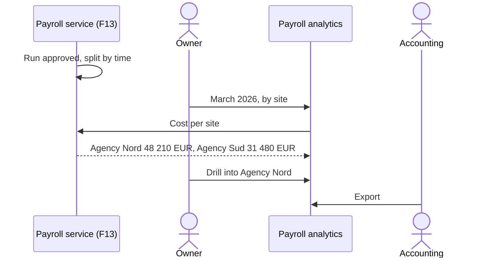

🏠 [Specs](../../../../README.md) › 🧩 [Functional capabilities](../../../README.md) ›
💶 [F13 Payroll (plugin)](../../README.md) › 📝 [Use cases](../README.md) ›
📝 [Use cases: FL-F13-05 Reports and rules](README.md) ›
📝 UC-F13-34 Analyse payroll cost by site, project and analytic axis

# 📝 UC-F13-34 Analyse payroll cost by site, project and analytic axis

**Status:** 🔄 waiting for the owner

## Summary

The owner, accounting and the payroll officer see the payroll cost of each run split by site, project and the analytic
axes of F8, from the time recorded in F9, and export it.

## Personas

- [U13 Owner](../../../../01-users/personas/u13-owner.md)
- [U05 Accounting](../../../../01-users/personas/u05-accounting.md)
- [U45 Payroll officer](../../../../01-users/personas/u45-payroll-officer.md)

## Goal

Know what each site and project costs in pay, month by month, without a spreadsheet.

## Trigger

A run approved; a monthly or yearly review.

## Frequency

Monthly after each run; the owner looks at it once a month.

## Preconditions

- The run is approved (UC-F13-07).
- Time is recorded per site and project in F9; the axes exist in F8.

## Postconditions

- Success: a payroll cost allocation per run, the analysis and its export; the split feeds the entries of UC-F13-13.
- Failure: the analysis shows the unallocated cost on the default site, flagged.

## Main flow

1. The run is approved; simple-ERP splits each employee's cost by the time recorded (BR-F13-23).
2. The owner opens Payroll analytics (S-F13-27) and chooses a period and an axis.
3. simple-ERP shows the cost per site, project or axis value, with headcount, overtime share and the change from last
   month.
4. The owner drills into a site to see its employees' costs.
5. Accounting exports the split or lets UC-F13-13 post the entries with it.

## Alternative flows

- 2a. A manager opens the analysis: headcount and hours only, amounts hidden.

## Error flows

- 1e. An employee has no time recorded: the whole cost goes to the default site and is flagged.
- Any step: a service does not answer; the call is retried first (BR-F3-32), then the message follows the error pattern
  (D122) and what was typed stays on the screen.

## Business rules

- [BR-F13-23 Payroll cost split by the analytic axes](../../business-rules/br-f13-23-payroll-cost-split-by-the-analytic-axes.md)
- [BR-F13-12 Payroll data restricted](../../business-rules/br-f13-12-payroll-data-restricted.md)

## Entities

- [E-F13-24 Payroll cost allocation](../../data/e-f13-24-payroll-cost-allocation.md)
- [E-F13-06 Pay run](../../data/e-f13-06-pay-run.md)
- [E-F13-25 Analytic axis](../../data/e-f13-25-analytic-axis.md)

## Permissions

Owner, accounting and payroll officer see amounts; managers see headcount and hours of their teams only.

## Notifications

- The owner is told (Proposed) when a site's monthly payroll cost rises more than 10 % from the month before.

## Audit events

Each opening and export of the analysis, with who and when (BR-F13-12).

## AI involvement

The AI assistant may answer "what did agency B cost in March" with the figure and the query behind it; never for roles
without access.

## API, MCP and A2A exposure

Through the API (T5) and as AI assistant tools (T6), with the caller's rights (BR-F3-34).

## Screens

- [S-F13-27 Payroll analytics](../../screens/05-reports-and-rules/s-f13-27-payroll-analytics.md)

## Flowchart

See [FL-F13-05 Reports and rules](../../flows/fl-f13-05-reports-and-rules.md#flowchart).

## Sequence diagram

## Acceptance criteria

1. **Given** Sophie Bernard with 120 h on Agency Nord and 31 h on Agency Sud in March **when** the run is approved
   **then** her cost is split 79.5 % and 20.5 %.
2. **Given** the owner of the home-care example company **when** he opens March by site **then** each agency's cost,
   headcount and change from February show.
3. **Given** a manager **when** they open the analysis **then** amounts are hidden.
4. **Given** an employee with no time recorded **when** the run is approved **then** the cost is on the default site and
   flagged.

## Non-functional notes

D408's targets ([Performance](../../../../05-non-functional/performance.md)): 95 % of screens within 1 second; lists
paged on the server, the first page within 1 second; reports within 5 seconds or in the background.

## Regulatory references

Retention:
[CR-FR-002 Accounting records kept ten years](../../../../10-country-packs/france/accounting/cr-fr-002-accounting-records-kept-ten-years.md).

## Related use cases

- [UC-F13-13 Post payroll entries to accounting](../03-declarations-and-payments/uc-f13-13-post-payroll-entries-to-accounting.md)
- [UC-F13-18 Report yearly](uc-f13-18-report-yearly.md)

## Open questions

None.

---

⬅️ [UC-F13-33](../09-collective-agreements-by-family/uc-f13-33-apply-the-construction-agreements.md) ·
⬆️ [Up](README.md) ·
➡️ [UC-F13-35 Pay posted workers](../10-special-contracts-and-outsourcing/uc-f13-35-pay-posted-workers.md)
