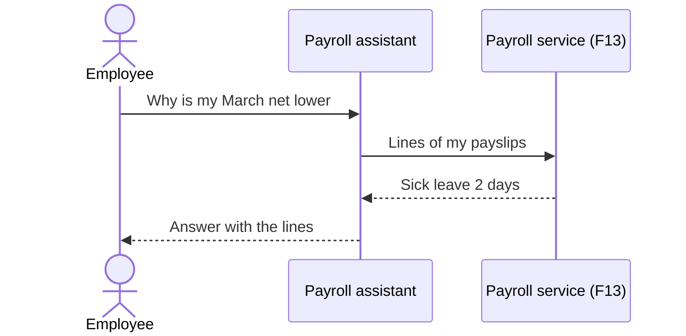

🏠 [Specs](../../../../README.md) › 🧩 [Functional capabilities](../../../README.md) ›
💶 [F13 Payroll (plugin)](../../README.md) › 📝 [Use cases](../README.md) ›
📝 [Use cases: FL-F13-06 Assistant](README.md) › 📝 UC-F13-20 Ask the AI assistant about pay

# 📝 UC-F13-20 Ask the AI assistant about pay

**Status:** ✅ specified

## Summary

Employees ask the AI assistant about their own payslip; the payroll officer asks about the run; answers come only from
the data each may see, and actions are confirmed.

## Personas

- [U01 Employee](../../../../01-users/personas/u01-employee.md)
- [U45 Payroll officer](../../../../01-users/personas/u45-payroll-officer.md)

## Goal

Pay questions answered without a meeting, within rights.

## Trigger

A question typed or spoken.

## Frequency

Daily.

## Preconditions

- The user is signed in.

## Postconditions

- Success: an answer with its source lines.
- Failure: refused when the data is not theirs.

## Main flow

1. The employee opens the payroll assistant (S-F13-20) and asks "why is my net lower in March".
2. simple-ERP finds the lines that changed in their own payslips.
3. The AI assistant answers with the lines and their reasons.
4. If an action is asked (send a copy), it is confirmed first (BR-F3-07).

## Alternative flows

- 1a. The payroll officer asks about the run: the answer covers the run.

## Error flows

- 2e. Another employee's pay is asked: refused (BR-F13-15).
- Any step: a service does not answer; the call is retried first (BR-F3-32), then the message follows the error pattern
  (D122) and what was typed stays on the screen.

## Business rules

- [BR-F13-15 Payroll assistant, own data only](../../business-rules/br-f13-15-payroll-assistant-own-data-only.md)
- [BR-F13-12 Payroll data restricted](../../business-rules/br-f13-12-payroll-data-restricted.md)

## Entities

- [E-F13-07 Payslip](../../data/e-f13-07-payslip.md)

## Permissions

Each employee their own; the payroll officer the run.

## Notifications

- None.

## Audit events

Each question and the data read, with who and when (BR-F13-12).

## AI involvement

The AI assistant reads only the asker's data; it never changes pay.

## API, MCP and A2A exposure

Through T5 and T6 with the caller's rights (BR-F3-34).

## Screens

- [S-F13-20 Payroll assistant](../../screens/06-assistant/s-f13-20-payroll-assistant.md)

## Flowchart

See [FL-F13-06 Assistant](../../flows/fl-f13-06-assistant.md#flowchart).

## Sequence diagram

## Acceptance criteria

1. **Given** Sophie's March net 85.40 EUR lower **when** she asks why **then** the answer names the sick-leave lines.
2. **Given** an employee asks about a colleague **when** asked **then** it is refused.
3. **Given** a request to send a copy **when** asked **then** a confirmation is shown first.

## Non-functional notes

D408's targets ([Performance](../../../../05-non-functional/performance.md)): 95 % of screens within 1 second; lists
paged on the server, the first page within 1 second; reports within 5 seconds or in the background.

## Regulatory references

Payroll rules of the France country pack:
[CR-FR-182 The payslip](../../../../10-country-packs/france/payroll/cr-fr-182-payslip.md),
[CR-FR-183 Monthly social declaration (DSN)](../../../../10-country-packs/france/payroll/cr-fr-183-dsn-monthly-declaration.md),
[CR-FR-184 Withholding tax on wages](../../../../10-country-packs/france/payroll/cr-fr-184-withholding-tax.md),
[CR-FR-185 Minimum wage (SMIC)](../../../../10-country-packs/france/payroll/cr-fr-185-minimum-wage.md),
[CR-FR-186 End-of-contract documents](../../../../10-country-packs/france/payroll/cr-fr-186-end-of-contract-documents.md),
[CR-FR-187 Equal-pay index](../../../../10-country-packs/france/payroll/cr-fr-187-equal-pay-index.md),
[CR-FR-042 Working time and rest](../../../../10-country-packs/france/labour/cr-fr-042-working-time-and-rest.md),
[CR-FR-043 Overtime](../../../../10-country-packs/france/labour/cr-fr-043-overtime.md),
[CR-FR-044 Paid leave](../../../../10-country-packs/france/labour/cr-fr-044-paid-leave.md),
[CR-FR-047 HR records retention](../../../../10-country-packs/france/labour/cr-fr-047-hr-records-retention.md),
[CR-FR-023 SEPA payment formats](../../../../10-country-packs/france/payments/cr-fr-023-sepa-formats.md),
[CR-FR-114 Staff meals as a benefit in kind](../../../../10-country-packs/france/labour/cr-fr-114-staff-meals-benefit.md),
[CR-FR-112 Meal vouchers (titres-restaurant)](../../../../10-country-packs/france/payments/cr-fr-112-meal-vouchers.md).

## Related use cases

- [UC-F13-08 Issue clarified payslips digitally](../02-monthly-pay-run/uc-f13-08-issue-clarified-payslips-digitally.md)

## Open questions

None.

---

⬅️ [UC-F13-19](../05-reports-and-rules/uc-f13-19-update-rates-and-rules-from-the-country-pack.md) · ⬆️ [Up](README.md) ·
➡️ [UC-F13-21](../07-schemes-and-special-contracts/uc-f13-21-enrol-employees-in-health-and-provident-schemes.md)
