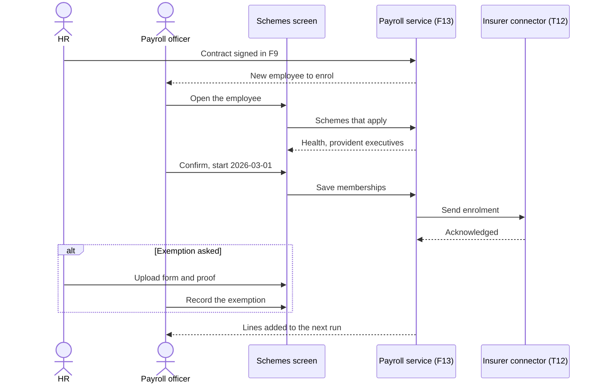

🏠 [Specs](../../../../README.md) › 🧩 [Functional capabilities](../../../README.md) ›
💶 [F13 Payroll (plugin)](../../README.md) › 📝 [Use cases](../README.md) ›
📝 [Use cases: FL-F13-07 Schemes and special contracts](README.md) ›
📝 UC-F13-21 Enrol employees in health and provident schemes

# 📝 UC-F13-21 Enrol employees in health and provident schemes

**Status:** ✅ specified, ⚖️ lawyer review before launch (D574)

## Summary

The payroll officer enrols each new employee in the company's mandatory health scheme and the provident schemes of their
agreement, or records an exemption with its proof, so that the right contributions appear on every payslip.

## Personas

- [U45 Payroll officer](../../../../01-users/personas/u45-payroll-officer.md)
- [U06 Human resources](../../../../01-users/personas/u06-hr.md), who signs the contract in F9 and collects the
  exemption form

## Goal

Every employee covered or lawfully exempted from their first day, with the right employee and employer shares on the
payslip.

## Trigger

A new contract in F9, a change of category (employee to executive), or an exemption proof about to lapse.

## Frequency

At each hire; for the home-care example company (SC04), about 6 a month.

## Preconditions

- The company's schemes, insurers and shares are set in payroll set-up (UC-F13-01).
- The employee has a pay profile (UC-F13-02).

## Postconditions

- Success: a scheme membership per mandatory scheme (enrolled or exempted), and its lines on the next payslip.
- Failure: the employee is flagged "no scheme" and blocks the pay run for them (BR-F13-16).

## Main flow

1. HR signs the contract in F9; the payroll officer sees the new employee in "To set up" on Schemes (S-F13-21).
2. The payroll officer opens the employee; SimpleERP proposes the schemes that apply from the establishment, the
   agreement and the category.
3. The payroll officer confirms each scheme and its start date; the shares come from the scheme.
4. SimpleERP saves the memberships, sends the enrolment to the insurer through its connector (T12) and adds the lines
   to the next pay run.
5. The next payslip shows the health and provident lines with the employee and employer shares.

## Alternative flows

- 3a. The employee asks for an exemption: HR uploads the form and its proof; the payroll officer records the exemption
  with its reason from the country pack's list; no line is deducted.
- 3b. The employee becomes an executive: the provident scheme of executives replaces the old one from the date of the
  change.
- 4a. The insurer has no connector: SimpleERP produces the enrolment file to send and marks the membership "sent by
  hand".

## Error flows

- 3e. The exemption reason is not in the country pack's list: refused, the reason list is shown.
- 4e. The pay run starts with an employee neither enrolled nor exempted: the employee is listed as an anomaly and the
  run cannot be approved for them (BR-F13-16).
- 5e. The exemption proof has lapsed: flagged one month before; the employee is enrolled from the lapse date
  if no new proof arrives.
- Any step: a service does not answer; the call is retried first (BR-F3-32), then the message follows the error pattern
  (D122) and what was typed stays on the screen.

## Business rules

- [BR-F13-16 Every employee covered by the mandatory schemes](../../business-rules/br-f13-16-every-employee-covered-by-the-mandatory-schemes.md)
- [BR-F13-12 Payroll data restricted](../../business-rules/br-f13-12-payroll-data-restricted.md)

## Entities

- [E-F13-17 Scheme membership](../../data/e-f13-17-scheme-membership.md)
- [E-F13-02 Employee pay profile](../../data/e-f13-02-employee-pay-profile.md)

## Permissions

Payroll officer: enrol and exempt. HR: upload forms and proofs, read the status. Employee: sees their own memberships in
their space. Managers never see shares or amounts (permissions page).

## Notifications

- The payroll officer is told of each new employee to enrol, the day the contract is signed.
- The employee receives their enrolment confirmation by email.
- The payroll officer and HR are told one month before an exemption proof lapses.

## Audit events

Enrolment, exemption, change and end, with who, when, the scheme, the dates and the shares; every view of an exemption
proof (BR-F13-12).

## AI involvement

The AI assistant may list employees with no scheme and prepare their enrolments for the payroll officer to confirm; it
never records an exemption by itself.

## API, MCP and A2A exposure

Memberships read and written through the API (T5) and as AI assistant tools (T6) within the payroll officer's rights
(BR-F3-34); insurer connectors through T12.

## Screens

- [S-F13-21 Schemes](../../screens/07-schemes-and-special-contracts/s-f13-21-schemes.md)

## Flowchart

See [FL-F13-07 Schemes and special contracts](../../flows/fl-f13-07-schemes-and-special-contracts.md#flowchart).

## Sequence diagram

## Acceptance criteria

1. **Given** Sophie Bernard, carer of the home-care example company, hired on 2026-03-01 **when** the payroll officer
   confirms the health scheme at 60.00 EUR a month, 40 % employee **then** her March payslip shows 24.00 EUR deducted
   and 36.00 EUR paid by the employer.
2. **Given** an employee covered by a spouse's scheme **when** HR uploads the attestation and the payroll officer
   records the exemption **then** no health line is deducted and the proof is kept with the membership.
3. **Given** a pay run of March 2026 **when** an employee has neither membership nor exemption **then** the run lists
   "no health scheme" for that employee and cannot be approved for them.
4. **Given** an exemption reason typed by hand **when** it is saved **then** it is refused and the country pack's list
   is shown.
5. **Given** an employee promoted to executive on 2026-06-01 **when** the change is saved **then** the executives'
   provident scheme applies from June and the old one ends on 31 May.

## Non-functional notes

D408's targets ([Performance](../../../../05-non-functional/performance.md)): 95 % of screens within 1 second; lists
paged on the server, the first page within 1 second; reports within 5 seconds or in the background.

## Regulatory references

Health and provident schemes: (⚖️ lawyer review before launch, D574) to read for the France pack: Code de la sécurité
sociale L911-7, national agreement on executives' provident cover. Retention:
[CR-FR-047 HR records retention](../../../../10-country-packs/france/labour/cr-fr-047-hr-records-retention.md).

## Related use cases

- [UC-F13-02 Set up employees' pay](../01-set-up/uc-f13-02-set-up-employees-pay.md)
- [UC-F13-04 Compute gross to net](../02-monthly-pay-run/uc-f13-04-compute-gross-to-net.md)
- [UC-F13-15 End a contract](../04-events/uc-f13-15-end-a-contract.md)

## Open questions

None.

---

⬅️ [UC-F13-20 Ask the AI assistant about pay](../06-assistant/uc-f13-20-ask-the-assistant-about-pay.md) ·
⬆️ [Up](README.md) · ➡️ [UC-F13-22 Pay an apprentice or an intern](uc-f13-22-pay-an-apprentice-or-an-intern.md)
