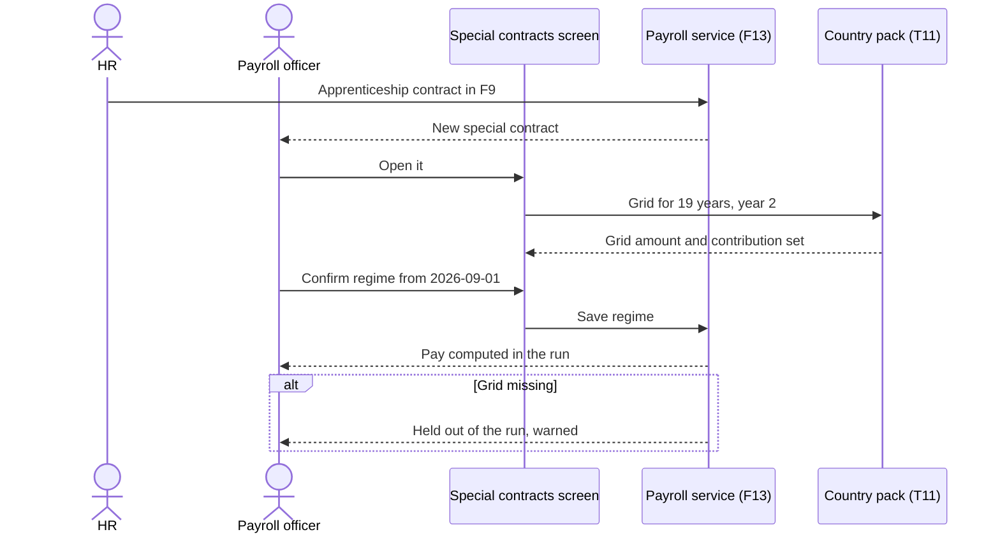

🏠 [Specs](../../../../README.md) › 🧩 [Functional capabilities](../../../README.md) ›
💶 [F13 Payroll (plugin)](../../README.md) › 📝 [Use cases](../README.md) ›
📝 [Use cases: FL-F13-07 Schemes and special contracts](README.md) › 📝 UC-F13-22 Pay an apprentice or an intern

# 📝 UC-F13-22 Pay an apprentice or an intern

**Status:** 🔄 waiting for the owner

## Summary

The payroll officer pays an apprentice by the grid of their age and contract year, or an intern by the allowance the law
sets for their stay, with the contributions and aids of each kind of contract.

## Personas

- [U45 Payroll officer](../../../../01-users/personas/u45-payroll-officer.md)
- [U06 Human resources](../../../../01-users/personas/u06-hr.md), who records the contract or the internship agreement
  in F9

## Goal

Apprentices and interns paid at least what the law sets for their age, year or stay, with the right contribution set.

## Trigger

An apprenticeship contract or an internship agreement recorded in F9; a birthday or a new contract year that changes the
grid.

## Frequency

A few a year; the construction example company (SC01) takes 4 apprentices each September.

## Preconditions

- The contract or the internship agreement is recorded in F9 with its training body.
- The country pack holds the grid and the allowance for the period (BR-F13-17).

## Postconditions

- Success: a special pay regime on the pay profile; the payslip uses the grid and the contribution set of the contract
  kind.
- Failure: the employee is held out of the run until the regime is set.

## Main flow

1. HR records the apprenticeship contract in F9; the payroll officer sees it on Special contracts (S-F13-22).
2. The payroll officer opens it; simple-ERP shows the age band, the contract year and the grid amount from the country
   pack.
3. The payroll officer confirms the regime, the training body and the start date.
4. simple-ERP computes the pay in the monthly run with the apprentice's contribution set and flags the date the grid
   changes.
5. On a birthday or a new contract year, simple-ERP raises the pay from the right date and shows the change to the
   payroll officer before the run.

## Alternative flows

- 1a. An intern: the payroll officer records the stay length and hours; when the stay is above the length the law sets,
  the allowance per hour is applied; below it, no allowance is due unless the company pays one.
- 4a. The company pays above the grid: the higher amount is kept and the grid stays the minimum.

## Error flows

- 2e. The grid for the period is missing from the country pack: the employee is held out of the run and the payroll
  officer and administrator are warned (BR-F13-17).
- 3e. The pay entered is below the grid: refused with the grid amount shown.
- 4e. An intern recorded as an employee: refused, interns have no employment contract; the regime must be "intern".
- Any step: a service does not answer; the call is retried first (BR-F3-32), then the message follows the error pattern
  (D122) and what was typed stays on the screen.

## Business rules

- [BR-F13-17 Special contracts paid by their own rules](../../business-rules/br-f13-17-special-contracts-paid-by-their-own-rules.md)
- [BR-F13-04 Never below the minimum wage](../../business-rules/br-f13-04-never-below-the-minimum-wage.md)

## Entities

- [E-F13-18 Special pay regime](../../data/e-f13-18-special-pay-regime.md)
- [E-F13-02 Employee pay profile](../../data/e-f13-02-employee-pay-profile.md)

## Permissions

Payroll officer: set the regime and pay. HR: records the contract in F9 and reads the regime. The apprentice or intern
sees their own payslip.

## Notifications

- The payroll officer is told of a new special contract and, (Proposed) 30 days before, of a grid change on a birthday
  or contract year.

## Audit events

Regime set, grid change applied, pay changed, with who, when, old and new amount.

## AI involvement

The AI assistant may explain the grid applied on a payslip line to the apprentice; it never changes a grid.

## API, MCP and A2A exposure

Through the API (T5) and as AI assistant tools (T6), with the caller's rights (BR-F3-34).

## Screens

- [S-F13-22 Special contracts](../../screens/07-schemes-and-special-contracts/s-f13-22-special-contracts.md)

## Flowchart

See [FL-F13-07 Schemes and special contracts](../../flows/fl-f13-07-schemes-and-special-contracts.md#flowchart).

## Sequence diagram

## Acceptance criteria

1. **Given** Lucas Martin, apprentice of 19 at the construction example company in his second year **when** the payroll
   officer confirms the regime **then** his pay is the grid amount for that band and year read from the country pack.
2. **Given** Lucas turns 21 on 2026-11-20 **when** the November run is computed **then** his pay changes from the date
   the country pack sets and the change is shown before approval.
3. **Given** an intern with a 3-month stay **when** the payroll officer records the stay **then** the allowance per hour
   of the country pack is applied to the hours of the agreement.
4. **Given** the pay entered is 50.00 EUR below the grid **when** it is saved **then** it is refused with the grid
   amount shown.

## Non-functional notes

D408's targets ([Performance](../../../../05-non-functional/performance.md)): 95 % of screens within 1 second; lists
paged on the server, the first page within 1 second; reports within 5 seconds or in the background.

## Regulatory references

Apprentice pay grid and intern allowance: (Proposed) to read for the France pack (Code du travail D6222-26, Code de
l'éducation L124-6). Minimum wage:
[CR-FR-185 Minimum wage (SMIC)](../../../../10-country-packs/france/payroll/cr-fr-185-minimum-wage.md).

## Related use cases

- [UC-F13-02 Set up employees' pay](../01-set-up/uc-f13-02-set-up-employees-pay.md)
- [UC-F13-04 Compute gross to net](../02-monthly-pay-run/uc-f13-04-compute-gross-to-net.md)
- [UC-F13-21 Enrol employees in health and provident schemes](uc-f13-21-enrol-employees-in-health-and-provident-schemes.md)

## Open questions

None.

---

⬅️ [UC-F13-21](uc-f13-21-enrol-employees-in-health-and-provident-schemes.md) · ⬆️ [Up](README.md) ·
➡️ [UC-F13-23 Pay a company officer](uc-f13-23-pay-a-company-officer.md)
