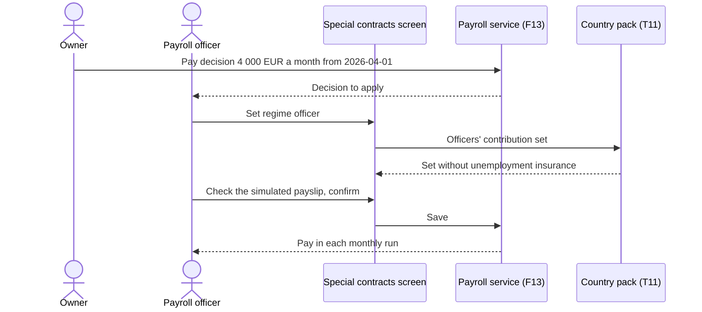

🏠 [Specs](../../../../README.md) › 🧩 [Functional capabilities](../../../README.md) ›
💶 [F13 Payroll (plugin)](../../README.md) › 📝 [Use cases](../README.md) ›
📝 [Use cases: FL-F13-07 Schemes and special contracts](README.md) › 📝 UC-F13-23 Pay a company officer

# 📝 UC-F13-23 Pay a company officer

**Status:** 🔄 waiting for the owner

## Summary

The payroll officer pays a company officer (a chair of a simplified company, a managing director) with the contribution
set of officers, without unemployment insurance and without employment-law items, as the owner decided.

## Personas

- [U45 Payroll officer](../../../../01-users/personas/u45-payroll-officer.md)
- [U13 Owner](../../../../01-users/personas/u13-owner.md), who decides the officer's pay

## Goal

The officer's pay on a payslip with the right contribution set and no employee-only items.

## Trigger

A decision of the owner or the shareholders setting or changing an officer's pay.

## Frequency

Once or twice a year per officer.

## Preconditions

- The officer exists as a person in F9 with the officer flag and no employment contract, or with both (a cumulated
  contract).
- The decision and its date are recorded (Proposed) as a file on the regime.

## Postconditions

- Success: a special pay regime "officer"; the payslip has no unemployment insurance, no paid leave and no overtime.
- Failure: the officer is held out of the run.

## Main flow

1. The owner records the pay decision; the payroll officer sees it on Special contracts (S-F13-22).
2. The payroll officer sets the regime "officer", the monthly gross and the start date.
3. SimpleERP selects the officers' contribution set from the country pack and removes the items officers do not have.
4. The payroll officer checks the simulated payslip and confirms.
5. The pay is computed in each monthly run and declared with the regime's codes.

## Alternative flows

- 2a. The officer also has an employment contract for a separate technical job: two pay elements are kept apart, the
  contract's with the full set and the mandate's with the officers' set.
- 2b. The officer is not paid: the regime is recorded with zero pay so that the declarations still know the officer.

## Error flows

- 3e. An unemployment insurance line is added by hand to an officer's pay: refused (BR-F13-17).
- 4e. The decision file is missing: the payroll officer is asked for it before confirming (Proposed).
- Any step: a service does not answer; the call is retried first (BR-F3-32), then the message follows the error pattern
  (D122) and what was typed stays on the screen.

## Business rules

- [BR-F13-17 Special contracts paid by their own rules](../../business-rules/br-f13-17-special-contracts-paid-by-their-own-rules.md)
- [BR-F13-12 Payroll data restricted](../../business-rules/br-f13-12-payroll-data-restricted.md)

## Entities

- [E-F13-18 Special pay regime](../../data/e-f13-18-special-pay-regime.md)

## Permissions

Payroll officer: set the regime. Owner: records the decision and reads the officer's pay. No other role sees an
officer's pay (BR-F13-12).

## Notifications

- The payroll officer is told when the owner records a pay decision.

## Audit events

Decision recorded, regime set, pay changed, with who, when and the amounts.

## AI involvement

The AI assistant may compare the cost of an officer's pay with a dividend in a simulation (UC-F13-16) for the owner; it
never sets the pay.

## API, MCP and A2A exposure

Through the API (T5) and as AI assistant tools (T6), with the caller's rights (BR-F3-34).

## Screens

- [S-F13-22 Special contracts](../../screens/07-schemes-and-special-contracts/s-f13-22-special-contracts.md)

## Flowchart

See [FL-F13-07 Schemes and special contracts](../../flows/fl-f13-07-schemes-and-special-contracts.md#flowchart).

## Sequence diagram

## Acceptance criteria

1. **Given** the chair of the consulting example company (SC03) with a decision of 4 000.00 EUR a month from 2026-04-01
   **when** the payroll officer sets the regime **then** the April payslip has no unemployment insurance and no
   paid-leave line.
2. **Given** an officer with a cumulated technical contract **when** the run is computed **then** two pay elements show,
   each with its own contribution set.
3. **Given** an unemployment insurance line added by hand **when** the payslip is saved **then** it is refused.
4. **Given** a manager of the company **when** they open the officer's pay **then** the amounts are hidden.

## Non-functional notes

D408's targets ([Performance](../../../../05-non-functional/performance.md)): 95 % of screens within 1 second; lists
paged on the server, the first page within 1 second; reports within 5 seconds or in the background.

## Regulatory references

Officers' contributions: (Proposed) to read for the France pack. Payslip:
[CR-FR-182 The payslip](../../../../10-country-packs/france/payroll/cr-fr-182-payslip.md).

## Related use cases

- [UC-F13-16 Simulate pay and costs](../04-events/uc-f13-16-simulate-pay-and-costs.md)
- [UC-F13-04 Compute gross to net](../02-monthly-pay-run/uc-f13-04-compute-gross-to-net.md)

## Open questions

None.

---

⬅️ [UC-F13-22 Pay an apprentice or an intern](uc-f13-22-pay-an-apprentice-or-an-intern.md) · ⬆️ [Up](README.md) ·
➡️ [UC-F13-24 Pay intermittent performers](uc-f13-24-pay-intermittent-performers.md)
