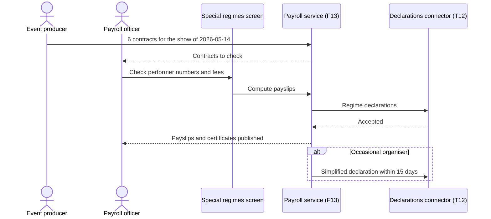

🏠 [Specs](../../../../README.md) › 🧩 [Functional capabilities](../../../README.md) ›
💶 [F13 Payroll (plugin)](../../README.md) › 📝 [Use cases](../README.md) ›
📝 [Use cases: FL-F13-07 Schemes and special contracts](README.md) › 📝 UC-F13-24 Pay intermittent performers

# 📝 UC-F13-24 Pay intermittent performers

**Status:** ✅ specified, ⚖️ lawyer review before launch (D574)

## Summary

The payroll officer pays artists and technicians hired show by show, with the performers' contribution set, the leave
and pension funds of their scheme and the declarations of their regime; an occasional organiser uses the simplified
service instead.

## Personas

- [U45 Payroll officer](../../../../01-users/personas/u45-payroll-officer.md)
- [U43 Event producer](../../../../01-users/personas/u43-event-producer.md), who books the performers for each show

## Goal

Each performer paid and declared to the bodies of their regime for each contract, on time.

## Trigger

A show contract recorded by the event producer (SC16).

## Frequency

Each show; the events example company (SC16) hires about 40 contracts a month in season.

## Preconditions

- The performer exists in F9 with their performer number and the contract's dates, hours or fees.
- The company's status (regular employer or occasional organiser, CR-FR-176, CR-FR-178) is set in payroll set-up.

## Postconditions

- Success: a payslip per contract, the declarations to the regime's bodies filed, the employment certificate given.
- Failure: the contract is held, the event producer and the payroll officer are told.

## Main flow

1. The event producer records the show contracts in F9 with dates and fees; the payroll officer sees them on Special
   regimes (S-F13-23).
2. The payroll officer checks each contract: performer number, hours or fee, and the leave fund and pension fund of the
   scheme.
3. SimpleERP computes each payslip with the performers' contribution set from the country pack.
4. SimpleERP builds the regime's declarations and files them through the connector (T12); the employment certificate is
   produced for each contract.
5. The payroll officer sees each declaration accepted and the payslips published to the performers.

## Alternative flows

- 1a. The company is an occasional organiser: the hiring declaration goes through the simplified service up to 2 hours
  before the show and the simplified declaration and payment within 15 days after the contract (CR-FR-178).
- 3a. One performer has several contracts in the month: one payslip per contract or one per month as the regime allows
  (⚖️ lawyer review before launch, D574: the GUSO and performers' funds rules on monthly payslips).

## Error flows

- 2e. The performer number is missing: the contract is held and the event producer is asked for it.
- 4e. A declaration is returned: it is shown with its reason; corrected and filed again (UC-F13-10).
- 4e2. The simplified declaration is late: the penalty of CR-FR-178 (6 %, then 1 % a month) is computed and shown.
- Any step: a service does not answer; the call is retried first (BR-F3-32), then the message follows the error pattern
  (D122) and what was typed stays on the screen.

## Business rules

- [BR-F13-17 Special contracts paid by their own rules](../../business-rules/br-f13-17-special-contracts-paid-by-their-own-rules.md)
- [BR-F13-18 Special regimes declared to their own bodies](../../business-rules/br-f13-18-special-regimes-declared-to-their-own-bodies.md)

## Entities

- [E-F13-18 Special pay regime](../../data/e-f13-18-special-pay-regime.md)
- [E-F13-09 Social declaration](../../data/e-f13-09-social-declaration.md)

## Permissions

Payroll officer: compute and file. Event producer: records contracts and fees, reads their state, never other pay data.

## Notifications

- The payroll officer is told of each new show contract; the event producer when a contract is held.
- The performer receives the payslip and the employment certificate by email.

## Audit events

Contract checked, payslip computed, declaration filed, accepted or returned, with who, when and the amounts.

## AI involvement

The AI assistant may prepare the contracts of a show from its line-up for the event producer to confirm; it never files
a declaration.

## API, MCP and A2A exposure

Through the API (T5) and as AI assistant tools (T6), with the caller's rights (BR-F3-34).

## Screens

- [S-F13-23 Special regimes](../../screens/07-schemes-and-special-contracts/s-f13-23-special-regimes.md)

## Flowchart

See [FL-F13-07 Schemes and special contracts](../../flows/fl-f13-07-schemes-and-special-contracts.md#flowchart).

## Sequence diagram

## Acceptance criteria

1. **Given** 6 contracts for a show on 2026-05-14 at the events example company **when** the payroll officer confirms
   them **then** 6 payslips are computed with the performers' contribution set and 6 employment certificates are
   produced.
2. **Given** an occasional organiser **when** a contract ends on 2026-05-14 **then** the simplified declaration and
   payment are due by 2026-05-29 and shown on the screen.
3. **Given** a simplified declaration filed on 2026-06-05 **when** it is late **then** a penalty of 6 % is shown, then 1
   % a month.
4. **Given** a contract with no performer number **when** it is checked **then** it is held and the event producer is
   asked for the number.

## Non-functional notes

D408's targets ([Performance](../../../../05-non-functional/performance.md)): 95 % of screens within 1 second; lists
paged on the server, the first page within 1 second; reports within 5 seconds or in the background.

## Regulatory references

[CR-FR-176 Performing-arts declaration](../../../../10-country-packs/france/events/cr-fr-176-performing-arts-declaration.md),
[CR-FR-178 Occasional organiser (GUSO)](../../../../10-country-packs/france/events/cr-fr-178-occasional-organiser-guso.md);
the performers' funds and contribution set: (⚖️ lawyer review before launch, D574) to read: the Audiens, Congés
Spectacles and France Travail annex 10 rules.

## Related use cases

- [UC-F13-10 File the monthly social declaration and handle returns](../03-declarations-and-payments/uc-f13-10-file-the-monthly-social-declaration-and-handle-returns.md)
- [UC-F13-08 Issue clarified payslips digitally](../02-monthly-pay-run/uc-f13-08-issue-clarified-payslips-digitally.md)

## Open questions

None.

---

⬅️ [UC-F13-23 Pay a company officer](uc-f13-23-pay-a-company-officer.md) · ⬆️ [Up](README.md) ·
➡️ [UC-F13-25 Pay farm workers under the MSA](uc-f13-25-pay-farm-workers-under-the-msa.md)
