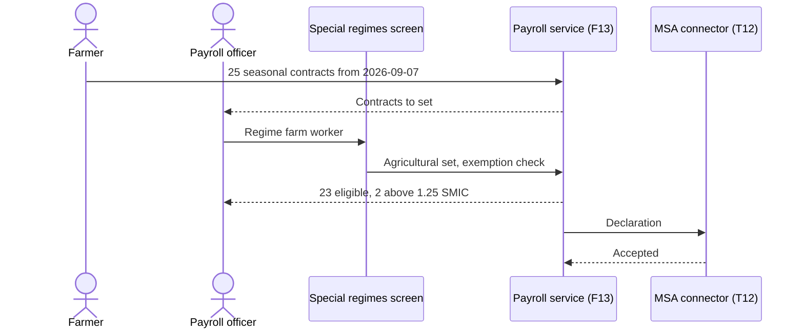

🏠 [Specs](../../../../README.md) › 🧩 [Functional capabilities](../../../README.md) ›
💶 [F13 Payroll (plugin)](../../README.md) › 📝 [Use cases](../README.md) ›
📝 [Use cases: FL-F13-07 Schemes and special contracts](README.md) › 📝 UC-F13-25 Pay farm workers under the MSA

# 📝 UC-F13-25 Pay farm workers under the MSA

**Status:** ✅ specified, ⚖️ lawyer review before launch (D574)

## Summary

The payroll officer pays farm workers with the agricultural contribution set, declares them to the MSA instead of the
general collector, and applies the exemption for occasional workers on low wages.

## Personas

- [U45 Payroll officer](../../../../01-users/personas/u45-payroll-officer.md)
- [U40 Farmer](../../../../01-users/personas/u40-farmer.md), who hires seasonal workers for the harvest

## Goal

Farm workers paid and declared to the MSA, with the seasonal exemption claimed when it applies.

## Trigger

A farm worker's contract in F9, often seasonal.

## Frequency

Each season; the agriculture example company (SC13) hires about 25 seasonal workers for the harvest.

## Preconditions

- The establishment is set as agricultural with its MSA account in payroll set-up.
- The contract is recorded in F9 with its seasonal flag.

## Postconditions

- Success: payslips with the agricultural set, the declaration filed to the MSA, the exemption claimed for eligible
  workers.
- Failure: the worker is held out of the run.

## Main flow

1. The farmer records the seasonal contracts in F9; the payroll officer sees them on Special regimes (S-F13-23).
2. The payroll officer confirms the regime "farm worker"; SimpleERP selects the agricultural contribution set and the
   MSA as collector.
3. SimpleERP checks each worker against the seasonal exemption: occasional contract and pay within 1.25 times the
   minimum wage (CR-FR-167).
4. The monthly run computes the pay with the exemption where it applies.
5. The declaration is filed to the MSA through its connector (T12) and the contributions paid to it (UC-F13-12).

## Alternative flows

- 3a. A worker's pay goes above 1.25 times the minimum wage that month: the exemption decreases or stops by the country
  pack's formula and the line shows why.

## Error flows

- 2e. The establishment has no MSA account: the regime cannot be set; the payroll officer is sent to payroll set-up.
- 5e. The MSA returns the declaration: it is shown with its reason and corrected (UC-F13-10).
- Any step: a service does not answer; the call is retried first (BR-F3-32), then the message follows the error pattern
  (D122) and what was typed stays on the screen.

## Business rules

- [BR-F13-17 Special contracts paid by their own rules](../../business-rules/br-f13-17-special-contracts-paid-by-their-own-rules.md)
- [BR-F13-18 Special regimes declared to their own bodies](../../business-rules/br-f13-18-special-regimes-declared-to-their-own-bodies.md)

## Entities

- [E-F13-18 Special pay regime](../../data/e-f13-18-special-pay-regime.md)
- [E-F13-11 Contribution payment](../../data/e-f13-11-contribution-payment.md)

## Permissions

Payroll officer: set the regime, compute, file. Farmer: records contracts and hours in F9, reads the total cost.

## Notifications

- The payroll officer is told of each new seasonal contract; the farmer of the harvest's total cost once the run is
  approved.

## Audit events

Regime set, exemption applied or stopped, declaration filed, with who, when and the amounts.

## AI involvement

The AI assistant may estimate the cost of the harvest team with the exemption for the farmer (UC-F13-16); it never
files.

## API, MCP and A2A exposure

Through the API (T5) and as AI assistant tools (T6), with the caller's rights (BR-F3-34).

## Screens

- [S-F13-23 Special regimes](../../screens/07-schemes-and-special-contracts/s-f13-23-special-regimes.md)

## Flowchart

See [FL-F13-07 Schemes and special contracts](../../flows/fl-f13-07-schemes-and-special-contracts.md#flowchart).

## Sequence diagram

## Acceptance criteria

1. **Given** 25 seasonal pickers hired on 2026-09-07 by the agriculture example company **when** the regime is set
   **then** their payslips use the agricultural set and the declaration goes to the MSA, not the general collector.
2. **Given** a picker paid 1.10 times the minimum wage **when** the run is computed **then** the seasonal exemption
   applies to their employer contributions.
3. **Given** a picker paid 1.40 times the minimum wage **when** the run is computed **then** the exemption does not
   apply and the line says why.
4. **Given** an establishment with no MSA account **when** the payroll officer sets the regime **then** it is refused
   and payroll set-up opens.

## Non-functional notes

D408's targets ([Performance](../../../../05-non-functional/performance.md)): 95 % of screens within 1 second; lists
paged on the server, the first page within 1 second; reports within 5 seconds or in the background.

## Regulatory references

[CR-FR-167 Seasonal workers exemption](../../../../10-country-packs/france/labour/cr-fr-167-seasonal-workers-exemption.md);
MSA declarations: (⚖️ lawyer review before launch, D574) to read: Code rural et de la pêche maritime, MSA
declaration rules.

## Related use cases

- [UC-F13-12 Pay contributions to the collectors](../03-declarations-and-payments/uc-f13-12-pay-contributions-to-the-collectors.md)
- [UC-F13-10 File the monthly social declaration and handle returns](../03-declarations-and-payments/uc-f13-10-file-the-monthly-social-declaration-and-handle-returns.md)

## Open questions

None.

---

⬅️ [UC-F13-24 Pay intermittent performers](uc-f13-24-pay-intermittent-performers.md) · ⬆️ [Up](README.md) ·
➡️ [UC-F13-26 Apply a wage garnishment](../08-deductions-savings-and-leave-pay/uc-f13-26-apply-a-wage-garnishment.md)
