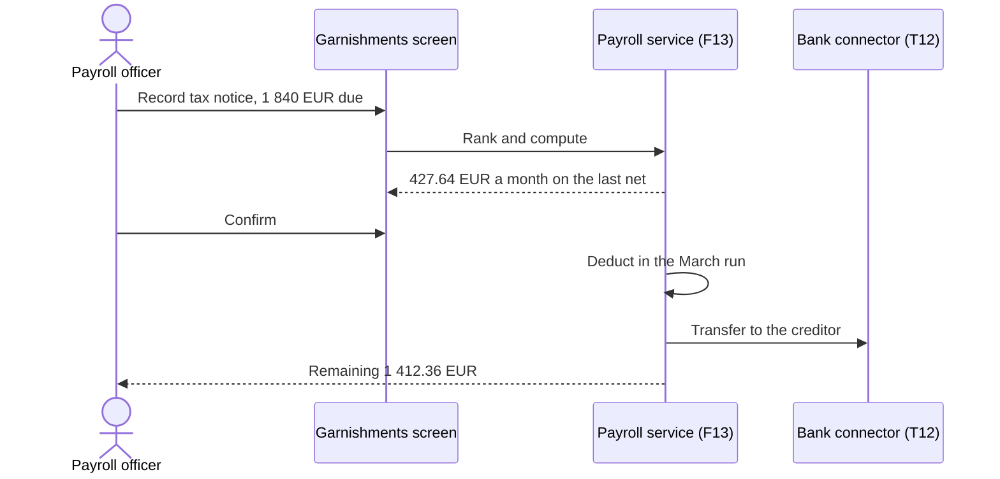

🏠 [Specs](../../../../README.md) › 🧩 [Functional capabilities](../../../README.md) ›
💶 [F13 Payroll (plugin)](../../README.md) › 📝 [Use cases](../README.md) ›
📝 [Use cases: FL-F13-08 Deductions, savings and leave pay](README.md) › 📝 UC-F13-26 Apply a wage garnishment

# 📝 UC-F13-26 Apply a wage garnishment

**Status:** 🔄 waiting for the owner

## Summary

The payroll officer records a garnishment order received for an employee, and simple-ERP deducts each month the
attachable portion of the net, pays the creditor and tracks what remains until the order is settled or lifted.

## Personas

- [U45 Payroll officer](../../../../01-users/personas/u45-payroll-officer.md)

## Goal

The order applied exactly within the attachable portion, the creditor paid each month, the employee told.

## Trigger

A court order, a maintenance order or a tax notice received by the company.

## Frequency

Rare: a few a year in a company of 150 employees.

## Preconditions

- The employee has a pay profile and a net pay.
- The country pack holds the attachable scale and the protected amount for the period (BR-F13-19).

## Postconditions

- Success: an active garnishment; each payslip deducts its amount and a transfer pays the creditor.
- Failure: nothing is deducted; the order stays "received" with the reason.

## Main flow

1. The payroll officer opens Garnishments and advances (S-F13-24) and chooses "Record an order".
2. The payroll officer enters the kind, the creditor and IBAN, the reference, the amount due and attaches the notice.
3. simple-ERP ranks the order among the employee's active orders and shows the monthly deduction computed on the last
   net with the scale.
4. The payroll officer confirms; the next run deducts the amount and the transfer to the creditor joins the pay
   transfers (UC-F13-09).
5. Each month the remaining amount decreases; when it reaches zero the order is settled and the employee is told.

## Alternative flows

- 3a. A maintenance order arrives while a tax notice is active: the maintenance order is deducted first and the tax
  notice takes what remains of the attachable portion.
- 5a. A release notice arrives: the payroll officer lifts the order from the date of the notice.

## Error flows

- 3e. The deduction would leave less than the protected amount: it is capped and the rest carried to next month
  (BR-F13-19).
- 2e. The creditor's IBAN is invalid: refused before saving.
- Any step: a service does not answer; the call is retried first (BR-F3-32), then the message follows the error pattern
  (D122) and what was typed stays on the screen.

## Business rules

- [BR-F13-19 Garnishment within the attachable portion](../../business-rules/br-f13-19-garnishment-within-the-attachable-portion.md)
- [BR-F13-12 Payroll data restricted](../../business-rules/br-f13-12-payroll-data-restricted.md)

## Entities

- [E-F13-19 Garnishment](../../data/e-f13-19-garnishment.md)
- [E-F13-08 Pay transfer](../../data/e-f13-08-pay-transfer.md)

## Permissions

Payroll officer only; the employee sees the deduction on their payslip; no manager or HR user sees the order
(BR-F13-12).

## Notifications

- The employee is told by the payroll officer's letter (Proposed) generated with the first deduction; the payroll
  officer is told when an order is settled.

## Audit events

Order recorded, ranked, deducted, settled or lifted, with who, when, amounts and the notice file.

## AI involvement

The AI assistant may read a scanned notice and pre-fill the order for the payroll officer to check; it never confirms an
order.

## API, MCP and A2A exposure

Through the API (T5) and as AI assistant tools (T6), with the caller's rights (BR-F3-34).

## Screens

- [S-F13-24 Garnishments and advances](../../screens/08-deductions-savings-and-leave-pay/s-f13-24-garnishments-and-advances.md)

## Flowchart

See [FL-F13-08 Deductions, savings and leave pay](../../flows/fl-f13-08-deductions-savings-and-leave-pay.md#flowchart).

## Sequence diagram

## Acceptance criteria

1. **Given** Karim Haddad with a net of 2 100.00 EUR and one dependant **when** a tax notice of 1 840.00 EUR is recorded
   **then** the monthly deduction is the attachable amount from the country pack's scale and his March payslip shows it.
2. **Given** a maintenance order and a tax notice **when** both are active **then** the maintenance order is deducted
   first.
3. **Given** a deduction that would leave less than the protected amount **when** the run is computed **then** it is
   capped and the difference is carried to April.
4. **Given** a remaining amount of 0.00 EUR **when** the last deduction is paid **then** the order is settled and no
   deduction appears the next month.

## Non-functional notes

D408's targets ([Performance](../../../../05-non-functional/performance.md)): 95 % of screens within 1 second; lists
paged on the server, the first page within 1 second; reports within 5 seconds or in the background.

## Regulatory references

Seizure of wages: (Proposed) to read for the France pack (Code du travail L3252-1 and R3252-2 and following).

## Related use cases

- [UC-F13-09 Pay employees by SEPA transfer](../03-declarations-and-payments/uc-f13-09-pay-employees-by-sepa-transfer.md)
- [UC-F13-04 Compute gross to net](../02-monthly-pay-run/uc-f13-04-compute-gross-to-net.md)

## Open questions

None.

---

⬅️ [UC-F13-25](../07-schemes-and-special-contracts/uc-f13-25-pay-farm-workers-under-the-msa.md) · ⬆️ [Up](README.md) ·
➡️ [UC-F13-27 Grant a pay advance](uc-f13-27-grant-a-pay-advance.md)
