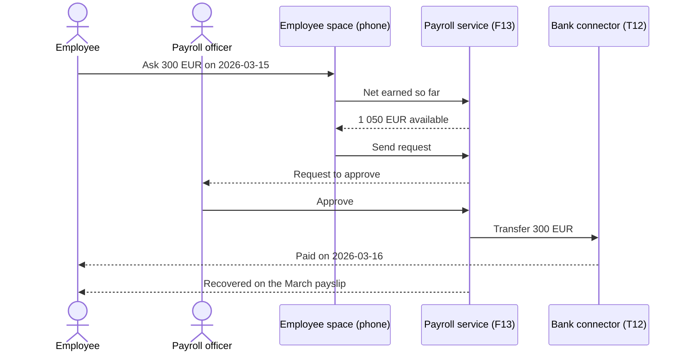

🏠 [Specs](../../../../README.md) › 🧩 [Functional capabilities](../../../README.md) ›
💶 [F13 Payroll (plugin)](../../README.md) › 📝 [Use cases](../README.md) ›
📝 [Use cases: FL-F13-08 Deductions, savings and leave pay](README.md) › 📝 UC-F13-27 Grant a pay advance

# 📝 UC-F13-27 Grant a pay advance

**Status:** 🔄 waiting for the owner

## Summary

An employee asks for an advance on the pay already earned this month from their phone; the payroll officer approves it,
it is paid by transfer and recovered on the next payslip.

## Personas

- [U01 Employee](../../../../01-users/personas/u01-employee.md), who asks for the advance
- [U45 Payroll officer](../../../../01-users/personas/u45-payroll-officer.md)

## Goal

The employee has money before pay day, within what they have earned, and the advance is recovered without a manual step.

## Trigger

The employee's request.

## Frequency

A few a month in companies with hourly staff, such as the restaurant example company (SC06).

## Preconditions

- The employee has a pay profile and an IBAN.
- The month's time recorded in F9 gives the net earned so far.

## Postconditions

- Success: an advance paid and a recovery line on the next payslip.
- Failure: the request is refused with the reason; nothing is paid.

## Main flow

1. The employee opens "Ask for an advance" in their space on the phone and types the amount; simple-ERP shows the most
   they can ask (the net earned so far).
2. The request reaches the payroll officer on Garnishments and advances (S-F13-24).
3. The payroll officer approves it; simple-ERP adds the transfer to the next pay transfer batch (UC-F13-09).
4. The transfer is sent; the employee is told.
5. The next payslip shows the advance recovered as a deduction.

## Alternative flows

- 3a. The payroll officer refuses: the employee is told the reason.
- 1a. The amount is above the net earned: simple-ERP offers a loan request instead, for the owner to approve with a
  repayment plan (BR-F13-20, Proposed).

## Error flows

- 1e. The employee has no IBAN on file: the request cannot be sent; the employee is asked to add it in their space.
- 3e. The run of the month is already paid: the advance is recovered on the following month's payslip.
- Any step: a service does not answer; the call is retried first (BR-F3-32), then the message follows the error pattern
  (D122) and what was typed stays on the screen.

## Business rules

- [BR-F13-20 Advances recovered from the next pay](../../business-rules/br-f13-20-advances-recovered-from-the-next-pay.md)
- [BR-F13-12 Payroll data restricted](../../business-rules/br-f13-12-payroll-data-restricted.md)

## Entities

- [E-F13-20 Pay advance](../../data/e-f13-20-pay-advance.md)
- [E-F13-08 Pay transfer](../../data/e-f13-08-pay-transfer.md)

## Permissions

Employee: asks for their own advance. Payroll officer: approves or refuses. Owner: approves loans (Proposed).

## Notifications

- The payroll officer is told of each request; the employee of the approval, the refusal and the transfer, by push and
  email.

## Audit events

Request, approval or refusal, transfer and recovery, with who, when and the amount.

## AI involvement

The AI assistant may tell the employee how much they can ask; it never approves an advance.

## API, MCP and A2A exposure

Through the API (T5) and as AI assistant tools (T6), with the caller's rights (BR-F3-34).

## Screens

- [S-F13-24 Garnishments and advances](../../screens/08-deductions-savings-and-leave-pay/s-f13-24-garnishments-and-advances.md)

## Flowchart

See [FL-F13-08 Deductions, savings and leave pay](../../flows/fl-f13-08-deductions-savings-and-leave-pay.md#flowchart).

## Sequence diagram

## Acceptance criteria

1. **Given** a waiter of the restaurant example company with 1 050.00 EUR net earned by 15 March **when** he asks 300.00
   EUR **then** the request reaches the payroll officer and, once approved, 300.00 EUR is transferred.
2. **Given** the advance paid **when** the March payslip is issued **then** it shows a deduction of 300.00 EUR "advance
   of 15 March".
3. **Given** a request of 1 500.00 EUR with 700.00 EUR earned **when** the employee sends it **then** it is refused and
   a loan request is offered.
4. **Given** no IBAN on file **when** the employee asks **then** the request is not sent and the IBAN form opens.

## Non-functional notes

D408's targets ([Performance](../../../../05-non-functional/performance.md)): 95 % of screens within 1 second; lists
paged on the server, the first page within 1 second; reports within 5 seconds or in the background.

The request works on a phone (D34) and is answered within the same business day (Proposed).

## Regulatory references

Advances on pay: (Proposed) to read for the France pack (Code du travail L3251-3).

## Related use cases

- [UC-F13-09 Pay employees by SEPA transfer](../03-declarations-and-payments/uc-f13-09-pay-employees-by-sepa-transfer.md)
- [UC-F13-08 Issue clarified payslips digitally](../02-monthly-pay-run/uc-f13-08-issue-clarified-payslips-digitally.md)

## Open questions

None.

---

⬅️ [UC-F13-26 Apply a wage garnishment](uc-f13-26-apply-a-wage-garnishment.md) · ⬆️ [Up](README.md) ·
➡️ [UC-F13-28 Compute profit-sharing and employee savings](uc-f13-28-compute-profit-sharing-and-employee-savings.md)
