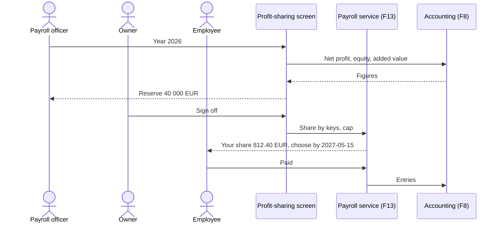

🏠 [Specs](../../../../README.md) › 🧩 [Functional capabilities](../../../README.md) ›
💶 [F13 Payroll (plugin)](../../README.md) › 📝 [Use cases](../README.md) ›
📝 [Use cases: FL-F13-08 Deductions, savings and leave pay](README.md) ›
📝 UC-F13-28 Compute profit-sharing and employee savings

# 📝 UC-F13-28 Compute profit-sharing and employee savings

**Status:** 🔄 waiting for the owner

## Summary

Once the year's accounts are closed, the payroll officer computes the profit-sharing reserve with the legal formula,
shares it by the agreement's keys, announces each share and pays or invests it by each employee's choice.

## Personas

- [U45 Payroll officer](../../../../01-users/personas/u45-payroll-officer.md)
- [U13 Owner](../../../../01-users/personas/u13-owner.md), who signs off the reserve
- [U01 Employee](../../../../01-users/personas/u01-employee.md), who chooses to be paid or to invest

## Goal

Each employee receives their share on time, paid or invested as they chose, within the ceilings.

## Trigger

The closing of the financial year in F8, for a company at or above the threshold (BR-F13-21).

## Frequency

Once a year.

## Preconditions

- The financial year is closed in F8 (net profit, equity, added value available).
- The company's profit-sharing agreement and keys are set in payroll set-up.

## Postconditions

- Success: a profit-sharing year settled; payslip lines for shares paid, an export for shares invested, entries in F8.
- Failure: the year stays "computed" and nothing is paid.

## Main flow

1. The payroll officer opens Profit-sharing (S-F13-25) and chooses the closed year; SimpleERP computes the reserve from
   F8's figures.
2. The owner checks and signs off the reserve.
3. SimpleERP shares the reserve by the keys, caps each share at the individual ceiling and shares the surplus again.
4. Each employee receives their share and chooses "paid" or "invested" in their space before the deadline.
5. Shares paid appear on the next payslip with their contribution set; shares invested are exported to the savings-plan
   keeper; entries go to F8.

## Alternative flows

- 4a. An employee makes no choice by the deadline: the share is invested by default (Proposed) to read.
- 3a. A leaver of the year: their share is computed on their time and pay, and sent to the address on file.

## Error flows

- 1e. The reserve is zero or negative: nothing is shared that year; employees are told.
- 1e2. The year is not closed in F8: the computation is refused.
- Any step: a service does not answer; the call is retried first (BR-F3-32), then the message follows the error pattern
  (D122) and what was typed stays on the screen.

## Business rules

- [BR-F13-21 Profit-sharing once the threshold is reached](../../business-rules/br-f13-21-profit-sharing-once-the-threshold-is-reached.md)
- [BR-F13-12 Payroll data restricted](../../business-rules/br-f13-12-payroll-data-restricted.md)

## Entities

- [E-F13-21 Profit-sharing year](../../data/e-f13-21-profit-sharing-year.md)
- [E-F13-12 Payroll entry](../../data/e-f13-12-payroll-entry.md)

## Permissions

Payroll officer: compute and settle. Owner: sign off the reserve. Employee: sees only their own share and makes their
choice.

## Notifications

- The owner is told the reserve is ready to sign off; each employee of their share and the deadline, by email and push;
  reminders (Proposed) 5 days before the deadline.

## Audit events

Reserve computed and signed off, shares sent, choices made, payment and export, with who, when and amounts.

## AI involvement

The AI assistant may explain to an employee how their share was computed; it never changes a key or a share.

## API, MCP and A2A exposure

Through the API (T5) and as AI assistant tools (T6), with the caller's rights (BR-F3-34).

## Screens

- [S-F13-25 Profit-sharing](../../screens/08-deductions-savings-and-leave-pay/s-f13-25-profit-sharing.md)

## Flowchart

See [FL-F13-08 Deductions, savings and leave pay](../../flows/fl-f13-08-deductions-savings-and-leave-pay.md#flowchart).

## Sequence diagram

## Acceptance criteria

1. **Given** the manufacturing example company with 60 employees and a reserve of 40 000.00 EUR **when** the owner signs
   it off **then** each share is computed by the keys of the agreement and none is above the individual ceiling.
2. **Given** an employee who chooses "paid" **when** the next payslip is issued **then** it shows the share with its
   contribution set.
3. **Given** an employee who makes no choice by 2027-05-15 **when** the deadline passes **then** the share is invested
   by default and the employee is told.
4. **Given** a negative reserve **when** it is computed **then** nothing is shared and employees are told.

## Non-functional notes

D408's targets ([Performance](../../../../05-non-functional/performance.md)): 95 % of screens within 1 second; lists
paged on the server, the first page within 1 second; reports within 5 seconds or in the background.

## Regulatory references

Headcount:
[CR-FR-046 Headcount thresholds](../../../../10-country-packs/france/labour/cr-fr-046-headcount-thresholds.md);
participation and savings plans: (Proposed) to read (Code du travail L3322-2, L3324-1, L3332-1).

## Related use cases

- [UC-F13-13 Post payroll entries to accounting](../03-declarations-and-payments/uc-f13-13-post-payroll-entries-to-accounting.md)
- [UC-F13-18 Report yearly](../05-reports-and-rules/uc-f13-18-report-yearly.md)

## Open questions

None.

---

⬅️ [UC-F13-27 Grant a pay advance](uc-f13-27-grant-a-pay-advance.md) · ⬆️ [Up](README.md) ·
➡️ [UC-F13-29 Value paid-leave pay](uc-f13-29-value-paid-leave-pay.md)
