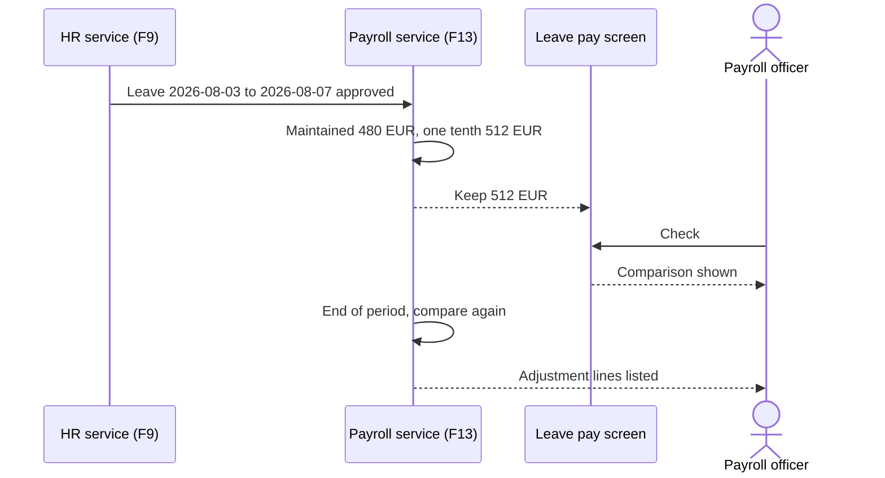

🏠 [Specs](../../../../README.md) › 🧩 [Functional capabilities](../../../README.md) ›
💶 [F13 Payroll (plugin)](../../README.md) › 📝 [Use cases](../README.md) ›
📝 [Use cases: FL-F13-08 Deductions, savings and leave pay](README.md) › 📝 UC-F13-29 Value paid-leave pay

# 📝 UC-F13-29 Value paid-leave pay

**Status:** ✅ specified, ⚖️ lawyer review before launch (D574)

## Summary

For each paid leave taken, SimpleERP computes both the maintained pay and one tenth of the reference gross, pays the
higher, and adjusts at the end of the reference period so that the employee gets the most favourable method.

## Personas

- [U45 Payroll officer](../../../../01-users/personas/u45-payroll-officer.md)

## Goal

Every employee paid for their leave by the most favourable method, with the comparison visible.

## Trigger

Approved paid leave in F9 falling in the pay period; the end of the reference period.

## Frequency

Every month for the employees on leave; once a year for the end-of-period adjustment.

## Preconditions

- The leave is approved in F9 (CR-FR-044).
- The reference period's gross is known.

## Postconditions

- Success: a leave pay valuation per leave, the higher amount on the payslip; an adjustment line when the end-of-period
  comparison differs.
- Failure: the run shows the leave as an anomaly to clear.

## Main flow

1. The monthly run finds the leave taken in the period and computes the maintained pay and one tenth (S-F13-26).
2. SimpleERP keeps the higher amount and shows both to the payroll officer.
3. The payroll officer checks the comparison and the run goes on (UC-F13-07).
4. At the end of the reference period SimpleERP compares again on the whole period and adds an adjustment line where
   one tenth is higher.
5. The payslip shows the leave line and, when there is one, the adjustment.

## Alternative flows

- 1a. The employee is a construction worker covered by the BTP paid-leave fund: no leave pay is computed; the absence is
  declared to the fund (CR-FR-088).
- 4a. The employee leaves during the period: the comparison is made on the final pay with the compensation for leave not
  taken (UC-F13-15).

## Error flows

- 1e. The reference gross is incomplete (an employee hired by transfer with no history): flagged; the maintained pay is
  used until the gross is entered.
- Any step: a service does not answer; the call is retried first (BR-F3-32), then the message follows the error pattern
  (D122) and what was typed stays on the screen.

## Business rules

- [BR-F13-22 Leave pay is the higher of two methods](../../business-rules/br-f13-22-leave-pay-is-the-higher-of-two-methods.md)
- [BR-F13-12 Payroll data restricted](../../business-rules/br-f13-12-payroll-data-restricted.md)

## Entities

- [E-F13-22 Leave pay valuation](../../data/e-f13-22-leave-pay-valuation.md)
- [E-F13-04 Payslip line](../../data/e-f13-04-payslip-line.md)

## Permissions

Payroll officer only; the employee sees the leave line on their payslip.

## Notifications

- The payroll officer is told of the employees whose end-of-period adjustment is above zero.

## Audit events

Both amounts, the amount kept and the adjustment, with when and the reference period.

## AI involvement

The AI assistant may explain to an employee why their leave line is the amount it is; it never changes the method.

## API, MCP and A2A exposure

Through the API (T5) and as AI assistant tools (T6), with the caller's rights (BR-F3-34).

## Screens

- [S-F13-26 Leave pay valuation](../../screens/08-deductions-savings-and-leave-pay/s-f13-26-leave-pay-valuation.md)

## Flowchart

See [FL-F13-08 Deductions, savings and leave pay](../../flows/fl-f13-08-deductions-savings-and-leave-pay.md#flowchart).

## Sequence diagram

## Acceptance criteria

1. **Given** Marc Petit takes 5 days with 480.00 EUR maintained and 512.00 EUR one tenth **when** the August run is
   computed **then** his leave line is 512.00 EUR.
2. **Given** maintained pay of 600.00 EUR and one tenth of 540.00 EUR **when** the run is computed **then** 600.00 EUR
   is paid.
3. **Given** the reference period ends on 31 May **when** the comparison on the whole period favours one tenth by 38.20
   EUR **then** an adjustment line of 38.20 EUR is added to the June payslip.
4. **Given** a construction worker of the construction example company **when** he takes leave **then** no leave pay is
   computed and the absence is declared to the BTP fund.

## Non-functional notes

D408's targets ([Performance](../../../../05-non-functional/performance.md)): 95 % of screens within 1 second; lists
paged on the server, the first page within 1 second; reports within 5 seconds or in the background.

## Regulatory references

[CR-FR-044 Paid leave](../../../../10-country-packs/france/labour/cr-fr-044-paid-leave.md),
[CR-FR-088 BTP paid-leave fund](../../../../10-country-packs/france/labour/cr-fr-088-btp-paid-leave-fund.md); the
one-tenth comparison: (⚖️ lawyer review before launch, D574) to read: Code du travail L3141-24.

## Related use cases

- [UC-F13-04 Compute gross to net](../02-monthly-pay-run/uc-f13-04-compute-gross-to-net.md)
- [UC-F13-15 End a contract](../04-events/uc-f13-15-end-a-contract.md)

## Open questions

None.

---

⬅️ [UC-F13-28 Compute profit-sharing and employee savings](uc-f13-28-compute-profit-sharing-and-employee-savings.md) ·
⬆️ [Up](README.md) ·
➡️ [UC-F13-30](../09-collective-agreements-by-family/uc-f13-30-apply-the-hotels-and-restaurants-agreement.md)
